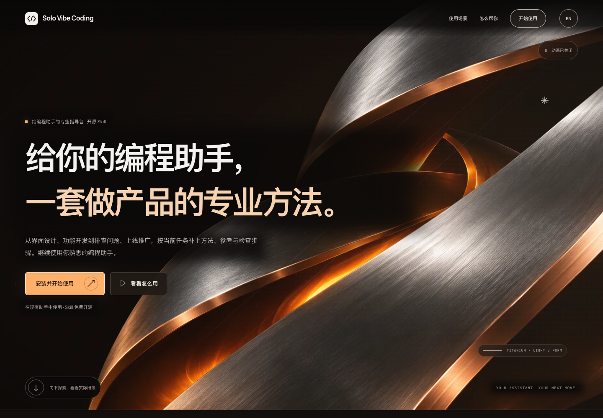

# 黑钛熔光首页预览与对照

使用电影感材质官网设计规范制作的新版本，以玻璃版 `471e3cd` 为工程与画面基准。新版本的审美效果由用户查看后判断；技术检查与独立审查不代替用户认可或真实用户研究。

[打开中文版](https://jmaxzh.github.io/solo-vibe-coding/zh-CN/?v=83c5dba) · [Open English](https://jmaxzh.github.io/solo-vibe-coding/?v=83c5dba)

## 截图

全部使用生产构建、相同语言和视口、减少动态效果状态；桌面 1440×1000，手机 390×844。

| 语言与设备 | 新首屏 | 新完整页面 | 新旧首屏对照 |
| --- | --- | --- | --- |
| 中文桌面 | [首屏](screenshots/after-zh-CN-desktop-hero.png) | [全页](screenshots/after-zh-CN-desktop-full.png) | [左旧右新](screenshots/comparison-zh-CN-desktop.png) |
| 中文手机 | [首屏](screenshots/after-zh-CN-mobile-hero.png) | [全页](screenshots/after-zh-CN-mobile-full.png) | [左旧右新](screenshots/comparison-zh-CN-mobile.png) |
| 英文桌面 | [首屏](screenshots/after-en-desktop-hero.png) | [全页](screenshots/after-en-desktop-full.png) | [左旧右新](screenshots/comparison-en-desktop.png) |
| 英文手机 | [首屏](screenshots/after-en-mobile-hero.png) | [全页](screenshots/after-en-mobile-full.png) | [左旧右新](screenshots/comparison-en-mobile.png) |

## 实现与验证

新主体使用拉丝钛金属和铜色内光；暖黑背景、浅琥珀色文字和橙色行动贯穿首页。横向四任务选择和宽幅证据行带来布局变化，产品数据、已有能力与内页视觉保持。

- [制作目标](design-brief.md)
- [实际差异与成本](change-evaluation.md)
- [检查结果与边界](verification.md)
- [独立只读审查](independent-review.md)
- [原创素材、最终文件与生成提示](visual-assets.md)
- [公开发布核验](deployment.md)
- [发布归档独立审查](release-review.md)
