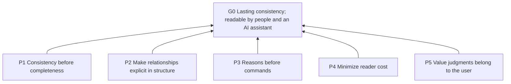
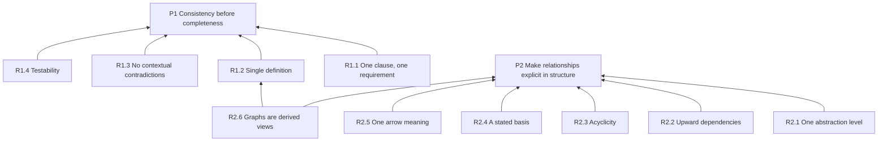
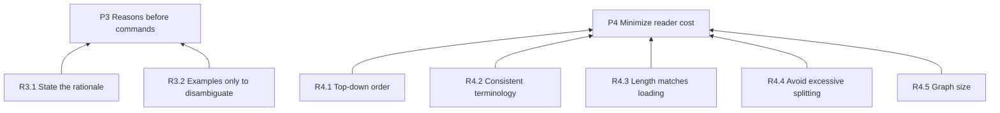
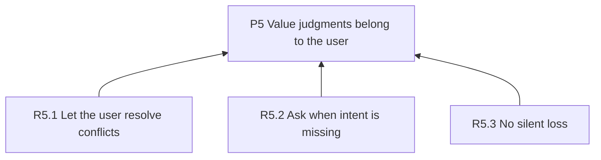
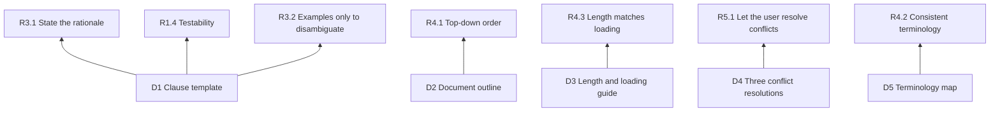
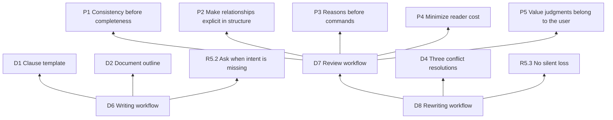

# Instruction Document Architect

## Purpose (G0)

Keep instruction documents consistent through long-term revision and readable by both people and an AI assistant.

## Overview

This document follows its own rules. Five principles directly serve its purpose:



## How to read and modify

- Read top down. Reading through the principles (L1) gives the whole picture.
- Each clause’s Basis line is the sole authoritative source of dependencies; graphs are derived views.
- After changing a clause, follow the graph upward to check its bases and downward to check clauses that depend on it.
- See R2.1 for level definitions and D5 for terminology.

## Principles (L1)

**P1 Consistency before completeness**: Prefer omitting a rule to keeping two rules that conflict or duplicate each other. Basis: G0.

**P2 Make relationships explicit in structure**: Express relationships between clauses through structure, without making readers infer them. Basis: G0.

**P3 Reasons before commands**: Every requirement should answer “why,” so an AI assistant can reason from that rationale in situations not explicitly covered. Basis: G0.

**P4 Minimize reader cost**: Minimize both human reading cost and the AI assistant’s context cost. Basis: G0.

**P5 Value judgments belong to the user**: The user decides tradeoffs and intent; the AI assistant does not decide on the user’s behalf. Basis: G0.

## Rules (L2)

### Serving P1 and P2



**R1.1 One clause, one requirement**: Express only one requirement per clause.
Basis: P1.
Criterion: The statement does not join two independent requirements; only one kind of violation can be identified. If either half remains valid after deleting the other, split the clause.

**R1.2 Single definition**: Define each requirement in one place; elsewhere, refer only to its identifier.
Basis: P1.
Criterion: No pair of clauses requires the same behavior in the same situation. When duplicates appear, keep the one at the more appropriate abstraction level.

**R1.3 No contextual contradictions**: Never impose opposite requirements in the same situation.
Basis: P1.
Criterion: Enumerate triggering situations for each related pair of clauses: their situations do not overlap, or their conclusions agree.

**R1.4 Testability**: Give every L2 rule a criterion so others can independently judge compliance.
Basis: P1.
Criterion: After reading the criterion, a reader can decide “compliant” or “violated” without asking the author.

**R2.1 One abstraction level**: Assign each clause to exactly one of the four levels below.
Basis: P2.
Criterion: L2 contains no value tradeoffs; L1 contains no concrete commands.

| Level | Name | Question answered | Typical form |
| --- | --- | --- | --- |
| L0 | Goal | For whom, and for what purpose? | 1–3 sentences |
| L1 | Principle | Which way should tradeoffs lean? | “Prefer X to Y” |
| L2 | Rule | In which situation must or must not something happen? | Testable imperative |
| L3 | Practice | How is it done? | Steps, templates, examples |

**R2.2 Upward dependencies**: Depend only on clauses at the same or a more abstract level.
Basis: P2.
Criterion: Every Basis points to the same or a higher level; no L1 depends on L2 and no L2 depends on L3.

**R2.3 Acyclicity**: Keep dependencies topologically sortable.
Basis: P2.
Criterion: Following Basis lines never leads back to the starting clause. A cycle indicates mutual justification: lift out a shared reason or merge the clauses.

**R2.4 A stated basis**: Give every non-L0 clause at least one higher-level basis.
Basis: P2.
Criterion: No clause lacks a Basis line.

**R2.5 One arrow meaning**: Express relationships in Mermaid. Every arrow means “depends on” and points from concrete to abstract; do not invent notation.
Basis: P2.
Criterion: Arrow semantics are consistent throughout each graph; do not draw conflicts or other relationships as edges.

**R2.6 Graphs are derived views**: Treat each clause’s Basis line as the authoritative dependency source and derive graphs from it. When they disagree, the clause takes precedence.
Basis: P2, R1.2.
Criterion: Every graph edge appears in a clause’s Basis line, and vice versa.

### Serving P3 and P4



**R3.1 State the rationale**: Besides identifiers, include one sentence in the Basis line explaining why the clause follows from its higher-level clauses.
Basis: P3.
Criterion: The rationale answers: “What part of the higher-level clause would suffer if this clause were removed?”

**R3.2 Examples only to disambiguate**: Write examples only for clauses likely to be misread; add counterexamples when needed.
Basis: P3.
Criterion: Every example addresses a plausible misreading of a specific clause.

**R4.1 Top-down order**: Arrange the document from higher to lower abstraction so truncating it anywhere leaves a complete coarse version.
Basis: P4.
Criterion: Reading only the first N sections gives a simplified whole rather than a fragment missing essential parts.

**R4.2 Consistent terminology**: Use one term for each concept throughout the document and explain it in one sentence on first use.
Basis: P4.
Criterion: No two terms refer to the same concept, and no term refers to two concepts.

**R4.3 Length matches loading**: The more persistently a document is loaded, the shorter it should be and the more universally its contents should apply.
Basis: P4.
Criterion: Each document contains only material appropriate to its loading time. See D3 for numerical guidance.

**R4.4 Avoid excessive splitting**: Recheck the hierarchy when one parent clause has too many children.
Basis: P4.
Criterion: Above roughly seven children, check for a missing intermediate level or children that are merely examples of the same rule.

**R4.5 Graph size**: Keep each graph to roughly 15 nodes or fewer; split larger graphs by L1 principle.
Basis: P4.
Criterion: Each graph is readable on one screen.

### Serving P5



**R5.1 Let the user resolve conflicts**: When a conflict is found, present resolution options to the user rather than choosing a side.
Basis: P5.
Criterion: The document contains no tradeoffs unconfirmed by the user.

**R5.2 Ask when intent is missing**: When a clause has no identifiable higher-level basis, ask the user about its intent instead of inventing a principle.
Basis: P5.
Criterion: Every added L1 principle can be traced to something the user said.

**R5.3 No silent loss**: During rewriting, give every intent in the old document a place in the new document, or explain its deletion in the change summary.
Basis: P5.
Criterion: A complete “old location → new clause” mapping exists.

## Practices (L3)

### Templates and guides



**D1 Clause template**. Basis: R3.1, R1.4, R3.2.

Use ordinary Markdown; identifiers are simply names in headings:

```markdown
**R2.1 Short title**: One imperative sentence.
Basis: Higher-level clause identifiers plus one sentence of rationale.
Criterion: What counts as compliance or violation.
Example: (Optional; only to disambiguate.)
```

**D2 Document outline**. Basis: R4.1.

Use this order: purpose (L0) → overview graph → how to read and modify → principles (L1) → rules (L2) → practices (L3).

**D3 Length and loading guide**. Basis: R4.3.

Determine loading behavior from the actual runtime’s discovery, activation, and file-loading mechanisms. The table describes typical patterns, not guarantees for every tool.

| Document | Loading | Requirements |
| --- | --- | --- |
| CLAUDE.md / AGENTS.md | May load persistently when the runtime discovers and applies the file | As short as possible; separate project facts from behavioral rules |
| SKILL.md | May load after activation when the runtime supports skills | Body below roughly 500 lines; move L3 to references/ when longer. The frontmatter description guides activation in runtimes that use it: state what it does and when to use it, favoring slightly proactive activation |
| references/*.md | Loaded on demand when the runtime or AI assistant reads the file | In SKILL.md, state when to read each file. Above roughly 300 lines, add a table of contents. One topic per file |

**D4 Three conflict resolutions**. Basis: R5.1.

Ask the user to choose, from lightest to most substantial change:

1. Different situations: write triggering conditions into both clauses so the conflict disappears.
2. A priority exists: add a higher-level principle explaining the tradeoff; make both lower-level clauses depend on it.
3. A true contradiction: let the user decide which clause to keep and delete the other.

**D5 Terminology map**. Basis: R4.2.

| User wording | General term | One-sentence explanation |
| --- | --- | --- |
| Atomic | Atomic clause, single responsibility (SRP) | One clause covers one thing |
| Non-overlapping | Single source of truth (SSOT / DRY) | Define the same thing in one place |
| Non-conflicting | Consistency | Never require opposite behaviors in the same situation |
| Pyramid-shaped | Pyramid Principle (Minto), abstraction levels | Higher levels answer why; lower levels answer how |
| Directed and acyclic | DAG | Dependencies point only from concrete to abstract |
| Requirements, principles, instructions | Different abstraction levels | See R2.1 |

### Workflows



**D6 Writing workflow**. Basis: D1, D2, R5.2.

Start from scratch:

1. Clarify L0: who is the reader, and how should the AI assistant behave differently when successful?
2. Invite the user to share all ideas in any format.
3. Assign levels using R2.1, split using R1.1, and merge using R1.2.
4. Find a basis for each clause; ask under R5.2 when none can be found.
5. Produce the document using D1 and D2, and draw graphs using R2.5.
6. Self-review using D7.

**D7 Review workflow**. Basis: P1, P2, P3, P4, P5.

Report only; do not modify the reviewed document.

Check the reviewed document clause by clause against every L2 rule in this document. Output the table below and a graph of current dependencies. Use three severity levels:

- Blocking: violations of R1.3 or R2.3.
- Important: violations of R1.1, R1.2, R2.1, R2.2, or R2.4.
- Suggestion: violations of other rules.

| ID | Location | Rule violated | Severity | Explanation | Recommendation |
| --- | --- | --- | --- | --- | --- |

**D8 Rewriting workflow**. Basis: D7, D4, R5.3.

Preserve intent while restructuring:

1. Run D7 on the old document as an internal working report.
2. Extract all clauses and build an “old location → new clause” mapping.
3. Split, merge, reassign levels, and fill in missing higher-level clauses.
4. When conflicts arise, ask the user to choose under D4.
5. Output the new document and a change summary: what was split, merged, deleted, and which higher-level clauses were added.
