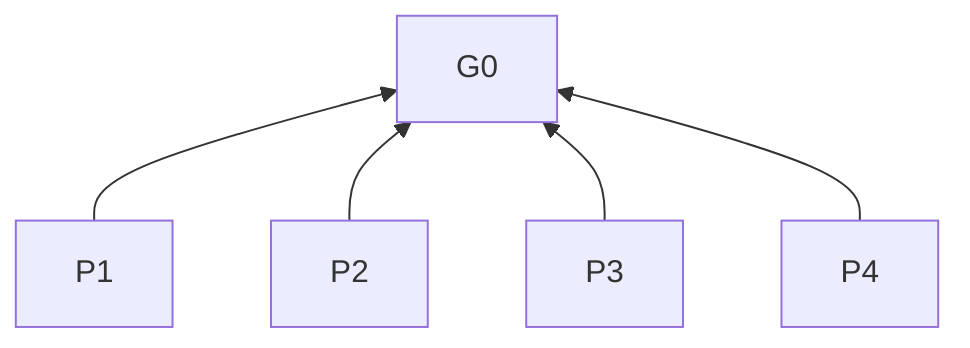
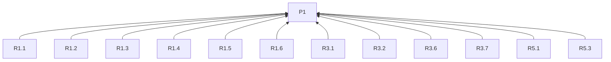
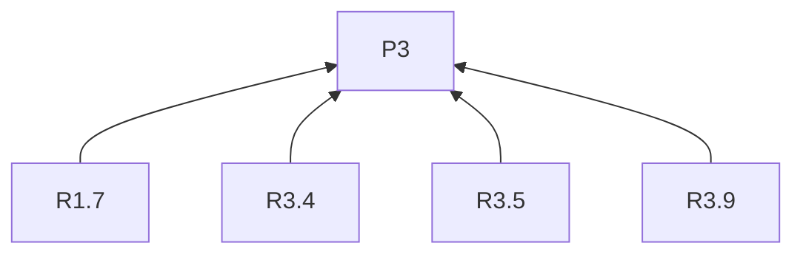
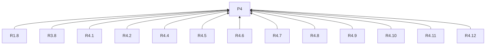
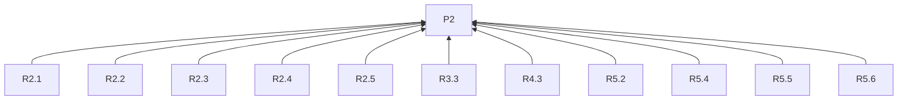
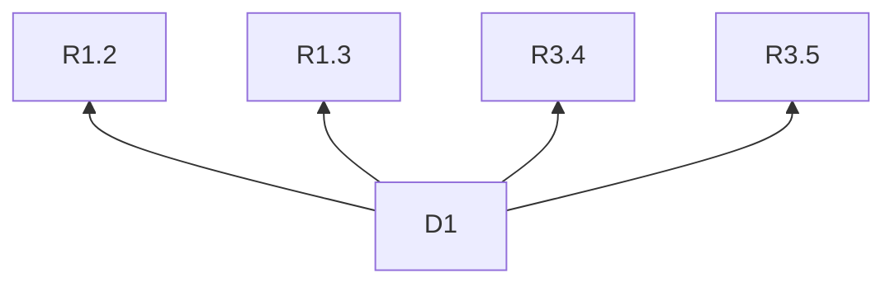

# Build in public

## Purpose (G0, L0)

Help authors and assistants turn any project’s material into reader-useful public writing, verifiable delivery under user control, and evidence-based follow-ups.

## Task routing

Task routing: specific development → R1.1; topic discovery → R1.2; series → R1.3; ideas or outline only → R1.4; revision → R1.8; review and delivery → R4.1–R4.12; follow-ups → R5.1–R5.6.

## Reading guidance

L0 is purpose; L1 principles; L2 rules; L3 practices. Basis names a clause’s reasons; diagram arrows point from clause to basis. Skill discovery uses name and description; R3.9 loads channel guides for the batch. D1 illustrates supplied material, not project facts.

## Overview

## Principles (L1)

**P1 Reader value**: Prefer topics and follow-ups that answer the intended reader’s question and serve the sharing purpose. Basis: G0.

**P2 Evidence and public scope**: Prefer traceable claims within permitted public scope to unsupported conclusions. Basis: G0.

**P3 Independent channel expression**: Prefer an argument, evidence and structure composed for each channel’s readers. Basis: G0.

**P4 User-controlled, verifiable delivery**: Prefer delivery tied to approved content and destinations, with outcomes that can be checked. Basis: G0.

## Rules (L2)

### Task and context

**R1.1** When asked to share a specific development, must draft from that development.
Basis: P1. Criterion: The draft addresses the specified development.

**R1.2** When discovering topics, must examine the requested period's working notes, drafts, decisions, trials and public-use feedback.
Basis: P1. Criterion: Topic evidence comes from the requested period and these available materials.

**R1.3** When planning a series, must use published pieces, receipts and available reader feedback to identify an open question and subsequent learning.
Basis: P1. Criterion: The proposed continuation names the earlier question and new learning.

**R1.4** When asked only for ideas or an outline, must deliver at that stage.
Basis: P1. Criterion: The deliverable matches the requested stage.

**R1.5** When context is established, must reuse the project's readers, sharing purpose, channels, destinations and writing language.
Basis: P1. Criterion: These choices match the established context.

**R1.6** When missing context would materially change the piece or delivery, must ask for that context.
Basis: P1. Criterion: The missing answer changes a choice in the requested content or delivery, such as reader, argument, language, participation route or account.

**R1.7** When the author supplies a voice or viewpoint, must preserve it.
Basis: P3. Criterion: Draft wording and argument retain the supplied voice and viewpoint.

**R1.8** When revising a draft, must keep edits within the requested scope.
Basis: P4. Criterion: Each edit falls within that scope.

### Public scope and evidence

**R2.1** When using feedback or participant or customer details, must stay within their permitted public scope.
Basis: P2. Criterion: Included details have permission for this public use.

**R2.2** When preparing public copy, must exclude credentials.
Basis: P2. Criterion: No credential appears in copy.

**R2.3** When describing work, must distinguish events, observations or measurements, and plans.
Basis: P2. Criterion: Readers can identify which status each claim has.

**R2.4** When claiming how much a change helped, must support the magnitude with measurements.
Basis: P2. Criterion: Improvement magnitudes have measurement evidence; a decision record alone only explains the choice.

**R2.5** When using numbers or comparisons, must retain their sources in local editorial notes.
Basis: P2. Criterion: Each number or comparison can be traced to its source.

### Topics and composition

**R3.1** When recommending a topic, must state its reader question, added understanding, supporting material and relevance to the sharing purpose.
Basis: P1. Criterion: Every recommendation has these four fields.

**R3.2** When prioritizing topics, must favor evidenced reader needs or first-hand observations, methods or tradeoffs that add to the reader’s understanding.
Basis: P1. Criterion: The recommendation identifies an evidenced reader need or explains how a first-hand observation, method or tradeoff changes the reader’s understanding.

**R3.3** When an idea lacks support, must identify the missing material.
Basis: P2. Criterion: The idea names what evidence is still needed.

**R3.4** When topics are selected, must assign them to destinations serving their readers and sharing purpose.
Basis: P3. Criterion: Assignments explain the reader and purpose fit; a batch may contain several topics and a topic several channels.

**R3.5** When writing for several channels, must compose each piece independently from the material for its readers.
Basis: P3. Criterion: Translation, shortening or a headline change alone is not counted as a distinct angle.

**R3.6** When drafting, must choose the sought reader response from the sharing purpose.
Basis: P1. Criterion: The ending serves that purpose; an informational update may end with its result.

**R3.7** When inviting feedback, trials or sign-ups, must specify the action, prerequisites and route to participate or respond.
Basis: P1. Criterion: The reader can determine what to do, what is needed and where to act.

**R3.8** When participation details are missing, must ask before marking the invitation ready to publish.
Basis: P4. Criterion: No invitation is marked ready while a participation detail is missing.

**R3.9** When a batch has selected channels, must read their linked writing and delivery guides.
Basis: P3. Criterion: Every selected channel has been consulted.

### Review and delivery

**R4.1** When presenting a batch for review, must show each complete draft with destination, images, links and any estimated charge.
Basis: P4. Criterion: The preview includes all content and delivery details for every item.

**R4.2** When reviewing HTML, must show both its rendering and the content to be delivered.
Basis: P4. Criterion: Both views correspond to the same draft.

**R4.3** When presenting public copy, must keep editorial source notes separate.
Basis: P2. Criterion: Source notes are outside the deliverable public copy.

**R4.4** When reviewing a batch, must let the user revise or remove items.
Basis: P4. Criterion: The batch reflects the user's revisions and removals.

**R4.5** Before any remote write, including a remote draft, must obtain explicit approval of the final drafts and destinations.
Basis: P4. Criterion: Approval identifies the exact draft version and destination account for each write.

**R4.6** When the batch or a destination changes after review, must show the revised preview for approval.
Basis: P4. Criterion: The approval covers the revised batch and destinations.

**R4.7** When delivering, must use each channel's agreed method and authorized account.
Basis: P4. Criterion: The actual method and account match those agreed.

**R4.8** When the method or account access is unavailable, must report awaiting delivery and identify the missing prerequisite.
Basis: P4. Criterion: The item remains awaiting delivery with the blocker named.

**R4.9** When processing an item, must record its approved version, destination, actual outcome and platform receipt if supplied.
Basis: P4. Criterion: The record associates these fields with the same item.

**R4.10** When an item is already delivered, must skip delivery.
Basis: P4. Criterion: No additional delivery is attempted for that completed item.

**R4.11** When delivery is uncertain, must check the destination before retrying.
Basis: P4. Criterion: A retry follows confirmed non-delivery.

**R4.12** When editing a published item, must require a separate explicit user request.
Basis: P4. Criterion: A publishing approval alone does not authorize editing published content.

### Learning from responses

**R5.1** When planning follow-ups, must compare the sharing purpose with user-provided or task-authorized feedback and results.
Basis: P1. Criterion: The assessment cites purpose-relevant evidence, such as replies, material requests or completed trials.

**R5.2** When assessing responses, must separate platform delivery receipts from reader-response evidence.
Basis: P2. Criterion: A receipt alone is not reported as reader response.

**R5.3** When selecting subsequent topics or drafting, must carry forward supported lessons and readers' actual questions.
Basis: P1. Criterion: The next piece connects to those lessons or questions.

**R5.4** When reporting a lesson, must identify its audience, channel and applicable conditions.
Basis: P2. Criterion: The lesson includes these applicability boundaries.

**R5.5** When evidence is sparse or unavailable, must identify remaining checks.
Basis: P2. Criterion: The assessment names what remains unverified.

**R5.6** When evidence is sparse or unavailable, must label performance explanations as hypotheses.
Basis: P2. Criterion: Such explanations are not presented as established findings.

## Channel guides

- [GitHub Pages](references/pages.md)
- [GitHub Discussions](references/discussions.md)
- [CNBlogs](references/cnblogs.md)
- [DEV Community](references/dev.md)
- [X](references/x.md)
- [Bluesky](references/bluesky.md)
- [Mastodon](references/mastodon.md)
- [WeChat Official Account](references/wechat.md)

## Practices (L3)

**D1** Basis: R1.2, R1.3, R3.4, R3.5.

Misreading addressed: One topic needs identical copy everywhere, or channels must be chosen before worthwhile questions.

For example, given the topic “why the exercise instructions changed,” write a before-and-after comparison for teachers and a trial invitation for learners. When looking for topics in a week’s work, first identify worthwhile questions in exercise revisions and trial feedback, then assign channels. Later trial results can supply a follow-up.

## Clause dependencies

## Sources

Topic selection draws on how `content-strategy` identifies reader questions and weighs what a piece adds. [Topic sources](https://github.com/coreyhaines31/marketingskills/blob/88c79f6528a9347420e57ceb1fff9a60de651768/skills/content-strategy/SKILL.md#content-ideation-sources) · [Content value](https://github.com/coreyhaines31/marketingskills/blob/88c79f6528a9347420e57ceb1fff9a60de651768/skills/content-strategy/SKILL.md#searchable-vs-shareable)

Reader-value and priority checks draw on `product-marketing` and `content-strategy`. [Audience context](https://github.com/coreyhaines31/marketingskills/blob/88c79f6528a9347420e57ceb1fff9a60de651768/skills/product-marketing/SKILL.md#sections-to-capture) · [Topic priorities](https://github.com/coreyhaines31/marketingskills/blob/88c79f6528a9347420e57ceb1fff9a60de651768/skills/content-strategy/SKILL.md#prioritizing-content-ideas)

Audience, desired response and channel-format guidance draws on `social`. [Audience and goals](https://github.com/coreyhaines31/marketingskills/blob/88c79f6528a9347420e57ceb1fff9a60de651768/skills/social/SKILL.md#before-creating-content) · [Platform adaptation](https://github.com/coreyhaines31/marketingskills/blob/88c79f6528a9347420e57ceb1fff9a60de651768/skills/social/SKILL.md#repurposing-workflow)

Action wording draws on `copywriting`, and response-based learning draws on `social`. [Reader actions](https://github.com/coreyhaines31/marketingskills/blob/88c79f6528a9347420e57ceb1fff9a60de651768/skills/copywriting/SKILL.md#cta-copy-guidelines) · [Response review](https://github.com/coreyhaines31/marketingskills/blob/88c79f6528a9347420e57ceb1fff9a60de651768/skills/social/SKILL.md#analytics--optimization)
