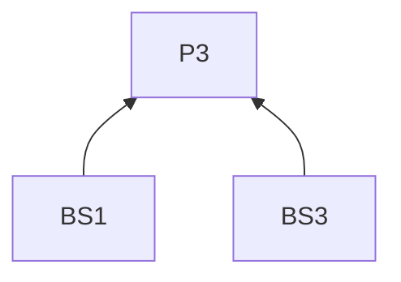
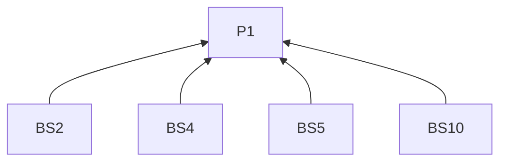
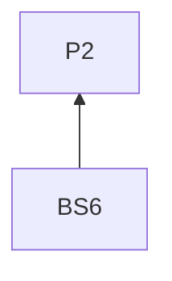
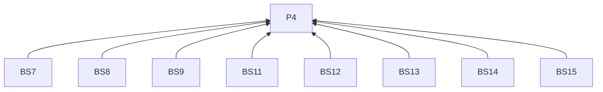
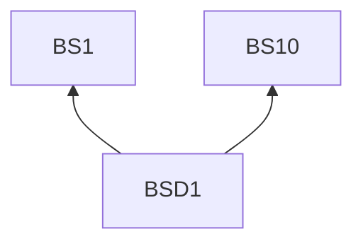

# Bluesky

## Reading guidance

This on-demand channel guide extends the [skill entry](../SKILL.md). G0 and P1–P4 are defined there; shared requirements have one definition in the entry. Channel identifiers mark L2 rules; examples are L3 practices. R4.5–R4.12 govern every remote delivery below.

## Rules (L2)

### Writing

**BS1** When opening a post, must identify the project or activity and one change or observation.
Basis: P3. Criterion: The timeline text names its subject and focus.

**BS2** When explaining the observation, must supply context and its connection to a decision, consequence or question.
Basis: P1. Criterion: A newcomer can respond without reading a full external article; a longer method or history may be linked.

**BS3** When using a demo or visual, must describe the significant content in text.
Basis: P3. Criterion: The description identifies what to notice; a before-and-after description may explain the change before the image opens.

**BS4** When following up, must name the earlier question and new learning.
Basis: P1. Criterion: The text distinguishes the earlier question from the update.

**BS5** When the earlier post is available for a follow-up, must link it.
Basis: P1. Criterion: The follow-up links the earlier post.

**BS6** When a limitation changes a result's meaning, must retain it.
Basis: P2. Criterion: The qualification remains beside the result.

**BS7** When reviewing the post, must include linked material and media descriptions.
Basis: P4. Criterion: The preview contains both alongside the text.

**BS8** When native attachments are required, must check the delivery method's support.
Basis: P4. Criterion: Support is checked for the intended attachment.

**BS9** When text and links are complete, must check the current platform limit.
Basis: P4. Criterion: The checked length includes the final text and links.

**BS10** When seeking responses, must ask a question answerable from concrete experience.
Basis: P1. Criterion: The question asks for an experience rather than unspecified reactions.

### Delivery

**BS11** When writing through AT Protocol, must confirm the account DID and trusted personal data server.
Basis: P4. Criterion: The write targets the confirmed identity and server.

**BS12** When writing through AT Protocol, must use that account's authenticated session.
Basis: P4. Criterion: Session identity matches the approved account.

**BS13** When writing through AT Protocol, must include creation time with its time zone.
Basis: P4. Criterion: The record contains a time-zone-qualified creation timestamp.

**BS14** When recording delivery under R4.9, must retain the AT URI.
Basis: P4. Criterion: The receipt identifies the new record.

**BS15** When checking uncertain delivery under R4.11, must inspect the account feed.
Basis: P4. Criterion: The feed is checked before a retry decision.

## Practices (L3)

**BSD1** Basis: BS1, BS10.

Misreading addressed: A feedback post can ask for reactions without a concrete change or answerable question.

Illustrative input. A workshop worksheet has been revised into separate task, answer-format and submission blocks. The author wants to learn where readers expect submission instructions.

> I split a workshop worksheet into task, answer format and submission blocks. When you open an exercise, where do you first look for the upload instructions?

Pair the concrete change with a question readers can answer from experience.

## Clause dependencies

## Sources

Conversational framing draws on [social, Engagement Strategy](https://github.com/coreyhaines31/marketingskills/blob/88c79f6528a9347420e57ceb1fff9a60de651768/skills/social/SKILL.md#engagement-strategy).

[Official documentation](https://atproto.com/guides/writing-data)
