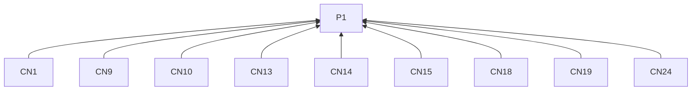
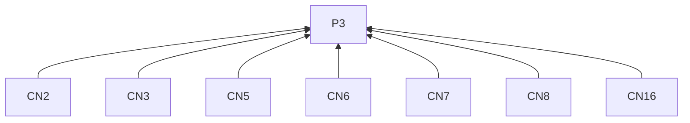
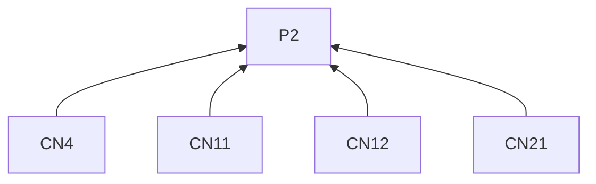
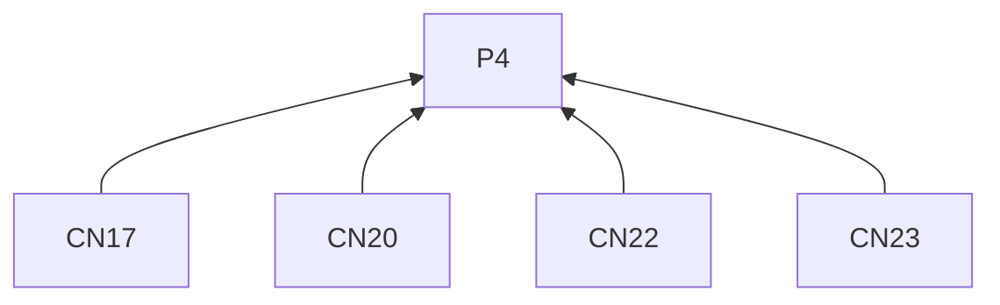
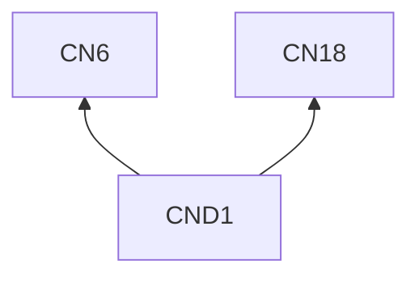

# CNBlogs

## Reading guidance

This on-demand channel guide extends the [skill entry](../SKILL.md). G0 and P1–P4 are defined there; shared requirements have one definition in the entry. Channel identifiers mark L2 rules; examples are L3 practices. R4.5–R4.12 govern every remote delivery below.

## Rules (L2)

### Writing

**CN1** When explaining a topic, must connect it to a practice other developers can understand or try, with its technical conditions.
Basis: P1. Criterion: Course, research or design accounts use actual tools or methods from the supplied material.

**CN2** When titling, must identify the problem, technique or decision and locating context.
Basis: P3. Criterion: A troubleshooting title may name symptom and component; a tutorial may name task and environment; promises follow R2.3–R2.5.

**CN3** When opening, must state the concrete problem and its effect on the work.
Basis: P3. Criterion: The opening establishes why the work mattered.

**CN4** When readers need prerequisites, versions or setup to follow, must state them.
Basis: P2. Criterion: The starting environment is identifiable.

**CN5** When writing a tutorial, must connect starting conditions, key actions, reasoning and a result check.
Basis: P3. Criterion: The explanation identifies where each setting or step matters.

**CN6** When troubleshooting, must connect symptoms, observations, possible causes, checks and the supported explanation.
Basis: P3. Criterion: Verified causes are distinguished from hypotheses under R2.3.

**CN7** When reviewing a choice, must describe constraints, actual options, selected approach and accepted cost.
Basis: P3. Criterion: The account identifies where it was tried and where applicability remains open.

**CN8** When organizing the article, must use headings that expose its reasoning.
Basis: P3. Criterion: The heading sequence follows the explanation.

**CN9** When including a command, short code fragment or error, must place it beside its explanation.
Basis: P1. Criterion: The reader can associate the fragment with its purpose.

**CN10** When providing commands or code examples, must state their inputs.
Basis: P1. Criterion: The reader can identify the needed input.

**CN11** When observed output is available, must show it.
Basis: P2. Criterion: The example includes the observed output.

**CN12** When showing expected output, must label it as expected.
Basis: P2. Criterion: Expected output cannot be mistaken for observed output.

**CN13** When unfamiliar technical terms arise, must define them.
Basis: P1. Criterion: The definition appears at first use.

**CN14** When choosing example detail, must keep the smallest complete example explaining the behavior.
Basis: P1. Criterion: The example contains all inputs and actions needed to explain the behavior; extended records follow CN24.

**CN15** When code must be copied, must use text.
Basis: P1. Criterion: Code is copyable rather than image-only.

**CN16** When showing visual behavior or comparisons, must explain the relevant visual difference beside the image.
Basis: P3. Criterion: Screenshots identify what the reader should notice.

**CN17** When preparing delivery, must produce titled Markdown and inspect its rendering.
Basis: P4. Criterion: The rendered article has been reviewed.

**CN18** When concluding, must state the verified result, applicable conditions and unresolved cause or next check.
Basis: P1. Criterion: The conclusion preserves the tested scope.

**CN19** When requesting experiences, must ask about the condition still uncertain.
Basis: P1. Criterion: The question identifies that condition.

**CN24** When providing full logs or larger source files, must link them from the compact example.
Basis: P1. Criterion: The article keeps the example complete and puts extended material behind links.

### Delivery

**CN20** When using the blog API, must use the blog owner's personal access token.
Basis: P4. Criterion: Token ownership matches the approved blog.

**CN21** When setting the AI-generated content declaration, must reflect actual authorship.
Basis: P2. Criterion: The declaration matches how the article was authored.

**CN22** When recording publication under R4.9, must retain the URL returned in `postUrl`.
Basis: P4. Criterion: The receipt uses the returned article URL.

**CN23** When checking uncertain delivery under R4.11, must inspect the target blog.
Basis: P4. Criterion: The blog is checked before a retry decision.

## Practices (L3)

**CND1** Basis: CN6, CN18.

Misreading addressed: One tested input establishes the fix for every input shape.

Illustrative input. A CSV exporter writes its header inside the row loop. A test with three input records produces three headers. Moving the header write before the loop produces one header and three data rows for the same input. Other input shapes have not been tested.

> **Tracing repeated headers in a CSV export**
>
> An export with three records produced a header before each data row. The header write was inside the loop that handled records.
>
> I moved the header write before the loop and repeated the test with the same input. The output then contained one header and three data rows.
>
> That check covers the supplied three-record input. Empty input and other record shapes need separate checks.

Keep the conclusion tied to the case actually tested.

## Clause dependencies

## Sources

The advice on specific, supportable wording draws on [copywriting, Drafting Protocol](https://github.com/coreyhaines31/marketingskills/blob/88c79f6528a9347420e57ceb1fff9a60de651768/skills/copywriting/SKILL.md#drafting-protocol).

[CNBlogs Markdown support](https://www.cnblogs.com/cmt/p/markdown.html) · [Official documentation](https://www.cnblogs.com/cmt/articles/19246558)
