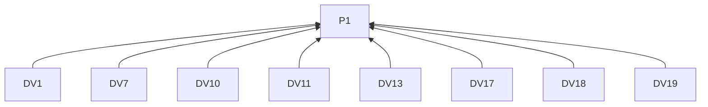
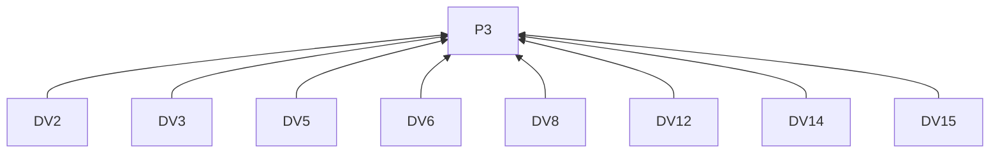
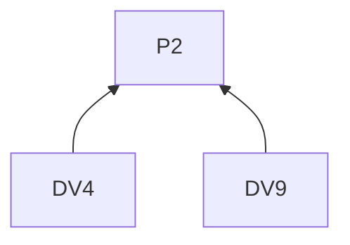
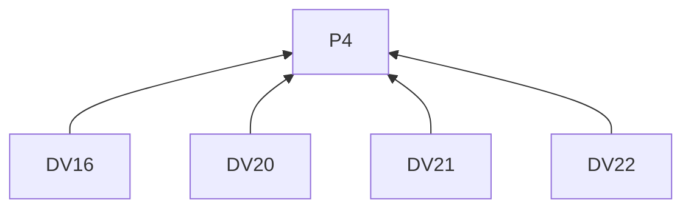
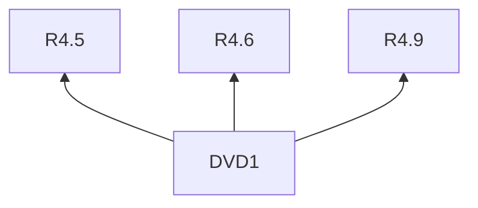

# DEV Community

## Reading guidance

This on-demand channel guide extends the [skill entry](../SKILL.md). G0 and P1–P4 are defined there; shared requirements have one definition in the entry. Channel identifiers mark L2 rules; examples are L3 practices. R4.5–R4.12 govern every remote delivery below.

## Rules (L2)

### Writing

**DV1** When explaining a method or experience, must introduce unfamiliar tools and project terms where needed to follow the explanation.
Basis: P1. Criterion: Developers outside the project can follow the account.

**DV2** When titling, must name the task, lesson or question.
Basis: P3. Criterion: The title identifies the article's subject.

**DV3** When opening, must use a small real situation to explain the method's significance and what readers will learn.
Basis: P3. Criterion: The opening connects a real situation to the learning outcome.

**DV4** When knowledge or environment affects an example, must state those prerequisites.
Basis: P2. Criterion: The example names the affected assumptions.

**DV5** When writing a tutorial, must give its starting state, important actions and outcome check.
Basis: P3. Criterion: A reader can follow and check the method.

**DV6** When writing a design lesson, must trace a real constraint to the choice it produced.
Basis: P3. Criterion: The choice is connected to its constraint.

**DV7** When writing a project update, must identify what another developer can try or examine next.
Basis: P1. Criterion: The next activity is explicit.

**DV8** When illustrating the central idea, must use a small example with assumptions and expected behavior.
Basis: P3. Criterion: The example contains those interpretation conditions.

**DV9** When an example is illustrative or untested, must label that status.
Basis: P2. Criterion: It cannot be mistaken for an observed project result.

**DV10** Before relying on a code fragment, must explain its purpose.
Basis: P1. Criterion: The explanation precedes reliance on the fragment.

**DV11** When linking a larger repository or record, must first establish context in the article.
Basis: P1. Criterion: The reader knows why to open the link.

**DV12** When preparing an article, must use titled Markdown with content-describing headings.
Basis: P3. Criterion: The structure identifies the article and its sections.

**DV13** When including necessary code, must keep it available as text.
Basis: P1. Criterion: Readers can copy the code.

**DV14** When including media, must caption or describe what it demonstrates.
Basis: P3. Criterion: The text identifies the media's contribution.

**DV15** When selecting tags, must describe the actual subject.
Basis: P3. Criterion: Tags match the article's content.

**DV16** When using rich embeds, must check the current editor's supported syntax.
Basis: P4. Criterion: The embed uses supported syntax.

**DV17** When ending, must return to the method's application and limitations.
Basis: P1. Criterion: The conclusion names where the method applies and its limits.

**DV18** When inviting a trial under R3.7, must identify what to observe.
Basis: P1. Criterion: The invitation names the requested observation.

**DV19** When ending with a question, must ask about an experience the article has prepared readers to discuss.
Basis: P1. Criterion: The question follows from the article's explanation.

### Delivery

**DV20** When using the article API, must use the publishing account's DEV API key.
Basis: P4. Criterion: The key belongs to the approved account.

**DV21** When an article awaits publication, must record its ID and pending state.
Basis: P4. Criterion: A remote article ID is not reported as publication.

**DV22** When an article is published, must retain its URL under R4.9.
Basis: P4. Criterion: The receipt identifies the published article.

## Practices (L3)

**DVD1** Basis: R4.5, R4.6, R4.9.

Misreading addressed: Approval follows the text regardless of a changed destination account.

Illustrative input. A document workflow requires approval of the exact draft and destination account. A draft approved for Account A is later assigned to Account B.

> **What a publishing approval needs to identify**
>
> A review step needs to identify both the text and the account that will receive it.
>
> Consider a draft approved for Account A. If its destination changes to Account B, the new destination needs review and approval, even when the text is identical.
>
> Record the approved version and account together, then associate the delivery outcome and platform receipt with that pair.

Use the account change to make the approval rule concrete.

## Clause dependencies

## Sources

Preserving supplied voice draws on [copywriting, Diagnose the Situation First](https://github.com/coreyhaines31/marketingskills/blob/88c79f6528a9347420e57ceb1fff9a60de651768/skills/copywriting/SKILL.md#diagnose-the-situation-first).

[DEV writing help](https://dev.to/help/writing-editing-scheduling) · [Official documentation](https://developers.forem.com/api/v1)
