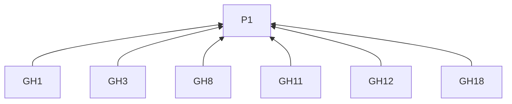
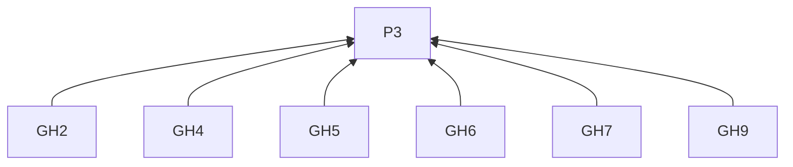
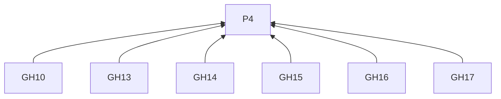
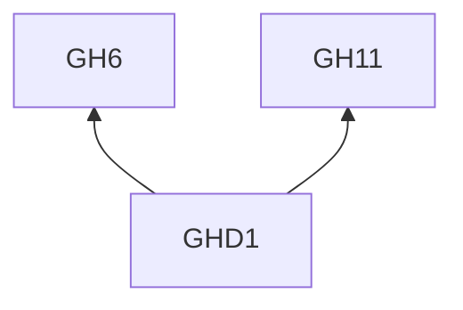

# GitHub Discussions

## Reading guidance

This on-demand channel guide extends the [skill entry](../SKILL.md). G0 and P1–P4 are defined there; shared requirements have one definition in the entry. Channel identifiers mark L2 rules; examples are L3 practices. R4.5–R4.12 govern every remote delivery below.

## Rules (L2)

### Writing

**GH1** When explaining the work, must supply background and project-term explanations for newcomers.
Basis: P1. Criterion: Existing repository readers and newcomers can understand the change or decision.

**GH2** When titling, must name the subject and conversation purpose.
Basis: P3. Criterion: Announcements identify the change; feedback titles identify the decision or experience needing input.

**GH3** When opening, must establish the current situation and why it matters to participants.
Basis: P1. Criterion: The opening explains participants' stake.

**GH4** Before shaping the post, must check the selected category and repository contribution guidance.
Basis: P3. Criterion: The discussion form and focused question fit its category and purpose.

**GH5** When announcing, must explain the change, affected readers and required action.
Basis: P3. Criterion: A date or version locates time-sensitive changes; a link provides implementation or a fuller account.

**GH6** When seeking feedback, must state the goal, constraints, actual options and open question.
Basis: P3. Criterion: Already-decided matters are identified so responses address the remaining choice.

**GH7** When asking for help, must give the intended result, observations, conditions and prior attempts.
Basis: P3. Criterion: A small reproduction or concrete example is included when available.

**GH8** When providing response context, must put necessary information in the post.
Basis: P1. Criterion: A reader can respond from the post; extended logs, design records and earlier discussions follow GH18.

**GH9** When including a screenshot, must show the disputed behavior or difference it clarifies.
Basis: P3. Criterion: The image has an identified explanatory role.

**GH10** When preparing the discussion for R4.1 review, must use a title and Markdown body.
Basis: P4. Criterion: The titled Markdown is reviewed with images and links under R4.1.

**GH11** When ending a feedback request, must ask a question answerable from experience.
Basis: P1. Criterion: The question can solicit example conditions or a specific observation.

**GH12** When inviting a trial under R3.7, must specify the starting point and feedback to return.
Basis: P1. Criterion: A participant knows how to start and what to report; announcements may end with their practical impact.

**GH18** When including longer logs, design records or earlier discussions, must link them from the response context.
Basis: P1. Criterion: Extended records remain accessible without replacing the post's essential response information.

### Delivery

**GH13** Before delivery, must confirm the target repository and discussion category.
Basis: P4. Criterion: The destination identifies both.

**GH14** Before creating a discussion, must verify Discussions is enabled and the account can start one in that category.
Basis: P4. Criterion: Both repository and account prerequisites hold.

**GH15** When using GraphQL, must identify the repository and category by their node IDs.
Basis: P4. Criterion: The IDs resolve to the confirmed destination.

**GH16** When recording delivery under R4.9, must retain the created discussion's URL.
Basis: P4. Criterion: The receipt identifies the discussion.

**GH17** When checking uncertain delivery under R4.11, must inspect the target category.
Basis: P4. Criterion: The category is checked before a retry decision.

## Practices (L3)

**GHD1** Basis: GH6, GH11.

Misreading addressed: A feedback request can omit actual options and ask only for preferences.

Illustrative input. A workshop has several exercises using the same upload destination. Each worksheet has separate task and answer-format blocks. The author wants feedback on where submission instructions should appear.

> **Where should workshop worksheets explain how to submit answers?**
>
> Each exercise has its own task and answer format, but all answers go to the same upload page.
>
> I can repeat the submission instructions on every worksheet, or put them once in the workshop introduction and link to them. Repeating them means updating several copies when the destination changes.
>
> If you teach or take workshops, where do you look for these instructions? Please describe a worksheet layout you have used and any difficulty finding the submission step.

Give participants the actual choice and ask for an experience that can inform it.

## Clause dependencies

## Sources

The focused-question approach follows GitHub's linked guidance. Reader context draws on [copywriting, Before Writing](https://github.com/coreyhaines31/marketingskills/blob/88c79f6528a9347420e57ceb1fff9a60de651768/skills/copywriting/SKILL.md#before-writing).

[Community conversation guidance](https://docs.github.com/en/discussions/guides/best-practices-for-community-conversations-on-github) · [Official documentation](https://docs.github.com/en/graphql/guides/using-the-graphql-api-for-discussions)
