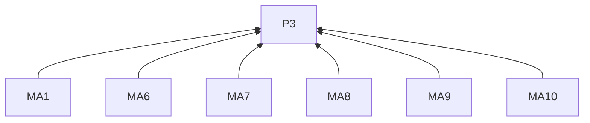
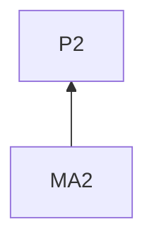
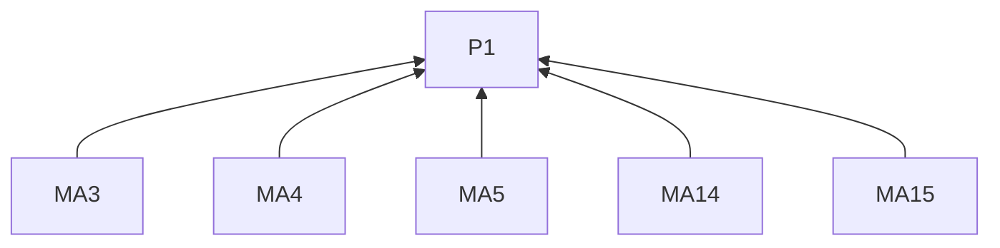
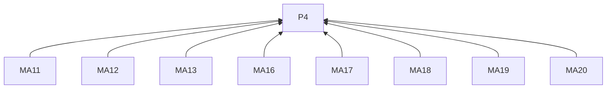
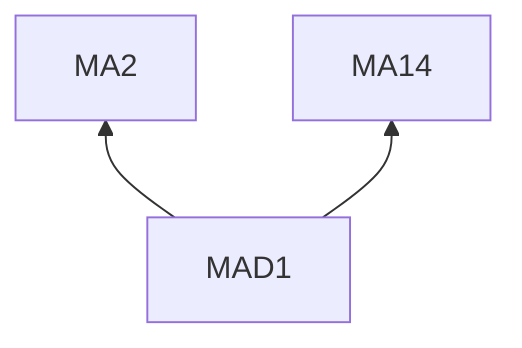

# Mastodon

## Reading guidance

This on-demand channel guide extends the [skill entry](../SKILL.md). G0 and P1–P4 are defined there; shared requirements have one definition in the entry. Channel identifiers mark L2 rules; examples are L3 practices. R4.5–R4.12 govern every remote delivery below.

## Rules (L2)

### Writing

**MA1** When opening, must identify the work and finding before explaining the resulting choice.
Basis: P3. Criterion: The observation and choice are understandable to instance readers and readers of shares elsewhere.

**MA2** When explaining a tradeoff, must state the condition that makes it meaningful.
Basis: P2. Criterion: The tradeoff includes its applicability condition.

**MA3** When using unfamiliar project terms, must explain them.
Basis: P1. Criterion: Readers outside the project can interpret the terms.

**MA4** When following up, must identify the earlier unresolved issue and new observation.
Basis: P1. Criterion: The update connects the earlier question to new evidence.

**MA5** When explaining reasoning, must make it understandable without opening a full record.
Basis: P1. Criterion: The post contains the reasoning; a full record may supply detail; status follows R2.3.

**MA6** When adding subject tags, must choose tags describing the post's subject.
Basis: P3. Criterion: Tags help locate the relevant conversation.

**MA7** When using community vocabulary, must keep it relevant to the topic.
Basis: P3. Criterion: The vocabulary refers to the post's subject.

**MA8** When mentioning people, must relate the mention to their participation.
Basis: P3. Criterion: Each mention has a role in the account.

**MA9** When attaching media, must describe significant content, including differences in comparisons.
Basis: P3. Criterion: The description identifies what the media adds.

**MA10** When preparing a content warning for a post, must describe what readers will encounter.
Basis: P3. Criterion: The warning names its content; this rule does not define a new threshold for which content needs warnings.

**MA11** Before delivery, must check the chosen instance's current text and media limits.
Basis: P4. Criterion: The final post is checked against that instance's limits.

**MA12** When reviewing, must include links, media descriptions and any content warning.
Basis: P4. Criterion: These appear in R4.1's preview.

**MA13** When native attachments are required, must confirm the method supports them.
Basis: P4. Criterion: The intended method supports the attachment.

**MA14** When ending, must give the observation's implication or a concrete question for readers with relevant experience.
Basis: P1. Criterion: The ending serves R3.6.

**MA15** When adding a follow-up post for more space, must make the connection between posts explicit.
Basis: P1. Criterion: Readers can identify what the follow-up continues.

### Delivery

**MA16** Before posting, must confirm the account's instance and public visibility.
Basis: P4. Criterion: The target instance and public visibility match the approved destination.

**MA17** When posting through the API, must use a user token with `write:statuses`.
Basis: P4. Criterion: The authorized token includes that scope.

**MA18** When retrying with an idempotency key, must reuse the original key for that post.
Basis: P4. Criterion: The same post keeps the same key.

**MA19** When recording delivery under R4.9, must retain the status URL.
Basis: P4. Criterion: The receipt identifies the status.

**MA20** When checking uncertain delivery under R4.11, must inspect the account on its instance.
Basis: P4. Criterion: The check uses the confirmed instance.

## Practices (L3)

**MAD1** Basis: MA2, MA14.

Misreading addressed: A tradeoff question can omit how each choice affects later work.

Illustrative input. A workshop uses the same upload page for several exercises. Submission steps can be repeated on each worksheet or maintained in shared instructions.

> I’m preparing workshop worksheets with separate task and answer-format blocks. Every exercise uses the same upload page.
>
> I’m deciding where to put the submission steps. Repeating them beside each task means editing each copy when the destination changes. How do you keep these instructions easy to find in your learning materials?

State how each option affects later updates so readers can offer relevant experience.

## Clause dependencies

## Sources

Audience context draws on [social, Before Creating Content](https://github.com/coreyhaines31/marketingskills/blob/88c79f6528a9347420e57ceb1fff9a60de651768/skills/social/SKILL.md#before-creating-content). Mastodon's linked documentation establishes the posting features.

[Posting features](https://docs.joinmastodon.org/user/posting/) · [Official documentation](https://docs.joinmastodon.org/methods/statuses/)
