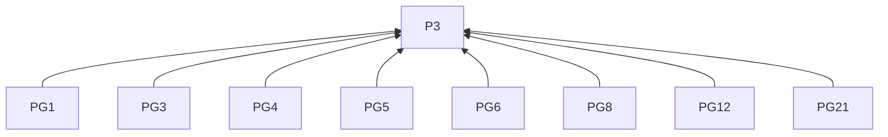
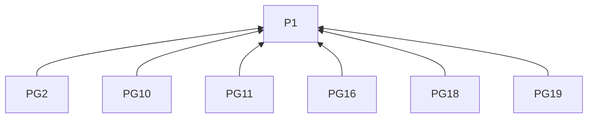
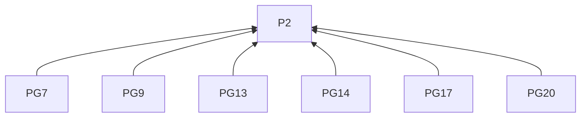
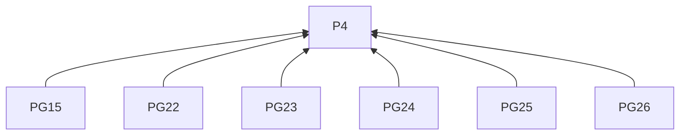
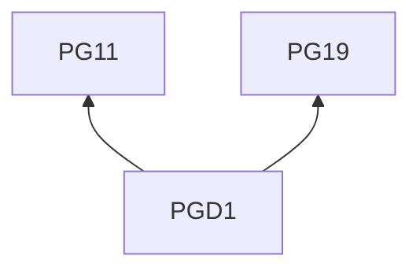

# GitHub Pages

## Reading guidance

This on-demand channel guide extends the [skill entry](../SKILL.md). G0 and P1–P4 are defined there; shared requirements have one definition in the entry. Channel identifiers mark L2 rules; examples are L3 practices. R4.5–R4.12 govern every remote delivery below.

## Rules (L2)

### Writing

**PG1** When writing a site article under R1.5 and R1.7, must let the site’s existing articles guide its expression.
Basis: P3. Criterion: The writing fits the site’s established articles; GitHub Pages is website hosting rather than a fixed editorial format.

**PG2** When opening for direct visitors, must provide enough project background to follow the next paragraph.
Basis: P1. Criterion: A newcomer need not first read a repository or earlier article; fuller context may be linked.

**PG3** When titling, must name the change, decision or question and the reader's reason to continue.
Basis: P3. Criterion: The title identifies the choice to understand or method to try.

**PG4** When opening, must use a consequential moment, observation or result from the material.
Basis: P3. Criterion: A decision review identifies the affected project part and its users.

**PG5** When writing progress, must connect previous state, work performed and current observations.
Basis: P3. Criterion: Activities are grouped around changes; milestone dates appear when needed to explain sequence.

**PG6** When reviewing a decision, must trace need or constraint, actual options, adopted choice and consequences.
Basis: P3. Criterion: Observations supporting the choice and its accepted cost accompany the benefit.

**PG7** When reporting an experiment, must connect question, setup, comparison, observations and justified conclusions.
Basis: P2. Criterion: Versions, trial conditions and measurement details permit interpretation; a planned trial leaves its result open under R2.3.

**PG8** When organizing the account, must use headings that expose its argument.
Basis: P3. Criterion: Headings let readers follow the particular argument.

**PG9** When explaining an action or decision, must connect it to the informing observation and cited evidence.
Basis: P2. Criterion: The account states why the evidence matters to the choice.

**PG10** When selecting detail, must retain what changes understanding or enables readers to try the method.
Basis: P1. Criterion: Routine activity is summarized; lengthy logs and background may be linked.

**PG11** When presenting a reproducible account, must provide conditions and key actions needed to interpret the result.
Basis: P1. Criterion: The account includes relevant exercises and trial notes, research protocol or a small technical example.

**PG12** When using images or tables, must place them beside the point they explain.
Basis: P3. Criterion: Readers can associate the illustration with the claim.

**PG13** When showing a comparison image, must identify the relevant change.
Basis: P2. Criterion: The caption tells readers what to notice.

**PG14** When showing results in a table, must label units and conditions.
Basis: P2. Criterion: Every result is interpretable with its units and conditions.

**PG15** When previewing, must check embedded media and links.
Basis: P4. Criterion: The rendered article's media and links have been checked.

**PG16** When introducing unfamiliar terms, must explain them at first use.
Basis: P1. Criterion: The explanation precedes reliance on the term.

**PG17** When findings are time-sensitive, must state their observation date or version.
Basis: P2. Criterion: Later readers can locate the finding in time or version.

**PG18** When ending, must state the current result and any open question following from it.
Basis: P1. Criterion: A decision record may end with its consequence.

**PG19** When inviting a trial under R3.7, must specify what to try and what feedback helps.
Basis: P1. Criterion: The invitation identifies the trial and feedback sought.

**PG20** When later evidence changes an earlier conclusion, must link the earlier article and explain the new learning.
Basis: P2. Criterion: The update makes the changed conclusion traceable.

**PG21** When preparing the article, must use the site's supported titled Markdown or HTML with required front matter.
Basis: P3. Criterion: Format matches the site; length follows the depth required to explain the subject.

### Delivery

**PG22** When deploying from a branch, must confirm repository, branch, publishing directory, article path and final HTTPS URL.
Basis: P4. Criterion: The source and expected destination are identified.

**PG23** Before updating a source file, must verify repository write access.
Basis: P4. Criterion: The authorized account can write the source repository.

**PG24** When recording submission, must retain the commit SHA.
Basis: P4. Criterion: The record identifies the submitted revision.

**PG25** Until the expected URL serves the approved article, must report deployment as pending.
Basis: P4. Criterion: Source submission alone is not reported as completed deployment.

**PG26** When the URL still shows an older version, must check deployment before submitting again.
Basis: P4. Criterion: The retry decision follows a deployment check under R4.11.

## Practices (L3)

**PGD1** Basis: PG11, PG19.

Misreading addressed: A reusable method must wait for trial results, or a planned trial already proves its effectiveness.

Illustrative input. The readers are workshop designers, and the purpose is to provide a reusable worksheet outline. An exercise asks for a two-sentence summary. Its revision separates the task, answer format and upload instructions into labelled blocks. A learner trial will check whether participants can find the submission step before asking for help.

> **A worksheet outline workshop designers can reuse**
>
> This summary exercise gives its instructions under three labels, each answering a different question for the learner.
>
> - The task block gives the short passage and asks for a summary.
> - The answer-format block specifies two sentences.
> - The submission block gives the upload steps.
>
> You can apply these labels to another exercise by filling in its activity, expected answer and submission steps. For this worksheet, the learner trial will check whether participants can find the submission step before asking for help. The results will inform the next layout decision.

Show designers what they can reuse, then explain the observation needed to assess the proposed layout.

## Clause dependencies

## Sources

- Audience context and preserving an existing author's vocabulary draw on `copywriting`, particularly “Before Writing” and “Diagnose the Situation First.” Here they guide project articles. [Reader context](https://github.com/coreyhaines31/marketingskills/blob/88c79f6528a9347420e57ceb1fff9a60de651768/skills/copywriting/SKILL.md#before-writing) · [Author's voice](https://github.com/coreyhaines31/marketingskills/blob/88c79f6528a9347420e57ceb1fff9a60de651768/skills/copywriting/SKILL.md#diagnose-the-situation-first)
- Opening with a real moment or finding draws on the story and value openings in `social`'s “Hook Formulas.” Here the opening must introduce the article's actual subject and context. [Opening examples](https://github.com/coreyhaines31/marketingskills/blob/88c79f6528a9347420e57ceb1fff9a60de651768/skills/social/SKILL.md#hook-formulas)

[GitHub Pages overview](https://docs.github.com/en/pages/getting-started-with-github-pages/what-is-github-pages) · [Official documentation](https://docs.github.com/en/pages/getting-started-with-github-pages/configuring-a-publishing-source-for-your-github-pages-site)
