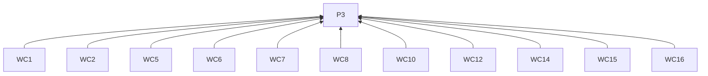
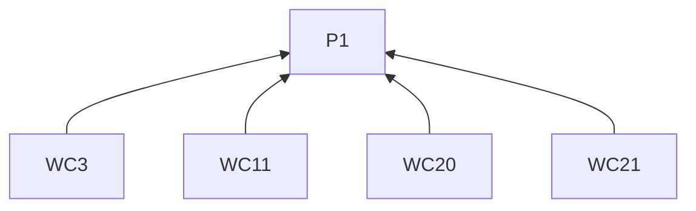
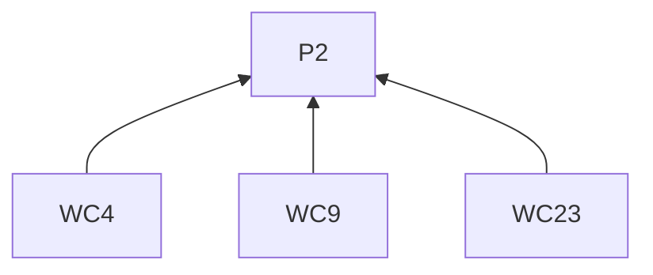
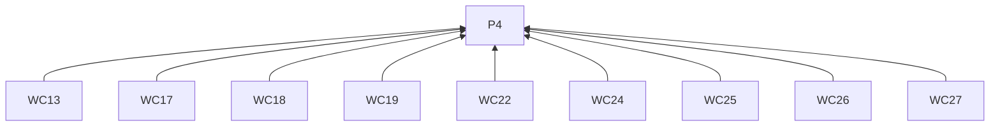
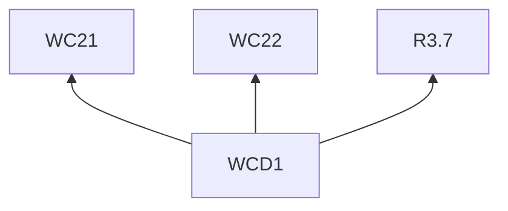

# WeChat Official Account

## Reading guidance

This on-demand channel guide extends the [skill entry](../SKILL.md). G0 and P1–P4 are defined there; shared requirements have one definition in the entry. Channel identifiers mark L2 rules; examples are L3 practices. R4.5–R4.12 govern every remote delivery below.

## Rules (L2)

### Writing

**WC1** When titling, must name the change, dilemma or question using words that express the author's viewpoint.
Basis: P3. Criterion: The promised insight is supported by the material under R2.3–R2.5.

**WC2** When opening, must use an actual action, observation or difficulty.
Basis: P3. Criterion: The opening identifies participants, their goal and what made the situation consequential.

**WC3** When unfamiliar project context is needed to follow the story, must supply it.
Basis: P1. Criterion: Readers can follow the development at that point.

**WC4** When quoting someone, must have material supporting both the wording and its public use.
Basis: P2. Criterion: The quotation matches supported wording and permission under R2.1.

**WC5** When writing a milestone account, must connect earlier situation, actions, difficulty, decision and current result.
Basis: P3. Criterion: The story explains the path to the milestone.

**WC6** When writing a decision account, must show alternatives and constraints through the work producing them.
Basis: P3. Criterion: The account connects choices to the work.

**WC7** When writing an experiment account, must connect question and trial conditions to observations and remaining uncertainty.
Basis: P3. Criterion: The account preserves the result's boundaries under R2.3.

**WC8** When explaining sequence, must use chronology.
Basis: P3. Criterion: The event sequence is explicit.

**WC9** When explaining causality, must support the relationship with material.
Basis: P2. Criterion: Sequence alone is not presented as evidence of causation.

**WC10** When using headings, must identify developments or questions in the account.
Basis: P3. Criterion: Headings follow the story's development.

**WC11** When interpreting a fact, must place its explanation beside it.
Basis: P1. Criterion: Facts and their interpretations stay associated; extended background may be linked.

**WC12** When paragraph focus changes, must start a new paragraph.
Basis: P3. Criterion: Each paragraph develops one connected thought.

**WC13** When reviewing layout, must inspect it on a narrow screen.
Basis: P4. Criterion: A narrow-screen rendering has been inspected.

**WC14** When choosing illustrations, must use visuals that clarify an action or consequence.
Basis: P3. Criterion: Screenshots, diagrams or comparisons have an identified explanatory role.

**WC15** When placing illustrations, must put them near their explanation with a caption identifying the point.
Basis: P3. Criterion: Caption and placement connect the visual to the explanation.

**WC16** When preparing the article, must produce titled, formatted HTML.
Basis: P3. Criterion: The deliverable includes title and formatted body.

**WC17** When reviewing under R4.1–R4.2, must include the actual cover.
Basis: P4. Criterion: The cover accompanies the rendered body and underlying content.

**WC18** When preparing inline images for a remote draft, must use WeChat-hosted addresses.
Basis: P4. Criterion: Each inline image uses a WeChat-hosted address.

**WC19** When checking hard formatting limits, must consult current official draft documentation.
Basis: P4. Criterion: The checks use the current draft format reference.

**WC20** When ending, must state what changed for participants and any open question following from the result.
Basis: P1. Criterion: The ending returns to participants and the result.

**WC21** When inviting a trial under R3.7, must identify who it is for and how to obtain the material.
Basis: P1. Criterion: The reader can determine eligibility and material access.

**WC22** When offering participation, must use a route available to the account.
Basis: P4. Criterion: The account supports the proposed participation route.

**WC23** When introducing a future test, must identify it as the next check.
Basis: P2. Criterion: The outcome remains open; a later article may return once evidence arrives.

### Delivery

**WC24** Before using the draft API, must verify draft permission, a current token and the approved cover's permanent `thumb_media_id`.
Basis: P4. Criterion: All three prerequisites are present; missing access follows R4.8.

**WC25** When delivering through the draft API, must return only the remote draft `media_id` and leave publication to the user.
Basis: P4. Criterion: Delivery stops at the remote draft.

**WC26** When the draft ID is missing, must check the account's drafts and published articles before another upload.
Basis: P4. Criterion: Both locations are checked under R4.11.

**WC27** Before marking the article published, must obtain user confirmation of publication.
Basis: P4. Criterion: A draft ID alone does not establish publication.

## Practices (L3)

**WCD1** Basis: WC21, WC22, R3.7.

Misreading addressed: An invitation is ready without a working route to obtain material and return feedback.

Illustrative input. The readers are prospective workshop participants, and the purpose is to recruit trial participants. An exercise asks for a two-sentence summary. The author can send the worksheet manually through the official account's conversation and receive answers and feedback there. The trial will observe where participants look for submission instructions and when they ask for help.

> **Try a two-sentence summary exercise with us**
>
> If you want to practise summarizing a short passage, you can help us try a workshop exercise. Read the passage, write a two-sentence summary and follow the worksheet's submission instructions.
>
> We are checking how the instructions work for participants. After trying the exercise, please tell us where you found the submission step and which part needed more explanation.
>
> To take part, message this official account asking for the worksheet. I will send the materials. You can return your answer and feedback in the same conversation.

Give prospective participants a task, a reason to respond and a complete route to obtain materials and return feedback.

## Clause dependencies

## Sources

The scene opening draws on [social, Hook Formulas](https://github.com/coreyhaines31/marketingskills/blob/88c79f6528a9347420e57ceb1fff9a60de651768/skills/social/SKILL.md#hook-formulas). Preserving supplied vocabulary draws on [copywriting, Diagnose the Situation First](https://github.com/coreyhaines31/marketingskills/blob/88c79f6528a9347420e57ceb1fff9a60de651768/skills/copywriting/SKILL.md#diagnose-the-situation-first).

[Draft format reference](https://developers.weixin.qq.com/doc/subscription/guide/product/draft.html) · [Official documentation](https://developers.weixin.qq.com/doc/subscription/guide/product/draft.html)
