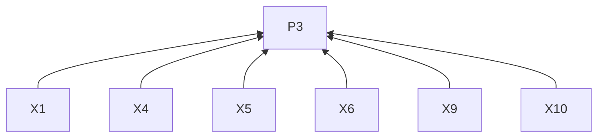
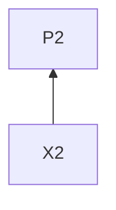
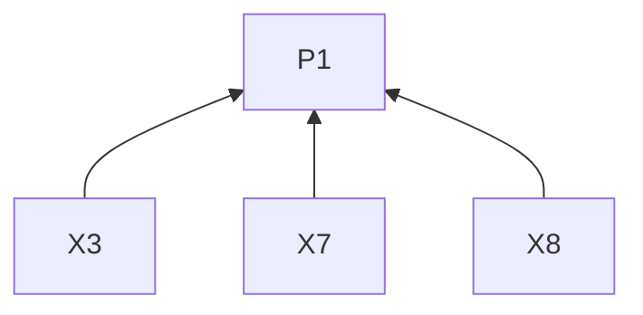
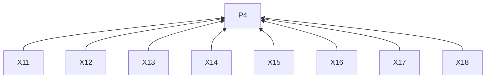
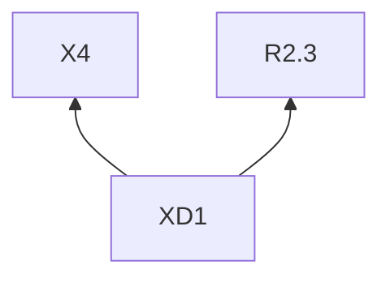

# X

## Reading guidance

This on-demand channel guide extends the [skill entry](../SKILL.md). G0 and P1–P4 are defined there; shared requirements have one definition in the entry. Channel identifiers mark L2 rules; examples are L3 practices. R4.5–R4.12 govern every remote delivery below.

## Rules (L2)

### Writing

**X1** When opening a post, must name the subject and lead with a concrete fact or claim about the selected development.
Basis: P3. Criterion: A standalone reader can identify what changed rather than a vague announcement.

**X2** When explaining a claim, must place its supporting observation, consequence or limiting condition beside it.
Basis: P2. Criterion: Important qualifications remain beside the claim; an actual number has its supplied basis, retained under R2.5.

**X3** When linking detail, must first give readers a reason to open it.
Basis: P1. Criterion: The post explains what the link adds.

**X4** When choosing format, must use one post for one self-contained development or a thread for connected observations or steps needed to explain it.
Basis: P3. Criterion: The chosen format fits the explanation and its evidence.

**X5** When writing a thread, must give its subject and reason to continue in the first post.
Basis: P3. Criterion: The opener identifies both.

**X6** When writing subsequent thread posts, must advance connected observations or steps.
Basis: P3. Criterion: Each subsequent post adds to the explanation.

**X7** When a thread post may be encountered separately, must retain context needed to understand it.
Basis: P1. Criterion: Its subject and relevance remain understandable alone.

**X8** When a thread reaches its result, must end the explanation.
Basis: P1. Criterion: Any question or invitation serves R3.6 rather than extending a completed explanation.

**X9** When the thought changes, must separate paragraphs.
Basis: P3. Criterion: Paragraph boundaries follow changes of thought.

**X10** When including a screenshot or demo, must describe its point and media content.
Basis: P3. Criterion: Readers know what the media demonstrates.

**X11** When reviewing under R4.1, must include the post’s attachments in that same preview.
Basis: P4. Criterion: The complete text and URLs in R4.1 are accompanied by the intended attachments.

**X12** When native media is required, must confirm the delivery method supports it.
Basis: P4. Criterion: The chosen method supports the required attachment.

**X13** Before delivery, must check the account and format's character limit and counting rules.
Basis: P4. Criterion: The final draft is checked using the applicable counting rules.

**X14** When previewing a thread, must show every post in order.
Basis: P4. Criterion: Approval covers the complete ordered thread.

### Delivery

**X15** When posting through the API, must use a user OAuth 2 token with `tweet.write` and required user scopes.
Basis: P4. Criterion: The token belongs to the approved user and has the required scopes.

**X16** Before approval, must check the current rate for the actual draft and show its estimated charge.
Basis: P4. Criterion: R4.1 uses a current estimate rather than the historical rates in the delivery note.

**X17** When recording delivery under R4.9, must retain the post URL or ID.
Basis: P4. Criterion: The receipt identifies the published post.

**X18** When checking uncertain delivery under R4.11, must inspect the account's posts.
Basis: P4. Criterion: The target account is checked before a retry decision.

## Delivery note

Historical record: rates checked on 3 November 2026 were USD 0.015 for an ordinary post and USD 0.200 for one containing a URL. This preserves the original record without revalidation; actual estimates follow X16.

## Practices (L3)

**XD1** Basis: X4, R2.3.

Misreading addressed: A thread is merely a longer single post, or a planned check is an observed improvement.

Illustrative input. A workshop exercise asks for a two-sentence summary. Its worksheet puts the task, answer format and submission instructions in one paragraph. The revision gives each a labelled block. A learner trial will check whether the submission step is easy to find.

A single post can report the change and the planned check.

> I split a workshop worksheet into task, answer format and submission blocks. They used to share one paragraph. In the learner trial, I’ll check whether people can find the submission step before asking for help.

A thread can explain what each block contributes.

> 1/ I split a workshop worksheet into three blocks. The original paragraph mixed what learners should do, what they should produce and where to submit it.
>
> 2/ The task block describes the exercise. The answer-format block asks for a two-sentence summary. The submission block gives the upload steps.
>
> 3/ The next learner trial will check whether the submission step is easy to find. The new layout is a proposal whose effect we still need to observe.

Choose the length that lets the reader understand the change and its evidence.

## Clause dependencies

## Sources

The specific opening and coherent thread draw on [social's X guidance at revision 88c79f6](https://github.com/coreyhaines31/marketingskills/blob/88c79f6528a9347420e57ceb1fff9a60de651768/skills/social/references/platforms.md#twitterx).

[X thread guidance](https://help.x.com/en/using-x/create-a-thread) · [Official documentation](https://docs.x.com/x-api/getting-started/pricing)
