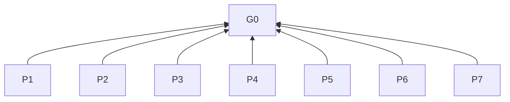

# Instruction Optimization

## Purpose (G0)

Make AI-facing instructions consistent, concise, and executable; preserve valid meaning and necessary boundaries through revision.

## Modes and reading guide

Levels: G0 purpose (L0), P principles (L1), R rules (L2), D practices (L3). Bases justify clauses; criteria test compliance.

Scope: R1. Preparation and modes: R2. Reference: R2.2.

## Overview

## Principles (L1)

**P1 Minimum sufficient instructions**: Prefer execution-relevant instructions to repetition, filler, basic-knowledge reminders, and unnecessary constraints. Basis: G0.

**P2 Executable meaning**: Prefer explicit actors, objects, conditions, actions, and outcomes to ambiguity. Basis: G0.

**P3 Scoped boundaries**: Keep domain rules, evidence requirements, permissions, and exceptions within scope. Basis: G0.

**P4 Outcome-oriented context**: Provide goals, audience, relevant context, constraint reasons, tradeoffs, and acceptance criteria for method choices. Basis: G0.

**P5 Context, not Control**: Prefer decision context and outcome requirements to prescribed steps, order, formats, or roles unless dependencies, interfaces, identified risks, or explicit user or higher-priority requirements justify them. Basis: G0.

**P6 Preserve valid content**: Preserve factual accuracy, complete meaning, useful information, and necessary behavioral boundaries through revision. Basis: G0.

**P7 Evidence-bounded conclusions**: Bound conclusions by textual, scenario, file/loading, or observed runtime evidence. Basis: G0.

## Rules (L2)

### R1 Scope

| Clause | Basis | Criterion |
| --- | --- | --- |
| **R1.1**: When a task designs, writes, optimizes, or reviews AI-facing instructions, prompts, skills, or model-execution rules, must apply this skill. | P3 | Includes embedded rules; imperative wording or steps alone do not qualify. |
| **R1.2**: When content explains, operates, or troubleshoots for readers, must route it to `sdlc-document-optimization`. | P3 | Mixed artifacts use both skills for their respective content; single-purpose tasks do not load both by default. |
| **R1.3**: When another skill is required, must discover it through the runtime catalog. | P3 | Load its registered name and namespace, or its entry and relevant resources at the discovered installation path. |
| **R1.4**: When a required skill or resource is unavailable, must report it and pause only dependent work. | P3 | Continue independent work without silently skipping rules or automatically installing dependencies. |
| **R1.5**: When working on an artifact, must follow its domain rules, format, and maintenance permissions. | P3 | Project- or knowledge-base-specific requirements stay within their scope. |

### R2 Preparation and modes

| Clause | Basis | Criterion |
| --- | --- | --- |
| **R2.1**: When starting, must establish scope, purpose, and applicable conventions. | P4 | Identify these before working on the artifact. |
| **R2.2**: When performing an in-scope task, must read [Prompt Design Guidelines](references/prompt-design.md). | P2 | All three modes use the reference. |
| **R2.3**: When selecting a mode, must use create for new artifacts, review only for review-only requests, and review and revise for existing-artifact changes. | P3 | Review-only requests leave targets unchanged. |

### Shared expression rules

| Clause | Basis | Criterion |
| --- | --- | --- |
| **R3.1**: When choosing terms, must prefer project or document definitions; otherwise use industry terminology. | P2 | Interpret original meaning rather than mechanically copying wording. |
| **R3.2**: When naming concepts, must use one standard term per concept and one concept per term. | P2 | Do not alternate synonyms for variety. |
| **R3.3**: When concepts affect understanding or definitions are ambiguous or conflicting, must clarify meaning, scope, and distinctions. | P2 | Intended meanings are distinguishable from alternatives and related concepts. |
| **R3.4**: When references or negation are ambiguous, must specify their scope. | P2 | No competing referent or negation scope changes required behavior. |
| **R3.5**: When describing causes, must distinguish possible from confirmed causes. | P7 | No possible cause is presented as confirmed. |
| **R3.6**: When organizing or compressing content, must preserve factual accuracy and complete meaning. | P6 | Logical relationships, necessary conditions, negation, explanations, and causality survive. |

### R4 Instruction design

| Clause | Basis | Criterion |
| --- | --- | --- |
| **R4.1**: When assessing prompts, must use reference D1. | P1, P2, P4 | No instruction per dimension is required; do not repeat requirements explicit in the task or context. |
| **R4.2**: When adding scenario guidance, must require an active scenario and a guidance gap. | P1, P3 | Both conditions in reference D2 hold for each addition. |
| **R4.3**: When instructions and data coexist, must distinguish them. | P3 | Specify evidence, permissions, and uncertainty handling only as required by the task. |
| **R4.4**: When assessing existing or proposed steps, order, formats, or roles, must identify their concrete task need. | P5 | Controls have P5 justification; none is invented merely to retain them. |
| **R4.5**: When context and acceptance criteria can replace unnecessary process controls, must replace them. | P5 | Address controls alongside wording without unnecessary scope expansion. |
| **R4.6**: When users or higher-priority instructions explicitly require current-task procedures, must preserve them. | P3, P5 | Procedures in the revision target remain subject to R4.4–R4.5. |

### R5 Creation, review, and maintenance

| Clause | Basis | Criterion |
| --- | --- | --- |
| **R5.1**: When creating, must write for goals, audience, and conventions using the reference. | P2, P4 | Before delivery, correct content and expression issues: completeness, explicit conditions and constraints, and related-document consistency. |
| **R5.2**: When reporting review findings, must give locations, problems, impacts, and revision suggestions. | P7 | Distinguish confirmed issues, matters needing confirmation, and unverified scope. |
| **R5.3**: When revising instructions, including this skill and its references, must use identified issues and revision goals. | P1, P6 | Leave useful content unchanged unless it needs revision. |
| **R5.4**: When organizing revisions, must choose units and order by scope, dependencies, and risk. | P5 | Related documents may change together for consistency; no fixed stage sequence is required. |
| **R5.5**: When adding requirements, must require an explicit task need, identifiable risk, or actual problem. | P1, P3 | Prioritize missing conditions and boundaries over formal completeness. |
| **R5.6**: When removing content, must establish that it is wrong, obsolete, unrelated, duplicated, or irrelevant to execution or outcomes. | P1, P6 | Evidence-backed removal is not loss; model knowledge alone never justifies removing necessary constraints. |
| **R5.7**: When merging rules, must require identical applicability and expected behavior. | P1, P6 | Distinct conditions, objects, or effects remain independently identifiable. |
| **R5.8**: When assessing retention, must keep content materially affecting correctness, evidence boundaries, permissions, or necessary exceptions. | P3, P6 | Remove repetition, filler, and basic-knowledge reminders without losing necessary information. |

### R6 Revision acceptance and reporting

| Clause | Basis | Criterion |
| --- | --- | --- |
| **R6.1**: When reviewing revisions, must compare improvements and regressions against originals. | P6 | Retain or restore useful information, necessary explanations, conditions, constraints, and behavioral boundaries; diffs support semantic judgment, not replace it. |
| **R6.2**: When finishing each revised document’s review, must show its comparison in a progress update. | P6, P7 | Use D3 for every document, including translations. |
| **R6.3**: When conflicts arise, must resolve them using goals, facts, and applicable constraints. | P3, P4, P6 | Check affected cross-document relationships. |
| **R6.4**: When an edit cannot meet R6.5, must restore affected content. | P6 | Report the unresolved issue and reason. |
| **R6.5**: When delivering, must require new artifacts to meet goals and conventions, and revisions to solve issues while retaining valid original content. | P1, P2, P4, P6 | No introduced omissions, ambiguity, contradictions, or redundancy. |
| **R6.6**: When closing, must briefly report outcome, unresolved issues, and verification limits. | P7 | Keep document comparisons in progress updates. |

### R7 Validation boundaries

| Clause | Basis | Criterion |
| --- | --- | --- |
| **R7.1**: When reviewing instructions, must use reference D4 to assess goals and necessary boundaries. | P4, P7 | Textual review and revision require no runtime environment. |
| **R7.2**: When wording leaves uncertainty, must walk through representative scenarios. | P5, P7 | Check removal of unnecessary controls while retaining necessary constraints and explicitly required procedures. |
| **R7.3**: When considering model execution or before-and-after model evaluation, must require explicit user request. | P3, P7 | Neither is a default completion requirement; R6.1 textual comparison remains required. |
| **R7.4**: When reporting verification, must distinguish textual findings, scenario inferences, file or loading checks, and observed runtime results. | P7 | Do not present inference as verified runtime behavior or generalize beyond evidence. |

## Practices (L3)

Design dimensions D1–D2 and checklist D4: [Prompt Design Guidelines](references/prompt-design.md).

**D3 Comparison format**. Basis: R6.1, R6.2.

For each material change: document and section; paired original/revised excerpts; practical effect on understanding or execution; explicit additions/deletions; important conditions’ retained locations or removal reasons; regressions and their resolution or status.
