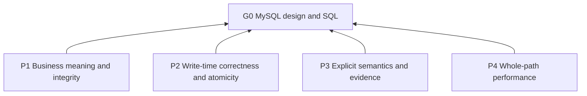

# MySQL Table and SQL Design

## Purpose (G0)

Help assistants design, write, modify, review, and optimize MySQL models and SQL while preserving business integrity, write correctness, and overall performance.

## Reading guide

`G0` is the purpose (L0); `P1`–`P4` are principles (L1); `R00a` and `R01a`–`R81c` are rules (L2). Each rule states its trigger, action, basis, and compliance criterion. Topic headings below group rules; they introduce no separate requirements. Letter suffixes identify atomic clauses within a topic entry.

Domain rules are in [MySQL design rules](references/mysql-design-rules.md). Examples are practices (L3), identified as `D01` onward in the [reference](references/mysql-design-examples.md). Their assumptions and SQL illustrate the cited rules rather than define additional global policy. R07b controls when to load them.

## Overview

## Principles (L1)

**P1 Business meaning and integrity**: Prefer designs that preserve declared business meaning and integrity. Basis: G0.

**P2 Write-time correctness and atomicity**: Prefer writes that enforce their conditions under concurrency and preserve required transaction boundaries. Basis: G0.

**P3 Explicit semantics and evidence**: Prefer explicit type, SQL, security, and version semantics and conclusions bounded by evidence. Basis: G0.

**P4 Whole-path performance**: Prefer fewer requests and lower whole-path cost while preserving correctness and workload requirements. Basis: G0.

## Rules (L2)

## Applicability

- **R01a** When the task or project establishes MySQL as the target database and concerns data modeling, table design, SQL, indexes, transactions, or concurrency control, apply this skill without requiring explicit invocation. Basis: P3. Criterion: Both the database and topic match.

- **R02a** When using this skill, do not require the SDLC workflow. Basis: P3. Criterion: Independent MySQL tasks remain supported.

- **R02b** When a database task is generic or concerns only other databases, do not select MySQL or apply this skill. Basis: P3. Criterion: No inferred MySQL target.

## Usage

- **R03a** When validating MySQL behavior, use official MySQL 8.4 semantics as the baseline without restricting the deployed version. Basis: P3. Criterion: The baseline does not become a deployment requirement.

- **R03b** When version differences matter, verify feature support, constraint enforcement, and deprecation in the actual target version. Basis: P3. Criterion: Version-sensitive conclusions identify target support.

- **R04a** When starting a task, establish the business meaning, integrity requirements, main access patterns, data scale and growth, concurrency, and consistency requirements relevant to it. Basis: P1, P3. Criterion: The task's design inputs are identified.

- **R04b** When existing designs or workload evidence are available, use them. Basis: P1, P3. Criterion: Decisions account for available evidence.

- **R04c** When key information is missing, state assumptions and their impact. Basis: P1, P3. Criterion: Missing inputs are not presented as known facts.

- **R05a** When applying transaction and concurrency rules, scope them to local InnoDB transactions. Basis: P3. Criterion: No atomicity claim extends beyond that scope.

- **R05b** When explaining the bans on transaction queries, `CHECK`, foreign-key constraints, or stored procedures, identify them as project conventions rather than MySQL limitations. Basis: P3. Criterion: Each ban is attributed to the project.

- **R06a** When reasoning under this skill, assume a record is modified at most once per millisecond. This does not establish a non-reused `updated_at` version; timestamp-based concurrency checks remain subject to R53a–R53c. See [timestamp checks](references/mysql-design-examples.md#timestamp-checks). Basis: P3, R53a, R53b, R53c. Criterion: The millisecond assumption is not used as proof of version safety.

- **R07a** When executing a task, apply only the rules relevant to it. Basis: P3. Criterion: Unrelated topics do not impose extra work.

- **R07b** When a rule needs clarification, read its topic in [MySQL design examples](references/mysql-design-examples.md); do not load all examples by default. Basis: P3. Criterion: Reference loading follows a specific rule/topic.

## Topic routing

- **R00a** When a task touches a topic below, read its section in [MySQL design rules](references/mysql-design-rules.md) before applying those rules. Basis: P3. Criterion: Every relevant topic is consulted; unrelated sections need not be loaded.

## Data modeling

[Read rules](references/mysql-design-rules.md#data-modeling).

### Entities, relationships, and field ownership

[Read rules](references/mysql-design-rules.md#entities-relationships-and-field-ownership).

## Table design

[Read rules](references/mysql-design-rules.md#table-design).

### Names and comments

[Read rules](references/mysql-design-rules.md#names-and-comments).

### Data types

[Read rules](references/mysql-design-rules.md#data-types).

### Keys and constraints

[Read rules](references/mysql-design-rules.md#keys-and-constraints).

### Character sets and collations

[Read rules](references/mysql-design-rules.md#character-sets-and-collations).

## SQL programming

[Read rules](references/mysql-design-rules.md#sql-programming).

### Queries

[Read rules](references/mysql-design-rules.md#queries).

### Data modification

[Read rules](references/mysql-design-rules.md#data-modification).

### Expressions and functions

[Read rules](references/mysql-design-rules.md#expressions-and-functions).

## Transactions and consistency

[Read rules](references/mysql-design-rules.md#transactions-and-consistency).

### Transaction management

[Read rules](references/mysql-design-rules.md#transaction-management).

### Concurrency control

[Read rules](references/mysql-design-rules.md#concurrency-control).

## Database security

[Read rules](references/mysql-design-rules.md#database-security).

## Performance optimization

[Read rules](references/mysql-design-rules.md#performance-optimization).

### Index optimization

[Read rules](references/mysql-design-rules.md#index-optimization).

### Query optimization

[Read rules](references/mysql-design-rules.md#query-optimization).

### Write optimization

[Read rules](references/mysql-design-rules.md#write-optimization).

### Execution plans and performance verification

[Read rules](references/mysql-design-rules.md#execution-plans-and-performance-verification).

#### Applicability and classification

[Read rules](references/mysql-design-rules.md#applicability-and-classification).

#### Verification method

[Read rules](references/mysql-design-rules.md#verification-method).

## Deliverables

- **R81a** When delivering the requested design, SQL, changes, or review findings, include business assumptions and reasons for consequential choices. Basis: P3. Criterion: Deliverables answer the task and explain decisions.

- **R81b** When correctness or performance questions remain unresolved, identify them. Basis: P3. Criterion: Open questions are visible.

- **R81c** When reporting checks, distinguish static analysis from executed checks. Basis: P3. Criterion: Evidence identifies which checks actually ran.
