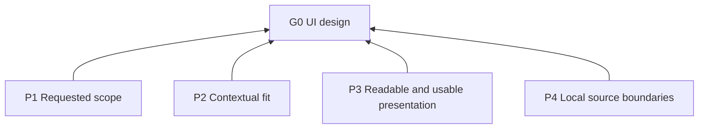

# UI Design

## Purpose (G0)

Provide context-fitted, readable, usable results for desktop, mobile, and web visual interface work and UI principle guidance. This skill is independent of the SDLC workflow and can be installed alone.

## Modes

Select from the request: principle guidance (R1.3), review (R1.4), design (R1.5, R3), implementation (R1.8–R1.13), or mixed work (R1.6–R1.7). Design delivery rules cover only the design portion of mixed work; implementation delivery and acceptance follow the task and existing project requirements.

## Reading and maintenance

L0 is purpose; L1 principles (P); L2 rules (R); L3 practices (D). `Basis` names dependencies; each rule’s required result is its criterion: compliant when that result holds under its trigger, violated otherwise. `may` denotes permission, not obligation. Platform references depend on this file’s principles; source notes retain adaptation context.

## Overview

## Principles (L1)

**P1 Requested scope**: Prefer the requested task mode and its authorized deliverables to unrequested expansion. Basis: G0.

**P2 Contextual fit**: Prefer decisions fitted to the product, platform, content, and explicit visual preferences to a universal style. Basis: G0.

**P3 Readable and usable presentation**: Preserve readable content, recognizable controls, and access to primary content and actions through visual changes. Basis: G0.

**P4 Local source boundaries**: Treat this skill’s English instructions as the maintained local adaptation; source consultation alone does not adopt upstream workflows, commands, toolchains, approval steps, style bans, or numeric defaults. Basis: G0.

## Rules (L2)

### Applicability

| ID | When | Required result (criterion) | Basis |
| --- | --- | --- | --- |
| R1.1 | Selecting this skill | must limit its application to requested desktop, mobile, or web visual interface work and UI principle guidance. Backend-only, database-only, and other nonvisual tasks are excluded. | P1 |
| R1.2 | Information organization, interaction behavior, or recovery is also involved | must use available UX guidance, such as `sdlc-ux-design`, for those decisions. | P1 |
| R1.3 | Only principle guidance is requested | must answer briefly at that level. No unrequested product-specific design, implementation, or acceptance testing. | P1 |
| R1.4 | The request is review-only | must report findings and recommendations without creating a design or changing implementation. | P1 |
| R1.5 | The request is design exploration, proposals, concept comparison, or prototype validation | must confine changes to standalone design artifacts. Production code changes require a request that includes implementation. | P1 |
| R1.6 | The request combines design and implementation | must deliver design before continuing with authorized implementation. | P1 |
| R1.7 | Assessing a mixed request | must deliver and assess design and implementation separately. Prototype validation is not implementation acceptance. | P1 |
| R1.8 | Implementing | must follow existing project checks. | P1 |
| R1.9 | During implementation, the current environment supports reproducing a defect | must use a focused recheck of that defect. | P1 |
| R1.10 | Selecting checks for other behavior changes | must base the selection on risk and scope. | P1 |
| R1.11 | Planning implementation verification | must not add verification environments, formal verification reports, or duplicate checks solely to satisfy this skill. | P1 |
| R1.12 | Reporting implementation results | must report checks performed, observations, and unverified scope. | P1 |
| R1.13 | Reporting implementation evidence or assessment | must distinguish runtime evidence, code-based inference, and subjective judgment. Model self-assessment is not presented as user acceptance. | P1 |

### Read on demand

| ID | When | Required result (criterion) | Basis |
| --- | --- | --- | --- |
| R2.1 | A concrete task has a known target platform | must read its platform reference using D1 and any additional references triggered by that document’s usage conditions. | P2 |
| R2.2 | The platform is unspecified | must infer it from task and project context first. Clarification is requested only if a concrete task still lacks a necessary platform decision. | P2 |
| R2.3 | Giving general advice | must use only shared principles. | P2 |
| R2.4 | An adaptation’s context or limits affect a decision | must consult its linked entry in [source context](references/sources.md) and the original passage when assumptions, exceptions, numbers, or adaptation details require it. If a passage is unavailable, identify unverified conclusions rather than invent missing details. | P4 |

### Design delivery

| ID | When | Required result (criterion) | Basis |
| --- | --- | --- | --- |
| R3.1 | Delivering requested visual exploration, proposals, concept comparison, or prototype validation, at any change size | must present UI proposals through image generation first, using a single-page HTML artifact if generation is unavailable or fails. Existing screenshots may serve as references. [Source context](references/sources.md#design-proposal-format). | P1 |
| R3.2 | Delivering combined UI/UX design | must provide a UI design image and an interactive UX HTML prototype. When R3.1 uses the HTML fallback, one HTML artifact serves both. | P1 |
| R3.3 | Creating HTML design artifacts | must default to inline CSS and JavaScript so they open directly. | P1 |
| R3.4 | Demonstrating interactions in HTML artifacts | must use local state and clearly identified illustrative data within the agreed interaction scope. | P1 |
| R3.5 | Producing a design artifact | must inspect its rendered result at the intended viewport using actual content if available; otherwise use clearly identified representative content. [Source context](references/sources.md#rendered-design). | P3 |
| R3.6 | Delivering design artifacts | must lead with images, previews, and openable files. Accompanying prose is brief and limited to opening instructions, simulation scope, and necessary limitations. | P1 |

### Applying the principles

| ID | When | Required result (criterion) | Basis |
| --- | --- | --- | --- |
| R4.1 | Applying shared or platform rules | must select those relevant to the requested work, target platform, and scenario. | P2 |
| R4.2 | Making a recommendation | must explain conditions and tradeoffs that affect it. No particular visual style is prescribed universally. | P2 |
| R4.3 | Citing a numeric requirement or recommendation | must verify its source, units, and target-platform applicability first. | P4 |

### Shared principles

#### Design principles

##### [Entry points and affordances](references/sources.md#entry-points-and-affordances)

| ID | When | Required result (criterion) | Basis |
| --- | --- | --- | --- |
| R5.1 | designing primary entry points | must make them visually recognizable. | P3 |
| R5.2 | designing a control | must communicate its use and action meaning through appearance, label, and placement. | P3 |

##### [Consistency and style](references/sources.md#consistency-and-style)

| ID | When | Required result (criterion) | Basis |
| --- | --- | --- | --- |
| R5.3 | choosing icons, components, and decoration | must align them with product purpose and existing design conventions. | P2 |
| R5.4 | adding decoration | must preserve content readability and action usability. | P2 |
| R5.5 | choosing a visual style | must fit product type, intended audience, usage context, and stated visual preferences. | P2 |

##### [Visual design system](references/sources.md#visual-design-system)

| ID | When | Required result (criterion) | Basis |
| --- | --- | --- | --- |
| R5.6 | applying visual rules to a page | must default to product-wide rules, with explicit page-level exceptions taking precedence on that page. The override applies only to that page’s visual rules, not unrelated product, accessibility, or authorization constraints. | P2 |
| R5.7 | organizing reusable design values and patterns | must organize them by semantic role. | P2 |
| R5.8 | extracting shared definitions | must base extraction on established repeated needs. | P2 |
| R5.9 | deciding reuse boundaries | must preserve distinctions in intent. | P2 |

##### [Aesthetic direction](references/sources.md#aesthetic-direction)

| ID | When | Required result (criterion) | Basis |
| --- | --- | --- | --- |
| R5.10 | explicit user aesthetic choices conflict with this skill’s stylistic preferences | must follow the user’s choices. | P2 |

##### [Presentation concept](references/sources.md#presentation-concept)

| ID | When | Required result (criterion) | Basis |
| --- | --- | --- | --- |
| R5.11 | designing a presentation page | must ground its visual concept in characteristics specific to its subject. | P2 |

##### [Content fit](references/sources.md#content-fit)

| ID | When | Required result (criterion) | Basis |
| --- | --- | --- | --- |
| R5.12 | choosing a layout | must accommodate actual content form, length, and quantity. | P3 |
| R5.13 | a structure cannot hold required content | must adapt the structure while preserving facts and necessary information. | P3 |

##### [Available media](references/sources.md#available-media)

| ID | When | Required result (criterion) | Basis |
| --- | --- | --- | --- |
| R5.14 | a visual approach depends on media | must base it on assets that exist or can actually be obtained. If required assets are unavailable, the composition remains feasible with obtainable assets. | P2 |

##### Typography

| ID | When | Required result (criterion) | Basis |
| --- | --- | --- | --- |
| R5.15 | styling text | must choose fonts, sizes, and line spacing for reading conditions. | P3 |
| R5.16 | establishing text hierarchy | must use size and weight. | P3 |
| R5.17 | displaying body and supporting text, including enlarged text | must keep it readable without clipping or hiding necessary content or controls. | P3 |

##### [Target languages](references/sources.md#target-languages)

| ID | When | Required result (criterion) | Basis |
| --- | --- | --- | --- |
| R5.18 | laying out supported languages and writing systems | must accommodate text expansion, reading direction, and script-specific shaping. | P3 |

##### [Layout and spacing](references/sources.md#layout-and-spacing)

| ID | When | Required result (criterion) | Basis |
| --- | --- | --- | --- |
| R5.19 | positioning and grouping elements | must express importance and relationships. | P3 |
| R5.20 | applying alignment and spacing | must use them consistently. | P3 |
| R5.21 | choosing density | must match reading, comparison, and operation needs. | P3 |
| R5.22 | assigning visual emphasis | must avoid competing emphasis. | P3 |
| R5.23 | choosing layout structure | must use available interface or container space. | P3 |
| R5.24 | available space changes | must reorganize content as needed to keep primary content and actions accessible. | P3 |

##### [Color, states, and focus](references/sources.md#color-states-and-focus)

| ID | When | Required result (criterion) | Basis |
| --- | --- | --- | --- |
| R5.25 | defining interface colors | must define and consistently use primary, supporting, and status colors. | P3 |
| R5.26 | rendering text, controls, and states | must ensure adequate contrast for text, controls, and states, making them distinguishable in their reading and usage conditions. | P3 |
| R5.27 | color conveys information | must supplement it with text or shapes. | P3 |
| R5.28 | rendering control states and focus | must make them visually identifiable. | P3 |
| R5.29 | a product supports an appearance | must verify text and control readability and state distinctions in that appearance. | P3 |
| R5.30 | the target platform exposes high-contrast preferences | must honor them in the rendered interface. | P3 |

##### Interaction targets

| ID | When | Required result (criterion) | Basis |
| --- | --- | --- | --- |
| R5.31 | sizing and spacing interaction targets | must account for mouse, touch, or other target input methods. Targets are easy to select without accidental adjacent activation. | P3 |

##### [Data encoding](references/sources.md#data-encoding)

| ID | When | Required result (criterion) | Basis |
| --- | --- | --- | --- |
| R5.32 | presenting data graphically | must choose encodings suited to the relationships users need to understand. | P3 |
| R5.33 | graphical data has applicable units and scales | must make them clear. | P3 |

##### [Motion purpose](references/sources.md#motion-purpose)

| ID | When | Required result (criterion) | Basis |
| --- | --- | --- | --- |
| R5.34 | adding motion to task-oriented or reading surfaces | must use it for feedback, state changes, or continuity. | P3 |
| R5.35 | motion explains a change | must make cause and effect understandable. | P3 |
| R5.36 | Choosing motion on persuasive or experiential surfaces | may use motion for a clear expressive purpose in its own right. | P3 |
| R5.37 | a user enables a reduced-motion preference supported by the target environment | must honor it. | P3 |
| R5.38 | reducing or replacing motion | must preserve readable content and understandable necessary state changes. | P3 |
| R5.39 | nonessential motion runs | must not block input. | P3 |
| R5.40 | an interaction supports switching or cancellation | must make its animation interruptible and transition to the latest interaction state. Interrupting animation does not itself cancel a background operation. | P3 |

## Practices (L3)

**D1 Platform routing**. Basis: R2.1, P2.

| Target | Read |
| --- | --- |
| Desktop | [Desktop principles](references/desktop.md) |
| Mobile | [Mobile principles](references/mobile.md) |
| Web | [Web principles](references/web.md) |
| Mobile web | Mobile and web references |
