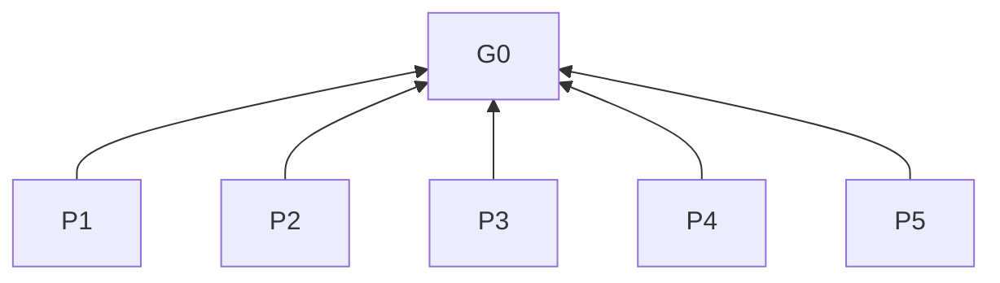

# UX Design

## Purpose (G0)

Support requested desktop, mobile, and web product task experiences so users can understand, complete, and recover their tasks.

This skill works independently of the SDLC workflow and can be installed alone.

## Structure and reading

Levels: G0 purpose (L0), P principles (L1), R rules (L2). Each row means “When triggered, must follow the requirement”; criteria test compliance. Bases point upward; diagram arrows mean dependency. Select scope before references. Implementation delivery/acceptance follows task and existing project requirements.

## Principles (L1)

**P1** Requested scope before workflow expansion. Basis: G0.

**P2** Task outcomes before interface simplification. Basis: G0.

**P3** Understandable actions and recoverable task progress. Basis: G0.

**P4** Accessible operation based on actual input capabilities. Basis: G0.

**P5** Factual evidence before unsupported claims. Basis: G0.

## Applicability

| Clause | When | Requirement | Criterion | Basis |
| --- | --- | --- | --- | --- |
| **R1.1** | Selecting scope | Apply to requested desktop/mobile/web product task experience design, implementation, modification, review, optimization, or principle guidance. | Exclude backend-only, database-only, and other work without user-facing interaction. | P1 |
| **R1.2** | Visual work also requested | Use available UI guidance, such as `sdlc-ui-design`, for visual hierarchy, typography, color, layout, control geometry, and motion. | Listed visual decisions covered. | P1 |
| **R1.3** | Principle guidance only | Answer briefly at principle level. | No product-specific design, implementation, or acceptance testing. | P1 |
| **R1.4** | Review only | Report findings and recommendations. | No new design or implementation changes. | P1 |
| **R1.5** | Design exploration, proposals, concept comparison, or prototype validation requested | Create/modify standalone design artifacts only. | Changes confined to design artifacts. | P1 |
| **R1.6** | Mixed design/implementation request | Deliver design before continuing authorized implementation. | Design delivered first. | P1 |
| **R1.7** | Mixed design/implementation request | Deliver and assess each separately. | Prototype validation is not implementation acceptance. | P1 |
| **R1.8** | Implementing | Follow existing project checks. | Project checks followed. | P1 |
| **R1.9** | Current environment supports defect reproduction | Use a focused defect recheck. | Reproduced defect rechecked. | P1 |
| **R1.10** | Checking other behavior changes | Select checks by risk and scope. | Affected behavior and risk covered. | P1 |
| **R1.11** | Implementing | Do not add verification environments, formal verification reports, or duplicate checks solely for this skill. | No skill-only verification work. | P1 |
| **R1.12** | Reporting implementation | Report performed checks, observations, and unverified scope. | All three reported. | P5 |
| **R1.13** | Reporting implementation | Distinguish runtime evidence, code-based inference, and subjective judgment. | Evidence types distinguishable. | P5 |
| **R1.14** | Reporting implementation | Do not equate model self-assessment with user acceptance. | No self-assessment acceptance claim. | P5 |
| **R1.15** | Changing production code | Require implementation in the request. | Implementation authorized. | P1 |

## Read on demand

| Clause | When | Requirement | Criterion | Basis |
| --- | --- | --- | --- | --- |
| **R2.1** | Applying this skill | Read/apply relevant [shared rules](references/shared.md) sections for the work, platform, and scenario. | No unrelated requirements imposed. | P1 |
| **R2.2** | Desktop target | Read [desktop principles](references/desktop.md). | Select by OS, input, window usage. | P1 |
| **R2.3** | Mobile target | Read [mobile principles](references/mobile.md). | Select by device, OS, grip. | P1 |
| **R2.4** | Web target | Read [web principles](references/web.md). | Select by browser usage. | P1 |
| **R2.5** | Combined platform contexts | For mobile web, read mobile and web; otherwise follow selected references’ additional-loading conditions. | All triggered references loaded. | P1 |
| **R2.6** | Platform unspecified | Infer from task/project context first. | Context consulted first. | P1 |
| **R2.7** | General advice with unspecified platform | Use shared principles only. | No platform decision required. | P1 |
| **R2.8** | Platform unspecified | Clarify only if a concrete task still needs a platform decision. | Missing decision blocks concrete task. | P1 |
| **R2.9** | Adaptation context/limits affect decisions | Consult linked [source context](references/sources.md); consult the original for unresolved assumptions, exceptions, numbers, or adaptation details. | Verify unresolved details or mark unverified. | P5 |
| **R2.10** | Consulting sources | English skill instructions govern the local adaptation. | No imported upstream workflows/toolchains, commands, approvals, style bans, or numeric defaults. | P5 |
| **R2.11** | Recommending | Explain recommendation-affecting conditions and tradeoffs. | Conditions/tradeoffs stated. | P1 |
| **R2.12** | Before numeric recommendations/requirements | Verify source, units, and target-platform applicability. | All three verified before citation. | P5 |

## Design delivery

This section applies only to requested interaction exploration, proposals, concept comparison, or prototype validation, at any change size. “Design task” below means this scope. In mixed requests, apply it only to the design portion.

| Clause | When | Requirement | Criterion | Basis |
| --- | --- | --- | --- | --- |
| **R3.1** | Design task | Present interactive single-page HTML. [Source context](references/sources.md#interactive-prototype) | Interactive HTML delivered. | P1 |
| **R3.2** | Design task | Make main prototype actions operable. | Main controls perform intended actions. | P1 |
| **R3.3** | Design task | Demonstrate relevant state changes. | Controls/feedback distinguish states. | P1 |
| **R3.4** | Design task | Make necessary return/recovery paths operable. | Paths reach intended states. | P1 |
| **R3.5** | Building HTML | Default to inline CSS/JavaScript for direct opening. | Default artifact opens directly. | P1 |
| **R3.6** | Building HTML | Demonstrate agreed interaction scope with local state. | Agreed scope demonstrated locally. | P1 |
| **R3.7** | Combined UI/UX design | Use image generation first for UI proposals. [Source context](references/sources.md#combined-design-format) | Image-first unless unavailable/failed. | P1 |
| **R3.8** | Combined UI/UX design | Provide interactive UX HTML. | Interactive prototype provided. | P1 |
| **R3.9** | Checking prototypes | Inspect rendered output at the intended viewport. [Source context](references/sources.md#rendered-prototype) | Target rendering inspected. | P1 |
| **R3.10** | Checking prototypes | Use actual content; if unavailable, clearly labeled representative content. | Content actual or labeled representative. | P1 |
| **R3.11** | Delivering design | Lead with interactive preview and openable HTML file. | Preview/file lead delivery. | P1 |
| **R3.12** | Delivering design | Keep prose brief: opening instructions, simulation scope, necessary limitations only. | Only listed explanation types. | P1 |
| **R3.13** | Checking prototypes | Check controls/feedback demonstrate intended operation and distinguish relevant states. | Operation/state feedback checked. | P1 |
| **R3.14** | UI image generation unavailable/failed | Use one HTML artifact for UI and UX. | One HTML covers both. | P1 |

## Shared principles

Under R2.1, read the relevant sections of [shared rules](references/shared.md) for the requested work, platform, and scenario; R4–R8 are this section’s execution clauses.
