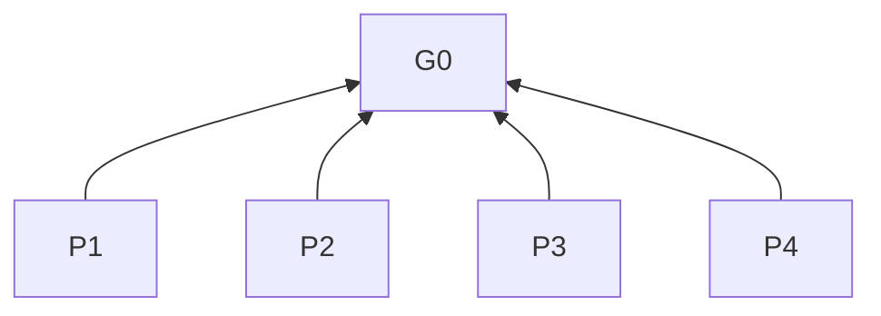

# SDLC Workflow

## Purpose (G0)

Deliver requested SDLC work, initialization, and knowledge-base maintenance.

## Reading guide

### Applicability

Conversational answers = chat responses; deliverables = code/documents/other artifacts. Rules govern named objects during execution. `P` = principle; `R` = rule; brackets = bases; `Check` = criterion.

## Principles

- **P1 Scope and authorization** [G0]: Respect task scope, authorization, and user decisions.
- **P2 Reuse** [G0]: Retain applicable work and information.
- **P3 Delivery quality** [G0]: Prioritize correctness, completeness, and maintainability.
- **P4 Communication** [G0]: Preserve meaning through standard terms and reader-oriented explanations.



## Workflow and capabilities

- **R1 Activation** [P1]: Without explicit invocation, do not execute. Check: named user invocation.
- **R2 Prerequisites** [P1, P2]: When invoked, derive stages from the goal; complete missing or revise inapplicable prerequisites in requirements → technical design → implementation order within scope. Check: single invocation.
- **R3 Reuse** [P2]: When contextual/existing requirements/designs/decisions support subsequent work, reuse them. Check: no repetition for missing standalone documents.
- **R4 Stage boundary** [P1]: When prerequisites hold, complete the requested stage without stage-by-stage confirmation or automatic later stages. Check: stage complete.
- **R5 Blocked decisions** [P1]: When critical ambiguity arises, use stage clarification; when major tradeoffs arise, use R14. Check: pause only affected work.
- **R6 Optional capabilities** [P1]: Without explicit requests, do not start project initialization or dedicated knowledge-base review. Check: neither stage entry nor routine reading/updates triggers them.
- **R7 Stage references** [P3]: When performing activities below, follow their references. Check: references read.

| Activity | Reference |
| --- | --- |
| Intent → requirements | [Requirements](references/intent-to-requirements.md) |
| Technical design | [Technical design](references/requirements-to-technical-design.md) |
| Implementation | [Implementation requirements](references/implementation.md) |
| Explicit initialization | [Project initialization](references/project-initialization.md): goals/scope → knowledge base → minimal verifiable engineering skeleton |
| Explicit knowledge-base review | [Knowledge-base review](references/project-knowledge-base-review.md) |

## General rules

### Conversational answers

- **R8 Terminology** [P4]: When answering, use project/document terms, otherwise standard industry terms; use one term per concept and one concept per term. Check: clarify ambiguous meanings/boundaries/conflicting definitions; explain unfamiliar terms as needed.
- **R9 Meaning** [P4]: When expressing intent, specify necessary actors, objects, prerequisites, constraints, and outcomes in standard terms. Check: references and negation scope unambiguous.
- **R10 Explanation** [P4]: When explaining, build from reader knowledge in causal order: why/how/result. Check: bridge logical gaps with necessary background, plain language, and examples as needed.
- **R11 Fidelity** [P2, P4]: When answering, preserve facts, complete meaning, tradeoffs, uncertainty, and already-clear accurate wording; remove filler/repetition. Check: distinguish possible from confirmed causes.

Document/instruction artifacts use R16.

### Delivery quality

- **R12 Solution** [P3]: When choosing a solution, decide directly using P3. Check: choice follows P3.
- **R13 Revision** [P2]: When revising deliverables, change incrementally. Check: valid structure/information retained.
- **R13a Non-documents** [P3]: When revising non-document artifacts, correct in-scope errors, replace obsolete/conflicting/superseded parts, and remove duplicate/unrelated content. Check: scope excludes documents/instructions; use R16 for those.
- **R14 Decisions** [P1]: When necessary structure/responsibility-boundary changes are authorized, proceed; ask only for decisions exceeding authorization, changing requirements, or involving major tradeoffs requiring user judgment. Check: no redundant authorization requests.
- **R15 Cleanup** [P2, P3]: When trial/error, misunderstandings, corrections, rollbacks, or abandoned approaches leave ineffective code/documents/configuration/tests, remove them. Check: retain necessary history and verification evidence.

## Skill dependencies

- **R16 Artifact routing** [P3]: When designing/writing/modifying/reviewing artifacts, load `sdlc-document-optimization` for reader-facing documents; `sdlc-instruction-optimization` for instructions, prompts, skills, and model-execution rules. Check: mixed artifacts apply both to respective content; single-purpose tasks load only the required skill.
- **R17 Resolution** [P3]: When loading dependencies, resolve registered names/namespaces through the runtime catalog/skill mechanism; without a loader, read installed entries/relevant resources. Check: locations discovered; no assumed checkout path, user directory, or namespace.
- **R18 Missing dependency** [P1, P3]: When required skills/resources cannot load, identify them; pause only dependent work. Check: continue independent work; no claimed application, silent skipping, or automatic download/install.
- **R19 Installation** [P1, P3]: When dependencies are required, explain that the full Solo Vibe Coding plugin includes them; give this minimum CLI guidance. Check: no execution without authorization.

```sh
npx skills add jmaxzh/solo-vibe-coding --skill sdlc-workflow --skill sdlc-document-optimization --skill sdlc-instruction-optimization
```

- **R20 Other skills** [P1]: When the suite is installed, retain UI, MySQL, and CC Connect skills' applicability/activation rules. Check: no blanket activation.

## Read on demand

- **R21 Operational answers** [P4]: When operational/troubleshooting guidance is needed, locate installed `sdlc-document-optimization` resources under R17; read only the relevant Operating instructions or Troubleshooting instructions section of `references/document-design.md`. Check: no main workflow/full documentation rules.
- **R22 Knowledge-base location** [P1]: When knowledge-base reading is needed, use the user-designated base; during initialization determine its location under initialization rules, otherwise ask if unspecified. Check: read throughout only as needed.
- **R23 Knowledge-base conventions** [P1, P3]: When using a knowledge base, read [project knowledge-base conventions](references/project-knowledge-base.md); apply rules for the activity. Check: protected documents require specific confirmation.
