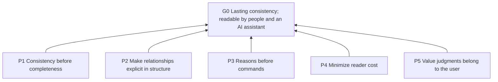
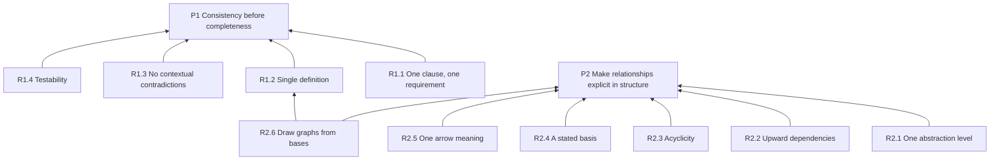
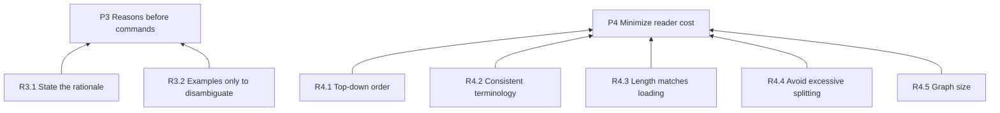
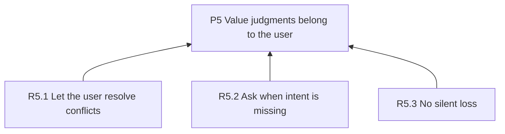
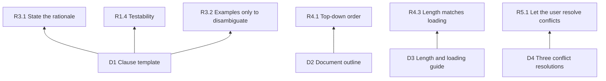
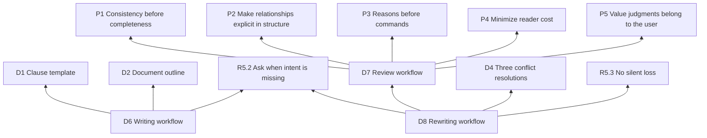

# Structuring Instruction Docs

## Invocation policy

All agents may load and execute this skill only when the user explicitly invokes structuring-instruction-docs. Task relevance, another skill's recommendation or reference, and an agent's own judgment do not authorize activation. Mentioning the skill as the subject of a review or edit is not an invocation.

## Purpose (G0)

Keep instruction documents consistent through long-term revision and readable by both people and an AI assistant.

## How to read and modify

A clause is an individually referable requirement or practice. Its identifier, such as P1 or R1.1, lets other clauses refer to it without restating it. The four levels separate purpose from increasingly concrete guidance:

| Level | Name | Question answered | Typical form |
| --- | --- | --- | --- |
| L0 | Goal | For whom, and for what purpose? | 1–3 sentences |
| L1 | Principle | Which way should tradeoffs lean? | “Prefer X to Y” |
| L2 | Rule | In which situation must or must not something happen? | Testable imperative |
| L3 | Practice | How is it done? | Steps, templates, examples |

A dependency explains why one clause needs another: the supported clause points to its basis. Each numbered clause below the goal has a Basis line naming its bases and explaining how it serves them. In diagrams, each arrow points from a clause to one of its bases; Mermaid is the text format used to draw these diagrams.

- Read top down. Reading through the principles gives the purpose and the main tradeoffs.
- Graphs are drawn from the Basis lines; when they disagree, the clauses take precedence.
- After changing a clause, check its bases and the clauses that depend on it.

## Overview

Five principles directly serve this purpose:



## Principles (L1)

**P1 Consistency before completeness**: Prioritize removing duplication and resolving conflicts rather than retaining problematic clauses for completeness. Handle intent tradeoffs under R5.1 and R5.3. Basis: G0. Unresolved duplication and conflict undermine consistency through later revisions.

**P2 Make relationships explicit in structure**: Express relationships between clauses through structure, without making readers infer them. Basis: G0. Explicit relationships let people and the assistant understand and maintain the document.

**P3 Reasons before commands**: Every requirement should answer “why,” so an AI assistant can reason from that rationale in situations not explicitly covered. Basis: G0. Reasons help readers preserve intent when applying or revising instructions.

**P4 Minimize reader cost**: Minimize both human reading cost and the AI assistant’s context cost. Basis: G0. Lower reading and context costs make instructions easier to use over time.

**P5 Value judgments belong to the user**: The user decides tradeoffs and intent; the AI assistant does not decide on the user’s behalf. Basis: G0. Keeping intent with the user prevents revisions from drifting away from the document’s purpose.

## Rules (L2)

### Serving P1 and P2



**R1.1 One clause, one requirement**: Express only one requirement per clause.
Basis: P1. Separating independent requirements makes duplication and conflict easier to isolate.
Criterion: If two requirements can be complied with or violated independently, express them as separate clauses.

**R1.2 Single definition**: Define each requirement in one place; elsewhere, refer only to its identifier.
Basis: P1. One definition prevents repeated requirements from diverging during revision.
Criterion: No pair of clauses requires the same behavior in the same situation. When duplicates appear, keep the one at the more appropriate abstraction level.

**R1.3 No contextual contradictions**: Never impose opposite requirements in the same situation.
Basis: P1. Compatible conclusions prevent readers from receiving conflicting instructions.
Criterion: Enumerate triggering situations for each related pair of clauses: their situations do not overlap, or their conclusions agree.

**R1.4 Testability**: Give every L2 rule a criterion so others can independently judge compliance.
Basis: P1. Shared criteria let different reviewers detect the same consistency problems.
Criterion: After reading the criterion, a reader can decide “compliant” or “violated” without asking the author.

**R2.1 One abstraction level**: Assign each clause to exactly one of the four levels defined in “How to read and modify.”
Basis: P2. Separating levels makes the relationship between purpose and concrete guidance visible.
Criterion: L2 contains no value tradeoffs; L1 contains no concrete commands.

**R2.2 Upward dependencies**: Depend only on clauses at the same or a more abstract level.
Basis: P2. Keeping bases at the same or a more abstract level prevents implementation details from justifying principles.
Criterion: Every Basis points to the same or a higher level; no L1 depends on L2 and no L2 depends on L3.

**R2.3 Acyclicity**: Keep dependencies free of cycles: following bases must never lead back to the starting clause.
Basis: P2. A chain that returns to itself cannot explain why its clauses are needed.
Criterion: Following Basis lines never leads back to the starting clause. A cycle indicates mutual justification: lift out a shared reason or merge the clauses.

**R2.4 A stated basis**: Give every non-L0 clause at least one higher-level basis.
Basis: P2. A higher-level basis connects each clause to the purpose it serves.
Criterion: Every non-L0 clause has a Basis line naming at least one more abstract clause; it may also name clauses at the same level.

**R2.5 One arrow meaning**: Express relationships in Mermaid. Every arrow means “depends on” and points from a clause to its basis at the same or a more abstract level; do not invent notation.
Basis: P2. One arrow meaning makes relationships interpretable without guessing.
Criterion: Arrow semantics are consistent throughout each graph; do not draw conflicts or other relationships as edges.

**R2.6 Draw graphs from bases**: Draw graphs from the dependencies named in each clause’s Basis line. When graphs and clauses disagree, the clauses take precedence.
Basis: P2, R1.2. Drawing from one authoritative source prevents diagrams and clauses from defining competing relationships.
Criterion: Across the full set of graphs, every edge matches a dependency named in a Basis line, and every such dependency is shown. Individual graphs cover their corresponding parts.

### Serving P3 and P4



**R3.1 State the rationale**: Besides identifiers, include one sentence in the Basis line explaining why the clause follows from its higher-level clauses.
Basis: P3. Identifiers alone do not explain why a requirement serves its bases.
Criterion: The rationale answers: “What part of the higher-level clause would suffer if this clause were removed?”

**R3.2 Examples only to disambiguate**: Write examples only for clauses likely to be misread; add counterexamples when needed.
Basis: P3. Targeted examples clarify the intended reasoning without adding unrelated material.
Criterion: Every example addresses a plausible misreading of a specific clause.

**R4.1 Top-down order**: Arrange the document from higher to lower abstraction so readers can stop at major section boundaries and still understand the purpose and the levels introduced so far.
Basis: P4. Introducing the whole before details reduces backtracking to understand earlier sections.
Criterion: Understanding the purpose and each introduced level does not require reading later sections; necessary concepts are explained before use.

**R4.2 Consistent terminology**: Use one term for each concept throughout the document and explain it in one sentence on first use.
Basis: P4. Stable, explained terms reduce the effort needed to interpret clauses.
Criterion: No two terms refer to the same concept, no term refers to two concepts, and each necessary term is explained on first use.

**R4.3 Length matches loading**: The more persistently a document is loaded, the shorter it should be and the more universally its contents should apply.
Basis: P4. Repeatedly read material consumes context and attention across many tasks.
Criterion: Each document contains only material appropriate to its loading time. See D3 for practical guidance.

**R4.4 Avoid excessive splitting**: Recheck the hierarchy when one parent clause has too many children.
Basis: P4. Checking crowded groups helps readers follow the hierarchy without unnecessary nesting.
Criterion: Roughly seven children is a prompt to check for a missing intermediate level or children that are merely examples of the same rule. Split only when it improves readability, not to meet a count.

**R4.5 Graph size**: Use roughly 15 nodes as a prompt to check graph readability; split by L1 principle when doing so helps readers.
Basis: P4. Readable graphs reduce the effort needed to trace relationships.
Criterion: Labels and relationships are easy to follow at a normal reading size; node count alone does not establish readability.

### Serving P5



**R5.1 Let the user resolve conflicts**: When a conflict is found, present resolution options to the user rather than choosing a side.
Basis: P5. Choosing which intent prevails is a user tradeoff.
Criterion: The document contains no tradeoffs unconfirmed by the user.

**R5.2 Ask when intent is missing**: When a clause has no identifiable higher-level basis, ask the user about its intent instead of inventing a principle.
Basis: P5. Inventing a missing purpose would assign intent on the user’s behalf.
Criterion: Every added L1 principle can be traced to something the user said.

**R5.3 No silent loss**: During rewriting, give every intent in the old document a place in the new document, or explain its deletion in the change summary.
Basis: P5. Accounting for old intents makes changes to the user’s requirements visible.
Criterion: A complete “old location → new clause” mapping exists.

## Practices (L3)

### Templates and guides



**D1 Clause template**. Basis: R3.1, R1.4, R3.2. The template gives reasons, criteria, and optional clarifying examples a consistent place.

Use ordinary Markdown; identifiers are simply names in headings:

```markdown
**R2.1 Short title**: One imperative sentence.
Basis: Higher-level clause identifiers plus one sentence of rationale.
Criterion: What counts as compliance or violation.
Example: (Optional; only to disambiguate.)
```

**D2 Document outline**. Basis: R4.1. This outline introduces purpose and reading concepts before detailed guidance.

Use this order: purpose (L0) → reading guidance and level definitions → overview graph → principles (L1) → rules (L2) → practices (L3).

**D3 Length and loading guide**. Basis: R4.3. Choosing content by reading frequency keeps repeated context focused.

Organize content around when the assistant reads it and how often it is reused. Frontmatter is the YAML metadata at the start of a file. The `references/` directory holds supplementary documents read only when needed. Check the target assistant’s actual reading behavior before choosing where content belongs.

| Document | When the assistant reads it | Guidance |
| --- | --- | --- |
| CLAUDE.md / AGENTS.md | When applied as project instructions, their contents can accompany many tasks | Keep them short and broadly applicable; separate project facts from behavioral rules |
| SKILL.md | When the skill is invoked | Describe what the skill does and when to use it in the frontmatter description. Only when the user permits automatic invocation, favor slightly proactive selection; explicit-only restrictions take precedence. Around 500 body lines, check whether detailed practices belong in references/ |
| references/*.md | When the assistant needs the linked detail | State when to read each file in SKILL.md. Around 300 lines, consider a table of contents. Keep each file focused on one topic |

Line counts are prompts to inspect readability and retrieval, not limits or guarantees of quality. Split content only when doing so makes it easier to find and use.

**D4 Three conflict resolutions**. Basis: R5.1. Concrete alternatives let the user decide how conflicting requirements should be reconciled.

Ask the user to choose, from lightest to most substantial change:

1. Different situations: write triggering conditions into both clauses so the conflict disappears.
2. A priority exists: add a higher-level principle explaining the tradeoff; make both lower-level clauses depend on it.
3. A true contradiction: let the user decide which clause to keep and delete the other.

### Workflows



**D6 Writing workflow**. Basis: D1, D2, R5.2. The workflow combines the clause template and outline while checking missing intent with the user.

Start from scratch:

1. Clarify L0: who is the reader, and how should the AI assistant behave differently when successful?
2. Invite the user to share all ideas in any format.
3. Assign levels using R2.1, split using R1.1, and merge using R1.2.
4. Find a basis for each clause; ask under R5.2 when none can be found.
5. Produce the document using D1 and D2, and draw graphs using R2.5.
6. Self-review using D7.

**D7 Review workflow**. Basis: P1, P2, P3, P4, P5. Checking all rules exposes inconsistent, unclear, or unsupported requirements without deciding user tradeoffs.

Report only; do not modify the reviewed document.

Check the reviewed document clause by clause against every L2 rule in this document. Output the table below and a graph containing only dependencies that can be confirmed from the document. Report missing bases as findings rather than drawing guessed dependencies as existing ones. Use three severity levels:

- Blocking: violations of R1.3 or R2.3.
- Important: violations of R1.1, R1.2, R2.1, R2.2, or R2.4.
- Suggestion: violations of other rules.

| ID | Location | Rule violated | Severity | Explanation | Recommendation |
| --- | --- | --- | --- | --- | --- |

**D8 Rewriting workflow**. Basis: D7, D4, R5.3, R5.2. Review and user decisions guide restructuring while preserving old intents and checking missing ones.

Preserve intent while restructuring:

1. Run D7 on the old document as an internal working report.
2. Extract all clauses and build an “old location → new clause” mapping.
3. Split, merge, and reassign levels. Before filling in missing higher-level clauses, check R5.2 and ask the user when intent is missing.
4. When conflicts arise, ask the user to choose under D4.
5. Output the new document and a change summary: what was split, merged, deleted, and which higher-level clauses were added.
