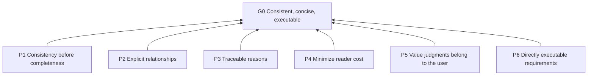

# Structuring Instruction Docs

## Purpose (G0)

Keep instruction documents consistent, concise, and executable through long-term revision; readable by people and assistants.

## Modes

- Write (D6): create a document from goals and requirements.
- Review (D7): report problems without modifying the document.
- Rewrite (D8): restructure an existing document while preserving its original intent.

When no mode is specified, see R5.4.

## Reading and modifying

- Clause: an individually referable requirement or practice; identifiers include P1 and R1.1.
- Basis: a clause names the identifiers of clauses it depends on; annotations may be standalone or inline.
- Range `Rx.a–Rx.b`: enumerate every clause in the range.
- Document rules constrain document text. Process rules constrain assistant behavior and are not applied during review: R2.8, R4.7, R5.1–R5.5.
- After changing a clause, recheck its bases and the clauses that depend on it.

| Level | Name | Question answered | Typical form |
| --- | --- | --- | --- |
| L0 | Purpose | For whom, and why? | 1–3 sentences |
| L1 | Principle | Which way should tradeoffs lean? | “Prefer X to Y” |
| L2 | Rule | When must or must not something happen? | Testable imperative |
| L3 | Practice | How is it done? | Steps, templates, examples |

## Overview



## Principles (L1)

**P1 Consistency before completeness**: Prefer internal consistency of the requirement set to its size. Basis: G0.

**P2 Explicit relationships**: Express relationships between clauses through structure, without making readers infer them. Basis: G0.

**P3 Traceable reasons**: Trace every requirement to a reason so assistants can reason about uncovered situations. Basis: G0.

**P4 Minimize reader cost**: Minimize both human reading cost and assistant context cost. Basis: G0.

**P5 Value judgments belong to the user**: The user decides tradeoffs and intent; the assistant does not decide on the user's behalf. Basis: G0. Unapproved tradeoffs change the document's purpose during revision.

**P6 Directly executable requirements**: Executors can act without asking follow-up questions. Basis: G0.

## Rules (L2)

### Consistency (P1)

**R1.1 One clause, one requirement**: Include only one requirement per clause.
Basis: P1. Combining requirements hides their separate conflicts.
Criterion: Two requirements can be complied with or violated independently → split them.

**R1.2 Single definition**: Define each requirement in one place; elsewhere, refer to its identifier.
Basis: P1. Repeated definitions diverge during revision.
Criterion: No two clauses require the same behavior in the same situation; for duplicates, keep the one at the more appropriate abstraction level.

**R1.3 No contextual contradictions**: Do not impose opposite requirements in the same situation.
Basis: P1.
Criterion: List triggering situations for each related pair of clauses; their situations do not overlap, or their conclusions agree.

**R1.4 Criteria for L2**: Attach a criterion to every L2 clause.
Basis: P1, P6. Reviewers need a shared basis for judging compliance.
Criterion: After reading the criterion, readers can decide “compliant” or “violated” without asking the author.

### Structure (P2)

**R2.1 One abstraction level**: Assign each clause to exactly one level.
Basis: P2.
Criterion: Classify the main statement using the level table; none is unclassified or spans levels. Reasons and criteria take their clause's level.

**R2.2 Upward bases**: Bases point only to clauses at the same or a more abstract level.
Basis: P2. Otherwise implementation details dictate the principles they serve.
Criterion: No L1→L2, L1→L3, or L2→L3 basis exists.

**R2.3 Acyclicity**: A basis chain must never return to its starting point.
Basis: P2. Circular justification has no independent reason.
Criterion: Following bases never returns to the starting point. A cycle → extract a shared reason or merge clauses.

**R2.4 Required basis**: Give every non-L0 clause at least one higher-level basis.
Basis: P2.
Criterion: Every non-L0 clause has a basis annotation containing at least one more abstract clause; it may also contain clauses at the same level.

**R2.5 Use Mermaid for relationships**: Draw relationship diagrams in Mermaid.
Basis: P2.
Criterion: Diagrams use Mermaid; no invented notation.

**R2.6 Arrows mean dependency only**: Arrows point from clauses to their bases.
Basis: P2.
Criterion: Every arrow means “depends on”; do not draw conflicts or other relationships as edges.

**R2.7 Draw diagrams from bases**: Take every diagram edge from a basis annotation.
Basis: P2, R1.2. Editing diagrams independently creates a second dependency definition.
Criterion: Every edge corresponds to a basis annotation; when they disagree, change the diagram, not the clauses.

**R2.8 Split clauses first**: When the target document lacks identifiers or bases, split it under R1.1 and assign temporary identifiers before review or rewriting.
Basis: P2.
Criterion: Every clause cited in the report has an identifier, original or temporary.

### Reasons (P3)

**R3.1 Explain unclear bases**: When readers cannot see the connection from a clause and its bases, add one sentence explaining why.
Basis: P3.
Criterion: After reading the clause and its bases, readers can explain why the bases support the clause without asking the author; otherwise, a reason sentence is required.

**R3.2 Reasons must add information**: Reasons state only consequences, tradeoffs, or application boundaries.
Basis: P3, P4.
Criterion: Every reason sentence contains a consequence, tradeoff, or boundary and does not restate the requirement.

**R3.3 Examples only for easily misread clauses**: Match examples to a specific misreading of a specific clause.
Basis: P3.
Criterion: Each example identifies the misreading it eliminates.
Example: R6.2 can be misread as “any vague word is a violation.” Counterexample: “Compress context when necessary” violates it; “Compress context when it exceeds 8k tokens” complies.

### Cost (P4)

**R4.1 Telegraphic wording**: Remove filler, politeness, redundant modifiers, and repeated sentences.
Basis: P4.
Criterion: Try deleting each word; a word whose removal leaves meaning unchanged → violation.

**R4.2 Omit default assistant behavior**: Do not document behavior the assistant would perform without instructions.
Basis: P4. Writing it only consumes context.
Criterion: Removing the clause leaves assistant behavior unchanged → violation.

**R4.3 Top-down order**: Put higher abstraction levels first.
Basis: P4.
Criterion: At any section boundary, readers can understand the purpose of what they have read and the levels introduced without reading later sections.

**R4.4 One term, one meaning**: Use one term per concept and one concept per term.
Basis: P4.
Criterion: No two terms refer to the same concept; no term refers to two concepts.

**R4.5 Define custom terms on first use**: Define each nonstandard term in one sentence where it first appears.
Basis: P4.
Criterion: Every nonstandard term has a definition at its first occurrence.

**R4.6 Include only triggerable clauses**: The triggering situations of L2 and L3 clauses must be possible when their document is loaded.
Basis: P4. Irrelevant clauses in persistent documents consume context on every task.
Criterion: A clause's trigger cannot occur in any situation where the document is loaded → violation.

**R4.7 Output language**: Write the output body in the user's specified language; otherwise, use the language of the user's request.
Basis: P4.
Criterion: The body uses one language, except for original quotations, identifiers, and Mermaid syntax.

### Executability (P6)

**R6.1 Trigger–action form**: Write every L2 clause as “When X, must/must not Y.”
Basis: P6.
Criterion: X and Y are observable events or states.

**R6.2 No vague words without criteria**: Do not use words such as “appropriate,” “try to,” “reasonable,” “high-quality,” “when necessary,” or “etc.”
Basis: P6.
Criterion: The clause contains no such words, unless the same sentence gives an observable standard.

### User decisions (P5)

**R5.1 Let the user resolve conflicts**: When a conflict is found, list options (see D5), wait for the user's choice, and do not decide independently.
Basis: P5.
Criterion: Every tradeoff in the document has an explicit user choice in the conversation.

**R5.2 Ask when intent is missing**: When a clause has no identifiable higher-level basis, ask the user's intent; do not invent principles.
Basis: P5.
Criterion: Every added L1 clause can be traced to the user's own words.

**R5.3 No silent loss**: During rewriting, give every intent in the old document a place in the new document, or explain its deletion in the change summary.
Basis: P5. A cleaner structure can conceal lost requirements.
Criterion: A complete “old location → new clause” mapping exists.

**R5.4 Read-only by default**: When the user specifies no mode and does not explicitly authorize editing, use review mode.
Basis: P5. Unauthorized edits exceed user intent.
Criterion: The target document is unchanged in this situation.

**R5.5 Explicit invocation only**: Execute this skill only when the user explicitly invokes it by name.
Basis: P5.
Criterion: No named invocation → no execution. Another skill's recommendation, task relevance, the assistant's own judgment, or mentioning this skill only as the subject of review or editing does not count as invocation.

## Practices (L3)

**D1 Clause template**. Basis: R1.4, R3.1, R3.3, R6.1.

```markdown
**R2.1 Title**: When X, must/must not Y.
Basis: Higher-level clause identifiers; add one reason sentence when the connection is unclear.
Criterion: How to judge compliance or violation.
Example: (Optional; only to eliminate misreading.)
```

**D2 Document outline**. Basis: R4.3.

Order: purpose (L0) → mode selection (for multiple modes) → reading guidance and level definitions → overview diagram → principles (L1) → rules (L2) → practices (L3).

**D3 Threshold prompts**. Basis: P4.

Heuristics, not limits; when exceeded, check readability before deciding whether to split.

- A parent clause has >7 children: check for a missing intermediate level or children that are examples of the same rule.
- A diagram has >15 nodes: split by L1.
- SKILL.md body has >500 lines: move details to references/ and state when to read them in the body.
- A references file has >300 lines: add a table of contents.
- Before writing, confirm how the target assistant actually loads the file.

**D4 Compact persistent documents**. Basis: P4, R2.4.

Applies to persistent files such as CLAUDE.md and AGENTS.md.

- Keep only L2 clauses, with inline bases: `R2.1 When X, must Y. [P2] Criterion: …`
- Put L0, L1, diagrams, and reasons in on-demand files (such as docs/ or references/); leave a one-line pointer in the persistent file: `When modifying clauses in this document, first read <path>.`
- Separate project facts from behavioral rules.

**D5 Three conflict resolutions**. Basis: R5.1.

From lightest to most substantial change, for the user to choose:

1. Different situations: add each clause's triggering conditions so the conflict disappears.
2. A priority exists: add a higher-level principle explaining the tradeoff; both clauses depend on it.
3. A true contradiction: the user chooses one clause to keep and deletes the other.

**D6 Writing workflow**. Basis: D1, D2, D7, R1.1, R1.2, R2.1, R5.2.

1. Clarify L0: who reads it; how should the assistant behave differently when successful?
2. Invite the user to share all ideas in any format.
3. Assign levels, split clauses, and merge duplicates.
4. Find a basis for each clause; when none is found, ask under R5.2.
5. Output using D1 and D2; add an overview diagram and diagrams split by L1, covering all bases.
6. Self-review using D7.

**D7 Review workflow**. Basis: R1.1–R1.4, R2.1–R2.8, R3.1–R3.3, R4.1–R4.6, R6.1–R6.2.

Report only; do not modify the target document.

1. Split clauses under R2.8 (when needed).
2. Check every clause against all document rules.
3. When the target document lacks bases throughout, combine R2.4 into one finding listing the affected scope; do not repeat it for every clause.
4. Output the table below and a diagram containing only dependencies confirmed from the document; report missing bases as findings, without drawing guessed edges.

Severity:

- Blocking: R1.3, R2.3.
- Important: R1.1, R1.2, R1.4, R2.1, R2.2, R2.4, R6.1, R6.2.
- Suggestion: other document rules.

| ID | Location | Rule violated | Severity | Explanation | Recommendation |
| --- | --- | --- | --- | --- | --- |

**D8 Rewriting workflow**. Basis: D5, D7, R5.2, R5.3.

1. Run D7 on the old document as an internal working report.
2. Extract every clause and build an “old location → new clause” mapping.
3. Split, merge, and reassign levels. Before adding higher-level clauses, ask the user under R5.2.
4. When conflicts arise, ask the user to choose under D5.
5. Output the new document and a change summary: what was split, merged, deleted, and which higher-level clauses were added.
