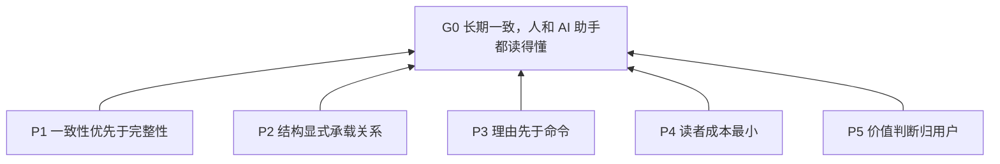
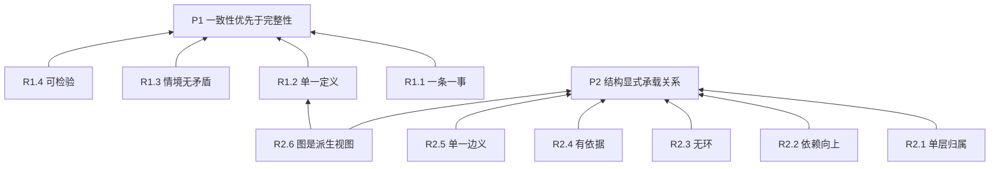
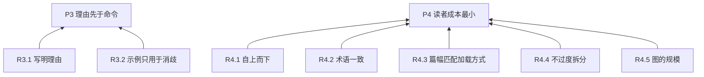
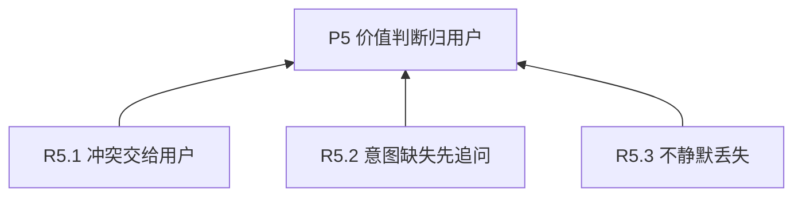
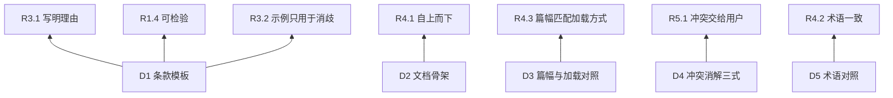
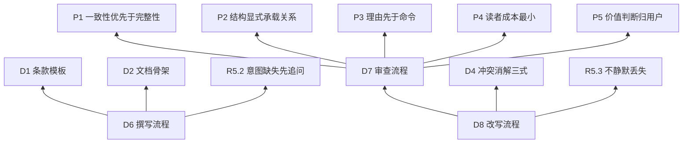

# 指令文档架构师

> 开发者维护译文；[英文源文档](../../../../skills/instruction-doc-architect/SKILL.md)是唯一可安装的规范性版本。

## 调用策略

所有智能体仅可在用户显式调用 instruction-doc-architect 时加载和执行本技能。任务匹配、其他技能推荐或引用、智能体自主判断均不构成启用授权。将该技能作为审查或修改对象提及，不属于调用。

运行时配置在受支持的环境中强化此策略；对于忽略技能声明或不支持调用策略的运行时，这些配置不保证强制执行。

## 目的（G0）

让指令文档在长期修改中保持一致，并且人和 AI 助手都读得懂。

## 总览

本文档自身遵守它所规定的规则。五条原则直接服务于目的：



## 如何阅读和修改

- 自上而下读。只读到原则（L1），就能得到全貌。
- 每条条款的“依据”行是依赖关系的唯一权威来源，图只是它的派生视图。
- 修改一条条款后，沿图向上检查它的依据，向下检查依赖它的条款。
- 本文档用到的层级定义见 R2.1，术语对照见 D5。

## 原则（L1）

**P1 一致性优先于完整性**: 宁可少写一条，也不留下互相打架或重复的两条。 依据: G0.

**P2 结构显式承载关系**: 条款之间的关系用结构表达，不靠读者揣摩。 依据: G0.

**P3 理由先于命令**: 每条要求都应能回答“为什么”，让 AI 助手在没写到的情况下也能顺着理由判断。 依据: G0.

**P4 读者成本最小**: 人的阅读成本和 AI 助手的上下文成本都要尽量低。 依据: G0.

**P5 价值判断归用户**: 取舍和意图由用户决定，AI 助手不替用户拍板。 依据: G0.

## 规则（L2）

### 服务于 P1、P2



**R1.1 一条一事**: 一条条款只表达一个要求。
依据: P1.
判据: 陈述里没有并列的两个独立要求；只能想出一种违反方式；删掉任意一半后另一半仍成立，则应拆分。

**R1.2 单一定义**: 同一个要求只在一处定义，其他位置只引用它的编号。
依据: P1.
判据: 任意两条条款不会在同一情境下要求同一行为。发现重复时，保留抽象层更合适的一条。

**R1.3 情境无矛盾**: 任何情境下，不同时存在相反的要求。
依据: P1.
判据: 对每对相关条款枚举触发情境，情境无交集，或结论一致。

**R1.4 可检验**: 每条规则（L2）带判据，让他人能独立判断遵守与否。
依据: P1.
判据: 判据读完后，不需要追问作者就能给出“遵守/违反”。

**R2.1 单层归属**: 每条条款属于且仅属于下表四层之一。
依据: P2.
判据: L2 不含价值取舍，L1 不含具体命令。

| 层 | 名称 | 回答的问题 | 典型形态 |
| --- | --- | --- | --- |
| L0 | 目标 | 为谁、为了什么？ | 1–3 句 |
| L1 | 原则 | 取舍时偏向什么？ | “宁可 X，不要 Y” |
| L2 | 规则 | 什么情境下必须或禁止做什么？ | 可检验的祈使句 |
| L3 | 做法 | 具体怎么做？ | 步骤、模板、示例 |

**R2.2 依赖向上**: 条款只能依赖同层或更抽象的条款。
依据: P2.
判据: 每条“依据”都指向同层或更高层；没有 L1 依赖 L2、L2 依赖 L3 的情况。

**R2.3 无环**: 依赖关系必须能做拓扑排序。
依据: P2.
判据: 沿“依据”行追溯，永不回到自身。出现环说明条款在互为理由，应上提共同原因，或合并。

**R2.4 有依据**: 每条非 L0 条款至少有一个上位依据。
依据: P2.
判据: 不存在没有“依据”行的条款。

**R2.5 单一边义**: 关系用 mermaid 表达，所有箭头只表示“依赖于”，由具体指向抽象；不自创记法。
依据: P2.
判据: 全图箭头语义一致；冲突等其他关系不画成边。

**R2.6 图是派生视图**: 依赖的权威来源是各条款的“依据”行，图由它生成；两者不一致时以条款为准。
依据: P2、R1.2.
判据: 图中每条边都能在某条款的“依据”行里找到，反之亦然。

### 服务于 P3、P4



**R3.1 写明理由**: “依据”行除编号外，用一句话说明为什么该条款能从上位条款推出。
依据: P3.
判据: 能回答“删去此条，会损害上位条款的什么”。

**R3.2 示例只用于消歧**: 只为容易误读的条款写示例，必要时加反例。
依据: P3.
判据: 每个示例都对应一个确实可能被误读的条款。

**R4.1 自上而下**: 文档按抽象层由高到低排布，在任何位置截断都是一份完整的粗略版本。
依据: P4.
判据: 只读前 N 节，得到的是全貌的简化版，不是缺了关键部分的残篇。

**R4.2 术语一致**: 同一概念全文只用一个词，首次出现时给一句解释。
依据: P4.
判据: 不存在两个词指同一件事，也不存在一个词指两件事。

**R4.3 篇幅匹配加载方式**: 文档越是常驻加载，篇幅越短，内容越要对每个任务都成立。
依据: P4.
判据: 每份文档只含与其加载时机相符的内容。具体数值见 D3。

**R4.4 不过度拆分**: 同一父条款下的子条款过多时，重新检查层级。
依据: P4.
判据: 子条款超过约 7 个时，确认是否缺一个中间层，或其中有些只是同一规则的示例。

**R4.5 图的规模**: 单张图控制在约 15 个节点以内，超过时按 L1 分图。
依据: P4.
判据: 任何一张图都能在一屏内看清。

### 服务于 P5



**R5.1 冲突交给用户**: 发现冲突时，向用户列出消解方案，不自行选边。
依据: P5.
判据: 文档里没有未经用户确认的取舍。

**R5.2 意图缺失先追问**: 找不到条款的上位依据时，向用户追问其意图，不替用户臆造原则。
依据: P5.
判据: 每条新增的 L1 原则都能追溯到用户说过的话。

**R5.3 不静默丢失**: 改写时，旧文档中的每条意图要么在新文档里有去处，要么在变更摘要里说明删除原因。
依据: P5.
判据: 存在“旧位置 → 新条款”的完整对照。

## 做法（L3）

### 模板与对照



**D1 条款模板**. 依据: R3.1、R1.4、R3.2.

普通 Markdown，编号只是标题里的名字：

```markdown
**R2.1 简短标题**：一句祈使句。
依据：上位条款编号＋一句理由。
判据：怎样算遵守，怎样算违反。
示例：（可选，仅用于消歧）
```

**D2 文档骨架**. 依据: R4.1.

按此顺序：目的（L0）→ 总览图 → 如何阅读和修改 → 原则（L1）→ 规则（L2）→ 做法（L3）。

**D3 篇幅与加载对照**. 依据: R4.3.

根据实际运行环境的发现、启用和文件加载机制确定加载方式。下表描述典型模式，不保证每种工具都按此加载。

| 文档 | 加载方式 | 要求 |
| --- | --- | --- |
| CLAUDE.md / AGENTS.md | 运行环境发现并应用文件时，可能常驻加载 | 越短越好；项目事实与行为规则分开 |
| SKILL.md | 运行环境支持技能时，可能在启用后加载 | 正文少于约 500 行；超出就把 L3 下沉到 references/；在使用 frontmatter 的 description 的运行环境中，它用于指导启用，写“做什么＋何时用”，宁可略为主动 |
| references/*.md | 运行环境或 AI 助手读取文件时按需加载 | 在 SKILL.md 中写明何时读哪一份；超过约 300 行加目录；每份只对应一个主题 |

**D4 冲突消解三式**. 依据: R5.1.

由轻到重，请用户选：

1. 情境其实不同：把触发条件写进两条条款，冲突自然消失。
2. 存在优先级：在更高层加一条原则说明取舍，两条下层条款都依赖它。
3. 真正矛盾：由用户决定保留哪一条，另一条删除。

**D5 术语对照**. 依据: R4.2.

| 用户的说法 | 通用术语 | 一句话解释 |
| --- | --- | --- |
| 原子的 | 原子条款、单一职责 (SRP) | 一条只管一件事 |
| 相互无重合 | 单一事实来源 (SSOT / DRY) | 同一件事只在一处定义 |
| 无冲突 | 一致性 | 同一情境下不会要求相反行为 |
| 金字塔型 | 金字塔原理 (Minto)、抽象层级 | 上层回答为什么，下层回答怎么做 |
| 有向无环 | DAG | 依赖只能由具体指向抽象 |
| 要求、原则、指令 | 不同的抽象层 | 见 R2.1 |

### 工作流程



**D6 撰写流程**. 依据: D1、D2、R5.2.

从零开始：

1. 问清 L0：读者是谁？成功时 AI 助手的行为有什么不同？
2. 让用户倒出所有想法，不限格式。
3. 按 R2.1 归层，按 R1.1 拆分，按 R1.2 合并。
4. 为每条找依据；找不到的按 R5.2 追问。
5. 按 D1、D2 输出，并按 R2.5 画图。
6. 用 D7 自审一遍。

**D7 审查流程**. 依据: P1、P2、P3、P4、P5.

只出报告，不改文档。

对被审文档逐条核对本文档的全部 L2 规则，输出下表，并附一张现状依赖图。严重度分三档：

- 阻断：违反 R1.3 或 R2.3。
- 重要：违反 R1.1、R1.2、R2.1、R2.2、R2.4。
- 建议：其余规则。

| 编号 | 位置 | 违反的规则 | 严重度 | 说明 | 建议 |
| --- | --- | --- | --- | --- | --- |

**D8 改写流程**. 依据: D7、D4、R5.3.

保持意图，重构结构：

1. 对旧文档做一次 D7，作为内部底稿。
2. 抽取所有条款，建立“旧位置 → 新条款”对照。
3. 拆分、合并、重新分层，补全缺失的上位条款。
4. 遇到冲突，按 D4 请用户选。
5. 输出新文档，并附变更摘要：拆了哪些、合了哪些、删了哪些、新增了哪些上位条款。
