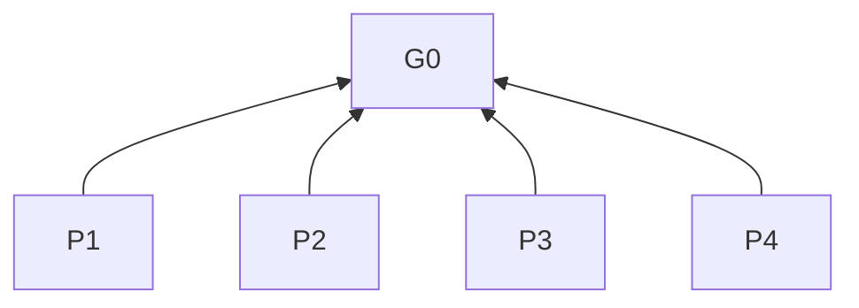
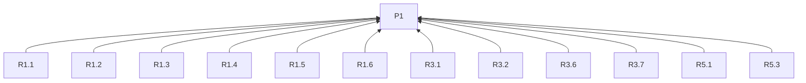
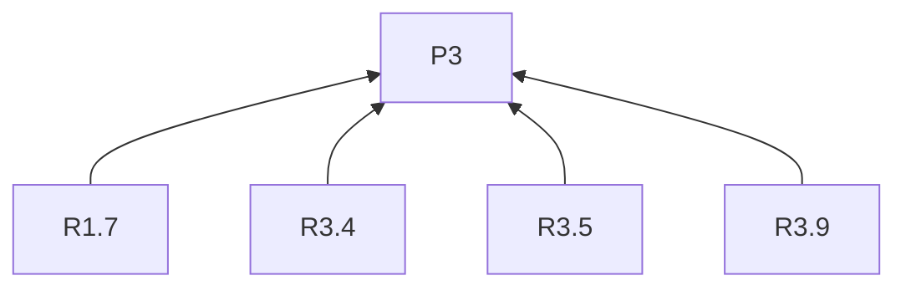
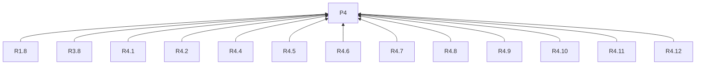
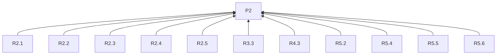
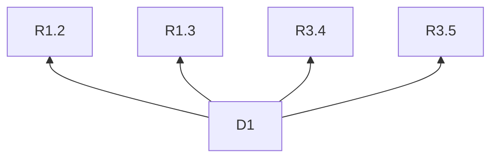

> 中文维护译文，与[英文原文](../../../../skills/sdlc-build-in-public/SKILL.md)同步。

# 公开构建

## 目的（G0，L0）

帮助任何项目的作者与助手，将项目材料转化为对读者有用的公开内容，并在用户控制下完成可核验的交付与后续策划。

## 任务分流

任务入口：具体进展 → R1.1；发现选题 → R1.2；系列 → R1.3；仅选题或提纲 → R1.4；修稿 → R1.8；审阅与交付 → R4.1–R4.12；后续策划 → R5.1–R5.6。

## 阅读说明

L0 是目的，L1 是原则，L2 是规则，L3 是实践。`依据`指向条款的理由；图中箭头从条款指向依据。技能入口通过名称和 description 发现；渠道文档由 R3.9 按批次读取。D1 是示例，不是项目事实。

## 概览

## 原则（L1）

**P1 读者价值**：优先选择回答目标读者问题、服务分享目的的选题与后续内容。 依据：G0。

**P2 事实与公开范围有据**：优先使用可追溯且在获准公开范围内的表述。 依据：G0。

**P3 各渠道独立表达**：优先按各渠道读者独立组织论点、证据和结构。 依据：G0。

**P4 交付受用户控制并可核验**：优先将交付关联到已审内容和目的地，并使结果可核对。 依据：G0。

## 规则（L2）

### 任务与背景

**R1.1** 用户要求分享具体进展时，须直接围绕该进展起草。
依据：P1。验收：稿件围绕指定进展。

**R1.2** 发现选题时，须查看指定时段的工作笔记、草稿、决策、试验和获准公开的反馈。
依据：P1。验收：选题依据来自指定时段及这些可用材料。

**R1.3** 策划系列时，须结合已发表内容、回执和可用读者反馈，找出未解问题及后来的新认识。
依据：P1。验收：续篇建议注明原有问题及新认识。

**R1.4** 用户只要求选题或提纲时，须交付到该阶段。
依据：P1。验收：交付物与所要求阶段一致。

**R1.5** 项目背景已明确时，须复用其读者、分享目的、渠道、目的地和写作语言。
依据：P1。验收：这些选择与已有背景一致。

**R1.6** 缺失背景会实质改变稿件或交付时，须询问该信息。
依据：P1。验收：缺失答案会改变本次内容或交付中的选择，如读者、论点、语言、参与入口或账号。

**R1.7** 作者提供语气或观点时，须沿用。
依据：P3。验收：稿件措辞和论述保留所给语气及观点。

**R1.8** 修改稿件时，须将改动限定在用户要求的范围内。
依据：P4。验收：每项改动均在要求范围内。

### 公开范围与证据

**R2.1** 使用反馈、参与者或客户信息时，须遵守其获准公开范围。
依据：P2。验收：纳入的细节获准用于本次公开分享。

**R2.2** 准备公开正文时，须排除凭证。
依据：P2。验收：正文不含凭证。

**R2.3** 描述工作时，须区分已发生事件、观察或测量结果，以及计划。
依据：P2。验收：读者能判断各项表述的状态。

**R2.4** 声称改动带来多大改善时，须以测量支持其幅度。
依据：P2。验收：改善幅度有测量依据；仅有决策记录只能解释选择。

**R2.5** 使用数字或比较时，须在本地编辑笔记中保留来源。
依据：P2。验收：每项数字或比较均能追溯来源。

### 选题与成稿

**R3.1** 推荐选题时，须说明读者问题、新增认识、支撑材料及其与分享目的的关系。
依据：P1。验收：每项建议均含这四项信息。

**R3.2** 排列选题优先级时，须优先考虑有据的读者需求，或能增加读者认识的一手观察、方法及取舍。
依据：P1。验收：建议指出有据的读者需求，或说明一手观察、方法或取舍如何改变读者理解。

**R3.3** 想法缺少支撑时，须指出缺失材料。
依据：P2。验收：该想法注明仍需什么证据。

**R3.4** 选题确定后，须按读者和分享目的分配目的地。
依据：P3。验收：分配说明读者和目的的匹配；同批可含多题，同题可投多渠道。

**R3.5** 为多个渠道写稿时，须从材料出发，按各自读者独立决定论点、证据和结构。
依据：P3。验收：仅翻译、缩短或换标题不算独立角度。

**R3.6** 起草时，须按分享目的确定期望的读者回应。
依据：P1。验收：结尾服务该目的；告知型更新可在交代结果后结束。

**R3.7** 邀请反馈、试用或报名时，须说明行动、准备条件和参与或回应入口。
依据：P1。验收：读者能确定做什么、准备什么及在哪里参与。

**R3.8** 参与信息缺失时，须先询问，再将邀请标为可发布。
依据：P4。验收：参与信息未齐全时不标为可发布。

**R3.9** 批次已选定渠道时，须读取对应链接中的写稿与交付指南。
依据：P3。验收：已查阅每个目标渠道。

### 审阅与交付

**R4.1** 提交批次审阅时，须展示各完整稿件及目的地、配图、链接和预计费用。
依据：P4。验收：预览包含每项的全部内容和交付信息。

**R4.2** 审阅 HTML 时，须展示排版效果和待交付内容。
依据：P4。验收：两种视图对应同一稿件。

**R4.3** 展示公开正文时，须将编辑来源笔记分开。
依据：P2。验收：来源笔记不混入待交付的公开正文。

**R4.4** 审阅批次时，须允许用户修改或移除稿件。
依据：P4。验收：批次反映用户的修改和移除决定。

**R4.5** 任何远端写入前，包括创建远端草稿，须取得最终稿件和目的地的明确批准。
依据：P4。验收：批准对应每次写入的具体版本和目的地账号。

**R4.6** 审阅后批次或目的地变更时，须重新展示预览并取得批准。
依据：P4。验收：批准覆盖变更后的批次和目的地。

**R4.7** 交付时，须使用各渠道商定的方法和获准账号。
依据：P4。验收：实际方法和账号与约定一致。

**R4.8** 交付方式或账号权限不可用时，须报告待交付并指出缺失条件。
依据：P4。验收：该项保持待交付，并注明阻碍。

**R4.9** 处理稿件时，须记录已审版本、目的地、实际结果及取得的平台回执。
依据：P4。验收：记录将这些字段关联到同一稿件。

**R4.10** 稿件已交付时，须跳过交付。
依据：P4。验收：不对该已完成稿件再次交付。

**R4.11** 交付结果不明时，须先核对目的地，再考虑重试。
依据：P4。验收：仅在确认未送达后重试。

**R4.12** 编辑已发表内容时，须有用户另行明确要求。
依据：P4。验收：仅有发布批准不授权修改已发表内容。

### 从回应中改进

**R5.1** 策划后续时，须将分享目的与用户提供或本任务获准使用的反馈和结果对照。
依据：P1。验收：评估引用与目的有关的证据，如具体回复、材料索取或完成试用。

**R5.2** 评估回应时，须区分平台交付回执与读者回应证据。
依据：P2。验收：不将交付回执本身当作读者回应。

**R5.3** 选择后续选题或起草时，须延续有据的认识及读者的实际问题。
依据：P1。验收：下一篇与这些认识或问题相连。

**R5.4** 报告经验时，须指出适用的读者、渠道和条件。
依据：P2。验收：经验包含这些适用边界。

**R5.5** 证据稀少或不可用时，须指出仍需进行的检查。
依据：P2。验收：评估注明仍未验证的事项。

**R5.6** 证据稀少或不可用时，须将传播效果的解释标为假设。
依据：P2。验收：这些解释不被表述为已确定的结论。

## 渠道文档

- [GitHub Pages](references/pages.md)
- [GitHub Discussions](references/discussions.md)
- [博客园](references/cnblogs.md)
- [DEV Community](references/dev.md)
- [X](references/x.md)
- [Bluesky](references/bluesky.md)
- [Mastodon](references/mastodon.md)
- [微信公众号](references/wechat.md)

## 实践（L3）

**D1** 依据：R1.2, R1.3, R3.4, R3.5.

消除误读：同题必须到处使用相同正文，或必须先选渠道再找有价值的问题。

例如，题目已定为“为什么改写练习说明”时，可以为教师写一份前后对比，为学员写一份试做邀请。从一周材料中找选题时，则先从练习修订和试教反馈中找出值得讲的问题，再安排渠道；后续可用新的试做结果接着写。

## 条款依赖

## 参考来源

选题方法借鉴 `content-strategy` 如何发现读者的问题、判断一篇内容能提供什么新价值。[选题来源](https://github.com/coreyhaines31/marketingskills/blob/88c79f6528a9347420e57ceb1fff9a60de651768/skills/content-strategy/SKILL.md#content-ideation-sources) · [内容价值](https://github.com/coreyhaines31/marketingskills/blob/88c79f6528a9347420e57ceb1fff9a60de651768/skills/content-strategy/SKILL.md#searchable-vs-shareable)

读者价值和选题优先级的判断借鉴 `product-marketing` 与 `content-strategy`。[受众背景](https://github.com/coreyhaines31/marketingskills/blob/88c79f6528a9347420e57ceb1fff9a60de651768/skills/product-marketing/SKILL.md#sections-to-capture) · [选题优先级](https://github.com/coreyhaines31/marketingskills/blob/88c79f6528a9347420e57ceb1fff9a60de651768/skills/content-strategy/SKILL.md#prioritizing-content-ideas)

受众、预期回应和渠道表达借鉴 `social`。[读者与写作目的](https://github.com/coreyhaines31/marketingskills/blob/88c79f6528a9347420e57ceb1fff9a60de651768/skills/social/SKILL.md#before-creating-content) · [平台适配](https://github.com/coreyhaines31/marketingskills/blob/88c79f6528a9347420e57ceb1fff9a60de651768/skills/social/SKILL.md#repurposing-workflow)

行动表达借鉴 `copywriting`，根据回应改进内容的做法借鉴 `social`。[读者行动](https://github.com/coreyhaines31/marketingskills/blob/88c79f6528a9347420e57ceb1fff9a60de651768/skills/copywriting/SKILL.md#cta-copy-guidelines) · [回应回顾](https://github.com/coreyhaines31/marketingskills/blob/88c79f6528a9347420e57ceb1fff9a60de651768/skills/social/SKILL.md#analytics--optimization)
