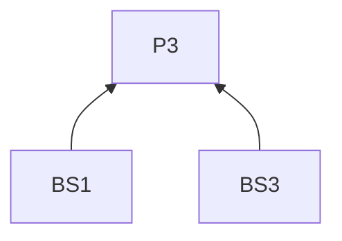
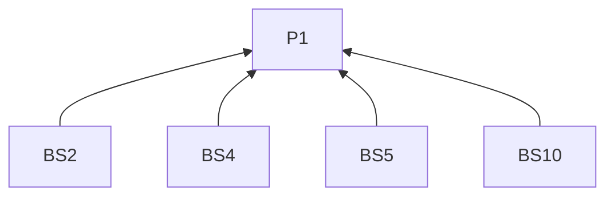
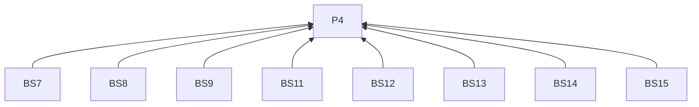
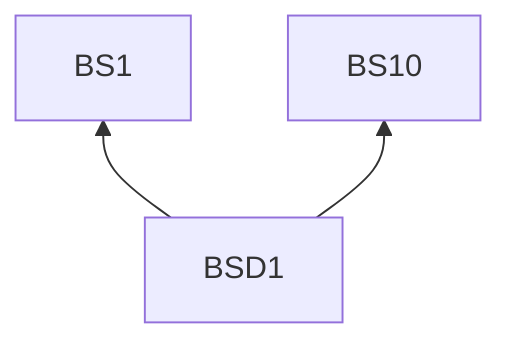

> 中文维护译文，与[英文原文](../../../../../skills/sdlc-build-in-public/references/bluesky.md)同步。

# Bluesky

## 阅读说明

本指南是[技能入口](../SKILL.zh-CN.md)的按需渠道文档。沿用入口的 G0 和 P1–P4；通用要求仅在入口定义。渠道编号标识 L2 规则；示例是 L3 实践。R4.5–R4.12 约束本指南的所有远端交付。

## 规则（L2）

### 写稿

**BS1** 写帖子开头时，须点明项目或活动及一项变化或观察。
依据：P3。验收：时间线正文注明对象和重点。

**BS2** 解释观察时，须补足背景及其与决定、影响或问题的联系。
依据：P1。验收：新读者无须阅读完整外文便能回应；可链接较长的方法或历史记录。

**BS3** 使用演示或视觉材料时，须用文字描述重要内容。
依据：P3。验收：描述指出看什么；前后对比描述可在图片打开前说明变化。

**BS4** 跟进旧帖时，须指出原有问题和新认识。
依据：P1。验收：正文区分原有问题和本次更新。

**BS5** 跟进时有旧帖地址，须附上链接。
依据：P1。验收：续帖含旧帖链接。

**BS6** 限制条件会改变结果含义时，须保留。
依据：P2。验收：结果旁保留限定条件。

**BS7** 审阅帖子时，须包含链接材料和媒体描述。
依据：P4。验收：预览在正文之外包含两者。

**BS8** 需要原生附件时，须核对交付方式是否支持。
依据：P4。验收：已核对所需附件的支持情况。

**BS9** 正文及链接齐全后，须核对平台当前限制。
依据：P4。验收：核对长度包含最终正文和链接。

**BS10** 希望获得回应时，须提出可凭具体经历回答的问题。
依据：P1。验收：问题指向经历而非笼统感想。

### 交付

**BS11** 通过 AT Protocol 写入时，须核对账号 DID 和可信个人数据服务器。
依据：P4。验收：写入指向已核对的身份和服务器。

**BS12** 通过 AT Protocol 写入时，须使用该账号已认证的会话。
依据：P4。验收：会话身份与获准账号一致。

**BS13** 通过 AT Protocol 写入时，须填写带时区的创建时间。
依据：P4。验收：记录含带时区的创建时间戳。

**BS14** 按 R4.9 记录交付时，须保留 AT URI。
依据：P4。验收：回执标识新记录。

**BS15** 按 R4.11 核对不明交付时，须检查账号动态。
依据：P4。验收：决定重试前已检查账号动态。

## 实践（L3）

**BSD1** 依据：BS1, BS10.

消除误读：反馈帖只征集感想，无须具体变化或可回答的问题。

假设材料。一份工作坊练习已拆成任务、答案形式和提交三个区块。作者想了解读者预期在哪里找到提交说明。

> 我把工作坊练习说明拆成了任务、答案形式和提交三个区块。你打开一道练习时，通常先去哪里找上传答案的说明？

先给出具体变化，再提出读者能够凭经历回答的问题。

## 条款依赖

## 参考来源

交流式表达借鉴 [social 的 Engagement Strategy](https://github.com/coreyhaines31/marketingskills/blob/88c79f6528a9347420e57ceb1fff9a60de651768/skills/social/SKILL.md#engagement-strategy)。

[官方文档](https://atproto.com/guides/writing-data)
