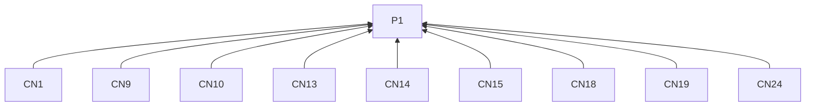
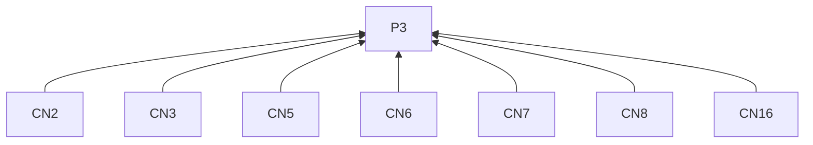
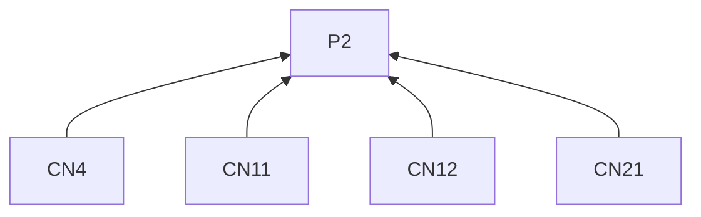
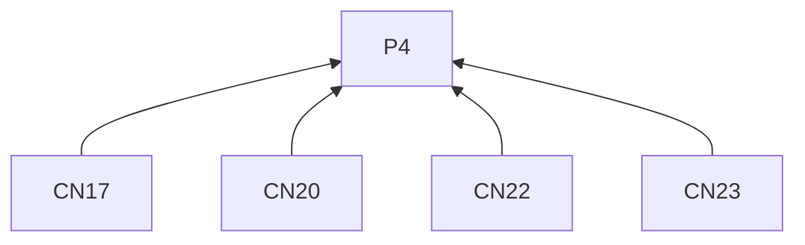
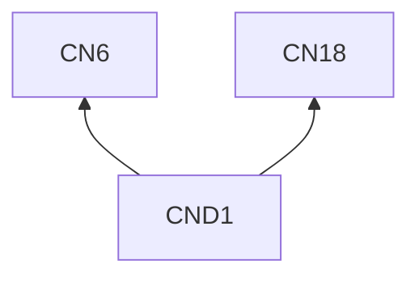

> 中文维护译文，与[英文原文](../../../../../skills/sdlc-build-in-public/references/cnblogs.md)同步。

# 博客园

## 阅读说明

本指南是[技能入口](../SKILL.zh-CN.md)的按需渠道文档。沿用入口的 G0 和 P1–P4；通用要求仅在入口定义。渠道编号标识 L2 规则；示例是 L3 实践。R4.5–R4.12 约束本指南的所有远端交付。

## 规则（L2）

### 写稿

**CN1** 解释选题时，须联系其他开发者可理解或尝试的实践，并交代技术条件。
依据：P1。验收：课程、研究或设计叙述使用材料中的实际工具或方法。

**CN2** 写标题时，须指出问题、技术或决策及定位背景。
依据：P3。验收：排错标题可含症状和组件；教程可含任务和环境；承诺遵循 R2.3–R2.5。

**CN3** 写开头时，须交代具体问题及其对工作的影响。
依据：P3。验收：开头建立工作的重要性。

**CN4** 读者跟随解释需要前提、版本或设置时，须说明。
依据：P2。验收：可识别起始环境。

**CN5** 写教程时，须串联起始条件、关键操作、理由和结果检查。
依据：P3。验收：解释指出各项设置或步骤的作用位置。

**CN6** 排错时，须串联症状、观察、可能原因、检查及有据解释。
依据：P3。验收：按 R2.3 区分已核实原因和假设。

**CN7** 复盘选择时，须说明约束、实际选项、最终做法及接受的代价。
依据：P3。验收：叙述指出已尝试范围和适用性未定之处。

**CN8** 组织文章时，须用小标题展现推理。
依据：P3。验收：小标题顺序跟随解释。

**CN9** 包含命令、小段代码或错误时，须放在相应解释旁。
依据：P1。验收：读者能将片段与用途对应。

**CN10** 提供命令或代码示例时，须说明输入。
依据：P1。验收：读者能确定所需输入。

**CN11** 有实际输出时，须展示。
依据：P2。验收：示例包含实际输出。

**CN12** 展示预期输出时，须标明其性质。
依据：P2。验收：预期输出不会被误认为实际输出。

**CN13** 出现陌生技术用语时，须解释。
依据：P1。验收：首次使用时有解释。

**CN14** 选择示例细节时，须保留解释行为所需的最小完整例子。
依据：P1。验收：示例包含解释行为所需的全部输入和动作；延伸记录遵循 CN24。

**CN15** 代码需要复制时，须使用文本。
依据：P1。验收：代码可复制，不仅存在于图片中。

**CN16** 展示视觉行为或比较时，须在图片旁解释相关差异。
依据：P3。验收：截图指出读者应注意什么。

**CN17** 准备交付时，须生成有标题的 Markdown 并检查渲染。
依据：P4。验收：已审阅渲染文章。

**CN18** 结尾时，须说明已验证结果、适用条件及未解原因或下次检查。
依据：P1。验收：结论保留已测试范围。

**CN19** 征集经验时，须针对仍不明确的条件提问。
依据：P1。验收：问题指出该条件。

**CN24** 提供完整日志或较大源文件时，须从精简示例链接到它们。
依据：P1。验收：文章保留完整示例，并用链接承接延伸材料。

### 交付

**CN20** 使用博客 API 时，须使用博客所有者的个人访问令牌。
依据：P4。验收：令牌所有者与获准博客一致。

**CN21** 设置 AI 生成内容声明时，须反映实际创作方式。
依据：P2。验收：声明与文章创作方式一致。

**CN22** 按 R4.9 记录发表时，须保留 `postUrl` 返回的 URL。
依据：P4。验收：回执使用返回的文章地址。

**CN23** 按 R4.11 核对不明交付时，须检查目标博客。
依据：P4。验收：决定重试前已检查博客。

## 实践（L3）

**CND1** 依据：CN6, CN18.

消除误读：测过一种输入就能证明修复适用于所有输入。

假设材料。CSV 导出程序在处理每条记录的循环中写入表头。三条输入记录生成了三个表头。将写表头的操作移到循环前，同样输入生成一个表头和三行数据，其他输入情况尚未测试。

> **定位 CSV 导出中重复出现的表头**
>
> 三条记录的导出结果在每行数据前都出现了表头。检查发现，表头写入位于处理记录的循环里。
>
> 我把写表头移到循环前，再用同样的输入测试。输出变成一个表头和三行数据。
>
> 这次检查覆盖的是给定的三条记录。空输入和其他记录形式还需要分别检查。

结论限定在实际检验过的情形。

## 条款依赖

## 参考来源

表述应具体且有依据的建议借鉴 [copywriting 的 Drafting Protocol](https://github.com/coreyhaines31/marketingskills/blob/88c79f6528a9347420e57ceb1fff9a60de651768/skills/copywriting/SKILL.md#drafting-protocol)。

[博客园 Markdown 支持](https://www.cnblogs.com/cmt/p/markdown.html) · [官方文档](https://www.cnblogs.com/cmt/articles/19246558)
