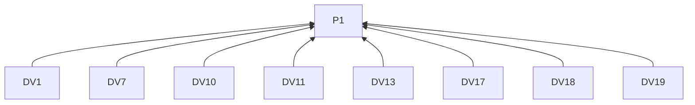
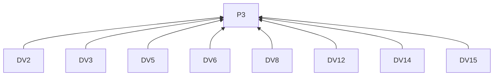
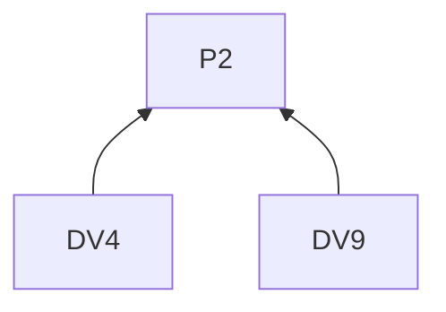
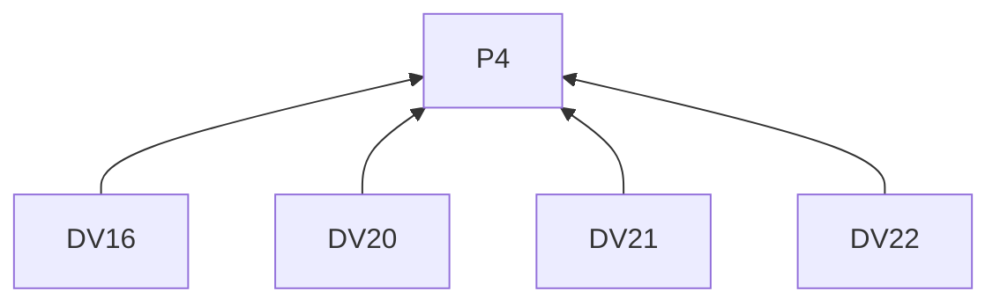
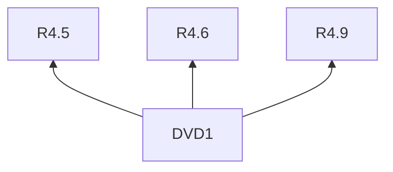

> 中文维护译文，与[英文原文](../../../../../skills/sdlc-build-in-public/references/dev.md)同步。

# DEV Community

## 阅读说明

本指南是[技能入口](../SKILL.zh-CN.md)的按需渠道文档。沿用入口的 G0 和 P1–P4；通用要求仅在入口定义。渠道编号标识 L2 规则；示例是 L3 实践。R4.5–R4.12 约束本指南的所有远端交付。

## 规则（L2）

### 写稿

**DV1** 解释方法或经历时，须在影响理解的位置介绍陌生工具和项目术语。
依据：P1。验收：项目外开发者能跟随叙述。

**DV2** 写标题时，须点明任务、经验或问题。
依据：P3。验收：标题指出文章主题。

**DV3** 写开头时，须用真实小情境说明方法的意义和读者能学到什么。
依据：P3。验收：开头将真实情境与学习收获相连。

**DV4** 基础知识或环境影响例子时，须说明这些前提。
依据：P2。验收：例子指出受影响的前提。

**DV5** 写教程时，须给出起点、重要操作和结果检查方法。
依据：P3。验收：读者能跟随并检查方法。

**DV6** 写设计经验时，须从真实约束解释其促成的选择。
依据：P3。验收：选择与约束相连。

**DV7** 写项目更新时，须指出其他开发者接下来能尝试或检查什么。
依据：P1。验收：下一项活动明确。

**DV8** 演示中心意思时，须用小例子说明假设和预期行为。
依据：P3。验收：例子含这些解释条件。

**DV9** 例子是示意或未测试时，须标明状态。
依据：P2。验收：不会被误认成项目观察结果。

**DV10** 依赖代码片段前，须解释其用途。
依据：P1。验收：先解释再依赖片段。

**DV11** 链接较大仓库或完整记录时，须先在文中建立背景。
依据：P1。验收：读者知道为何打开链接。

**DV12** 准备文章时，须使用有标题的 Markdown 和描述内容的小标题。
依据：P3。验收：结构指出文章及各节内容。

**DV13** 包含必要代码时，须保留为文本。
依据：P1。验收：读者可复制代码。

**DV14** 包含媒体时，须用图注或描述解释其作用。
依据：P3。验收：文字指出媒体的作用。

**DV15** 选择标签时，须描述实际主题。
依据：P3。验收：标签与文章内容一致。

**DV16** 使用富媒体嵌入时，须核对当前编辑器支持的语法。
依据：P4。验收：嵌入使用受支持语法。

**DV17** 结尾时，须回到方法的应用与局限。
依据：P1。验收：结论指出方法的应用和局限。

**DV18** 按 R3.7 邀请尝试时，须指出观察什么。
依据：P1。验收：邀请注明所需观察。

**DV19** 以问题结尾时，须围绕文章已帮助读者理解的经历提问。
依据：P1。验收：问题承接文章解释。

### 交付

**DV20** 使用文章 API 时，须使用发文账号的 DEV API Key。
依据：P4。验收：密钥属于获准账号。

**DV21** 文章等待发表时，须记录 ID 和待发表状态。
依据：P4。验收：远端文章 ID 不被当作已发表。

**DV22** 文章已发表时，须按 R4.9 保留 URL。
依据：P4。验收：回执标识已发表文章。

## 实践（L3）

**DVD1** 依据：R4.5, R4.6, R4.9.

消除误读：目的地账号改变后，原正文的批准仍自动有效。

假设材料。一个文稿流程要求确认具体稿件和目标账号。已获准发到账号 A 的稿件，后来被改为发到账号 B。

> **一次发布确认需要指向什么**
>
> 审稿环节需要同时指明正文，以及接收它的账号。
>
> 假设一份稿件已获准发到账号 A。目的地改成账号 B 后，即使正文完全相同，也需要重新审阅并确认新目的地。
>
> 把已确认版本与账号放在一起记录，再将交付结果和平台回执关联到这一对信息。

用账号变化说明审批规则怎样应用到具体情境。

## 条款依赖

## 参考来源

保留已有作者语气借鉴 [copywriting 的 Diagnose the Situation First](https://github.com/coreyhaines31/marketingskills/blob/88c79f6528a9347420e57ceb1fff9a60de651768/skills/copywriting/SKILL.md#diagnose-the-situation-first)。

[DEV 写作帮助](https://dev.to/help/writing-editing-scheduling) · [官方文档](https://developers.forem.com/api/v1)
