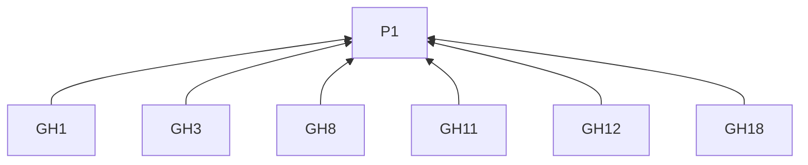
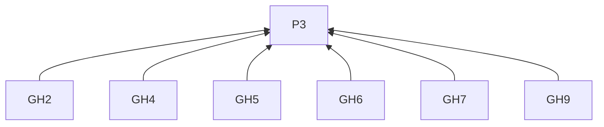
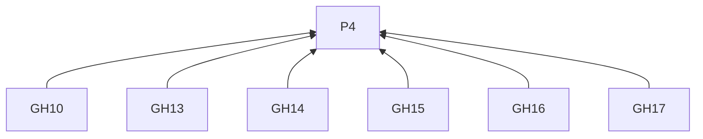
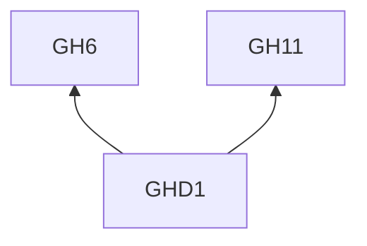

> 中文维护译文，与[英文原文](../../../../../skills/sdlc-build-in-public/references/discussions.md)同步。

# GitHub Discussions

## 阅读说明

本指南是[技能入口](../SKILL.zh-CN.md)的按需渠道文档。沿用入口的 G0 和 P1–P4；通用要求仅在入口定义。渠道编号标识 L2 规则；示例是 L3 实践。R4.5–R4.12 约束本指南的所有远端交付。

## 规则（L2）

### 写稿

**GH1** 解释工作时，须为新参与者补足背景并解释项目术语。
依据：P1。验收：仓库既有读者和新读者均能理解变化或决策。

**GH2** 写标题时，须指出对象和交流目的。
依据：P3。验收：公告指出变化；反馈标题指出需要意见的决策或体验。

**GH3** 写开头时，须交代当前情况及其与参与者的关系。
依据：P1。验收：开头解释参与者为何关注。

**GH4** 组织帖子前，须检查所选分类和仓库贡献指南。
依据：P3。验收：讨论形式和聚焦问题与分类及目的相符。

**GH5** 发布公告时，须说明变化、受影响读者及所需行动。
依据：P3。验收：日期或版本定位时效性变化；链接承接实现或完整说明。

**GH6** 征求意见时，须说明目标、约束、实际选项和未解问题。
依据：P3。验收：指出已决事项，使回应针对尚待选择部分。

**GH7** 求助时，须给出期望结果、观察、条件和已有尝试。
依据：P3。验收：有小规模复现或具体例子时予以提供。

**GH8** 提供回应背景时，须将必要信息放入帖内。
依据：P1。验收：读者可根据帖内信息回应；延伸日志、设计记录及旧讨论遵循 GH18。

**GH9** 包含截图时，须展示其澄清的争议行为或差异。
依据：P3。验收：图片有明确解释作用。

**GH10** 为 R4.1 审阅准备讨论时，须使用标题和 Markdown 正文。
依据：P4。验收：标题和 Markdown 按 R4.1 与配图及链接一同审阅。

**GH11** 结束反馈请求时，须提出可凭经验回答的问题。
依据：P1。验收：问题可征集例子条件或具体观察。

**GH12** 按 R3.7 邀请试用时，须说明起点和需要返回的反馈。
依据：P1。验收：参与者知道如何开始及反馈什么；公告可在交代实际影响后结束。

**GH18** 包含较长日志、设计记录或旧讨论时，须从回应背景中链接到它们。
依据：P1。验收：延伸记录可访问，且不替代帖内回应所需信息。

### 交付

**GH13** 交付前，须核对目标仓库和讨论分类。
依据：P4。验收：目的地标明两者。

**GH14** 创建讨论前，须核实仓库已启用 Discussions，且账号有权在该分类发起讨论。
依据：P4。验收：仓库和账号两项条件均满足。

**GH15** 使用 GraphQL 时，须用节点 ID 标识仓库和分类。
依据：P4。验收：ID 对应已确认目的地。

**GH16** 按 R4.9 记录交付时，须保留新建讨论的 URL。
依据：P4。验收：回执标识该讨论。

**GH17** 按 R4.11 核对不明交付时，须检查目标分类。
依据：P4。验收：决定重试前已检查分类。

## 实践（L3）

**GHD1** 依据：GH6, GH11.

消除误读：反馈请求可省略实际选项，只征求偏好。

假设材料。工作坊的多道练习使用同一个上传地址，每份练习已把任务与答案形式分开。作者希望了解提交说明适合放在哪里。

> **工作坊练习应该在哪里说明怎样提交答案？**
>
> 每道练习都有自己的任务和答案形式，但答案都上传到同一个页面。
>
> 我可以在每份练习里重复提交说明，也可以把说明集中放在工作坊介绍中，再提供链接。重复放置意味着上传地址变化时需要修改多份说明。
>
> 如果你教过或参加过工作坊，通常会去哪里找这类说明？请描述一种你用过的练习布局，以及寻找提交步骤时遇到的困难。

交代实际选择，再邀请读者提供能帮助判断的经历。

## 条款依赖

## 参考来源

聚焦问题的做法依据上面链接的 GitHub 指南。读者背景借鉴 [copywriting 的 Before Writing](https://github.com/coreyhaines31/marketingskills/blob/88c79f6528a9347420e57ceb1fff9a60de651768/skills/copywriting/SKILL.md#before-writing)。

[社区讨论建议](https://docs.github.com/en/discussions/guides/best-practices-for-community-conversations-on-github) · [官方文档](https://docs.github.com/en/graphql/guides/using-the-graphql-api-for-discussions)
