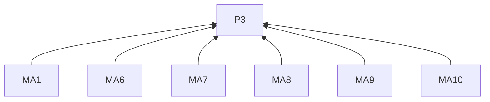
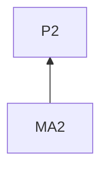
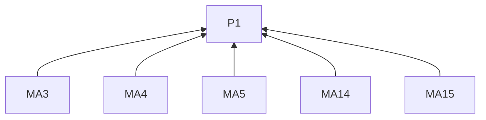
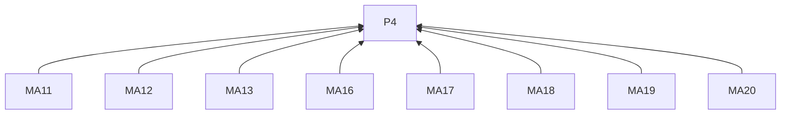
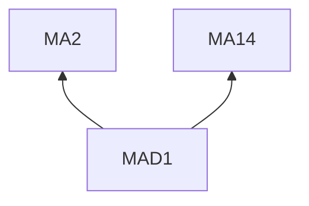

> 中文维护译文，与[英文原文](../../../../../skills/sdlc-build-in-public/references/mastodon.md)同步。

# Mastodon

## 阅读说明

本指南是[技能入口](../SKILL.zh-CN.md)的按需渠道文档。沿用入口的 G0 和 P1–P4；通用要求仅在入口定义。渠道编号标识 L2 规则；示例是 L3 实践。R4.5–R4.12 约束本指南的所有远端交付。

## 规则（L2）

### 写稿

**MA1** 写开头时，须先点明工作和发现，再解释由此作出的选择。
依据：P3。验收：实例读者及其他地方看到转发的读者能理解观察和选择。

**MA2** 解释取舍时，须说明其成立条件。
依据：P2。验收：取舍含适用条件。

**MA3** 使用陌生项目术语时，须解释。
依据：P1。验收：项目外读者能理解术语。

**MA4** 跟进旧进展时，须指出原有未解问题和新观察。
依据：P1。验收：更新将原问题与新证据连接。

**MA5** 解释推理时，须使其无须打开完整记录也能理解。
依据：P1。验收：帖内含推理；完整记录可补充细节；状态遵循 R2.3。

**MA6** 添加主题标签时，须选择描述实际主题的标签。
依据：P3。验收：标签帮助找到相关讨论。

**MA7** 使用社区用语时，须与主题相关。
依据：P3。验收：用语指向帖子主题。

**MA8** 提及他人时，须与其参与关系相关。
依据：P3。验收：每次提及均对应叙述中的参与角色。

**MA9** 附加媒体时，须描述重要内容，包括比较中的差异。
依据：P3。验收：描述指出媒体补充什么。

**MA10** 为帖子准备内容提示时，须说明读者将会看到什么。
依据：P3。验收：提示点明其内容；本条不新增哪些内容需要提示的判断门槛。

**MA11** 交付前，须核对所选实例当前的文字和媒体限制。
依据：P4。验收：最终帖子按该实例限制核对。

**MA12** 审阅时，须包含链接、媒体描述及所需内容提示。
依据：P4。验收：这些内容进入 R4.1 的预览。

**MA13** 需要原生附件时，须核对方法是否支持。
依据：P4。验收：拟用方法支持该附件。

**MA14** 结尾时，须交代观察的意义，或向有相关经历的读者提出具体问题。
依据：P1。验收：结尾服务 R3.6。

**MA15** 为补充篇幅添加续帖时，须写清各帖联系。
依据：P1。验收：读者能识别续帖延续什么。

### 交付

**MA16** 发帖前，须核对账号实例及公开可见性。
依据：P4。验收：目标实例及公开可见性与获准目的地一致。

**MA17** 通过 API 发帖时，须使用含 `write:statuses` 的用户令牌。
依据：P4。验收：获准令牌含该权限。

**MA18** 使用幂等键重试时，须沿用该帖原键。
依据：P4。验收：同一帖子保留同一键。

**MA19** 按 R4.9 记录交付时，须保留动态 URL。
依据：P4。验收：回执标识该动态。

**MA20** 按 R4.11 核对不明交付时，须到所在实例检查该账号。
依据：P4。验收：核对使用已确认实例。

## 实践（L3）

**MAD1** 依据：MA2, MA14.

消除误读：取舍问题可省略各选项对后续工作的影响。

假设材料。工作坊的多道练习使用同一个上传页面。提交步骤可以在各份练习中重复放置，也可以集中维护。

> 我在准备工作坊练习，已把任务和答案形式分别写明。每道练习都使用同一个上传页面。
>
> 现在需要决定提交步骤放在哪里。每道题旁都放一份，地址变化时就需要逐份修改。你们的教学材料怎样让这类说明容易找到？

交代不同方案对后续修改的影响，让读者能提供相关经历。

## 条款依赖

## 参考来源

读者背景借鉴 [social 的 Before Creating Content](https://github.com/coreyhaines31/marketingskills/blob/88c79f6528a9347420e57ceb1fff9a60de651768/skills/social/SKILL.md#before-creating-content)。上面链接的 Mastodon 官方文档用于说明发帖功能。

[发帖功能](https://docs.joinmastodon.org/user/posting/) · [官方文档](https://docs.joinmastodon.org/methods/statuses/)
