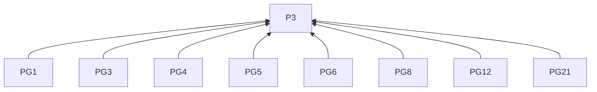
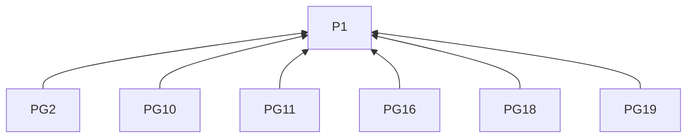
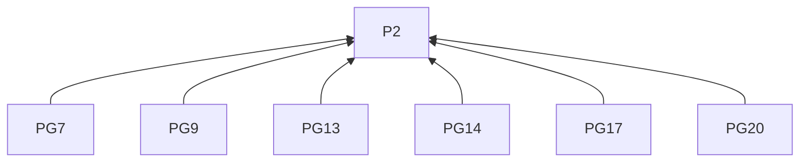
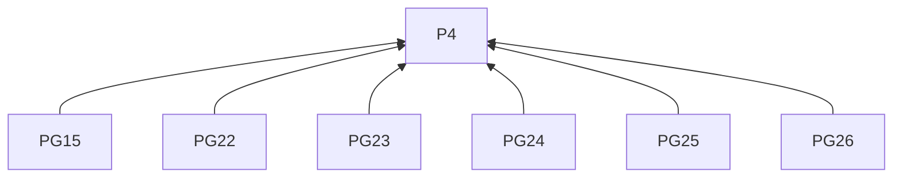
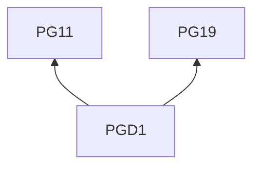

> 中文维护译文，与[英文原文](../../../../../skills/sdlc-build-in-public/references/pages.md)同步。

# GitHub Pages

## 阅读说明

本指南是[技能入口](../SKILL.zh-CN.md)的按需渠道文档。沿用入口的 G0 和 P1–P4；通用要求仅在入口定义。渠道编号标识 L2 规则；示例是 L3 实践。R4.5–R4.12 约束本指南的所有远端交付。

## 规则（L2）

### 写稿

**PG1** 按 R1.5 和 R1.7 撰写站点文章时，须让站点既有文章指导表达。
依据：P3。验收：写法符合站点既有文章；GitHub Pages 是网站托管方式，而非固定编辑体例。

**PG2** 为直接访问的读者写开头时，须补足继续读下一段所需的项目背景。
依据：P1。验收：新读者无须先读仓库或旧文；可链接完整背景。

**PG3** 写标题时，须指出变化、决策或问题及读者继续阅读的理由。
依据：P3。验收：标题指出可理解的选择或可尝试的方法。

**PG4** 写开头时，须从材料中有影响的时刻、观察或结果切入。
依据：P3。验收：决策复盘指出受影响的项目部分及使用者。

**PG5** 写进展时，须串联之前状态、所做工作和当前观察。
依据：P3。验收：活动围绕变化组织；解释先后关系所需的节点日期得到说明。

**PG6** 复盘决策时，须串联需求或约束、实际选项、最终选择和影响。
依据：P3。验收：收益之外说明支持选择的观察及接受的代价。

**PG7** 报告实验时，须串联问题、设置、比较、观察及可支持的结论。
依据：P2。验收：版本、试验条件和测量细节足以解释结果；计划中的试验按 R2.3 保持结果待验证。

**PG8** 组织叙述时，须用小标题呈现论述。
依据：P3。验收：小标题让读者跟随本篇的论述。

**PG9** 解释行动或决策时，须联系促成它的观察及引用证据。
依据：P2。验收：叙述说明证据为何与选择相关。

**PG10** 选择细节时，须保留能改变理解或帮助尝试方法的内容。
依据：P1。验收：常规活动得到概括；可链接长日志和背景。

**PG11** 提供可复现叙述时，须给出解释结果所需的条件和关键动作。
依据：P1。验收：叙述含相关练习与试教记录、研究方案或小型技术示例。

**PG12** 使用图片或表格时，须放在其解释的内容旁。
依据：P3。验收：读者能将图表与表述对应。

**PG13** 展示对比图时，须指出相关变化。
依据：P2。验收：图注告诉读者看什么。

**PG14** 用表格展示结果时，须标明单位和条件。
依据：P2。验收：每项结果均可结合单位和条件解释。

**PG15** 预览时，须检查嵌入媒体和链接。
依据：P4。验收：已核对渲染文章中的媒体和链接。

**PG16** 引入陌生术语时，须在首次使用处解释。
依据：P1。验收：先解释再依赖术语。

**PG17** 结论具有时效性时，须注明观察日期或版本。
依据：P2。验收：后来的读者能定位结论的时间或版本。

**PG18** 结尾时，须交代当前结果及由此产生的开放问题。
依据：P1。验收：决策记录可在说明影响后结束。

**PG19** 按 R3.7 邀请试用时，须说明试什么及何种反馈有帮助。
依据：P1。验收：邀请指出试用和所需反馈。

**PG20** 后续证据改变旧结论时，须链接旧文并说明新认识。
依据：P2。验收：更新使结论变化可追溯。

**PG21** 准备文章时，须使用站点支持的有标题 Markdown 或 HTML，并含所需 front matter。
依据：P3。验收：格式符合站点；篇幅由解释主题所需深度决定。

### 交付

**PG22** 从分支部署时，须核对仓库、分支、发布目录、文章路径和最终 HTTPS URL。
依据：P4。验收：源与预期目的地均已确定。

**PG23** 更新源文件前，须核实仓库写权限。
依据：P4。验收：获准账号能写入源仓库。

**PG24** 记录源提交时，须保留 commit SHA。
依据：P4。验收：记录标识所提交版本。

**PG25** 预期 URL 尚未展示已审文章时，须报告待部署。
依据：P4。验收：不将源提交本身报告为已完成部署。

**PG26** URL 仍展示旧版时，须先检查部署，再考虑重新提交。
依据：P4。验收：按 R4.11 检查部署后才决定重试。

## 实践（L3）

**PGD1** 依据：PG11, PG19.

消除误读：可复用方法必须等试验结果才能分享，或计划中的试验已经证明其效果。

假设材料。读者是工作坊设计者，目的是提供可复用的练习说明结构。一道练习要求学员用两句话概括短文，改版将任务、答案形式和上传步骤分成带标题的区块。试教将检查参与者能否在求助前找到提交步骤。

> **工作坊设计者可以复用的练习说明结构**
>
> 这道概括练习用三个标题组织说明，每个区块回答学员的一个不同问题。
>
> - 任务区提供短文，要求完成概括。
> - 答案形式区规定用两句话作答。
> - 提交区给出上传步骤。
>
> 你可以把这些标题用到其他练习中，分别填入活动、预期答案和提交步骤。本次练习的试教将检查参与者能否在求助前找到提交步骤，再据结果调整布局。

先展示设计者可以复用什么，再解释判断布局效果需要的观察。

## 条款依赖

## 参考来源

- 读者背景和保留作者惯用表达，借鉴 `copywriting` 的“Before Writing”与“Diagnose the Situation First”，在这里用于项目文章。[读者背景](https://github.com/coreyhaines31/marketingskills/blob/88c79f6528a9347420e57ceb1fff9a60de651768/skills/copywriting/SKILL.md#before-writing) · [作者语气](https://github.com/coreyhaines31/marketingskills/blob/88c79f6528a9347420e57ceb1fff9a60de651768/skills/copywriting/SKILL.md#diagnose-the-situation-first)
- 从真实时刻或发现切入，借鉴 `social` 的“Hook Formulas”中的故事与价值开头，在这里要求开头交代文章的实际主题和背景。[开头示例](https://github.com/coreyhaines31/marketingskills/blob/88c79f6528a9347420e57ceb1fff9a60de651768/skills/social/SKILL.md#hook-formulas)

[GitHub Pages 概述](https://docs.github.com/en/pages/getting-started-with-github-pages/what-is-github-pages) · [官方文档](https://docs.github.com/en/pages/getting-started-with-github-pages/configuring-a-publishing-source-for-your-github-pages-site)
