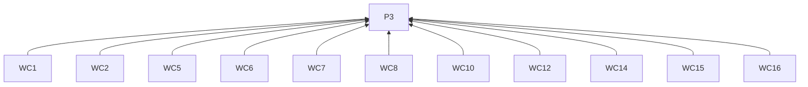
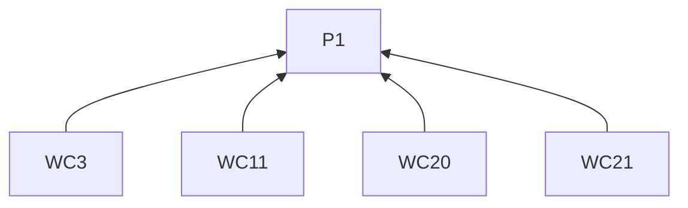
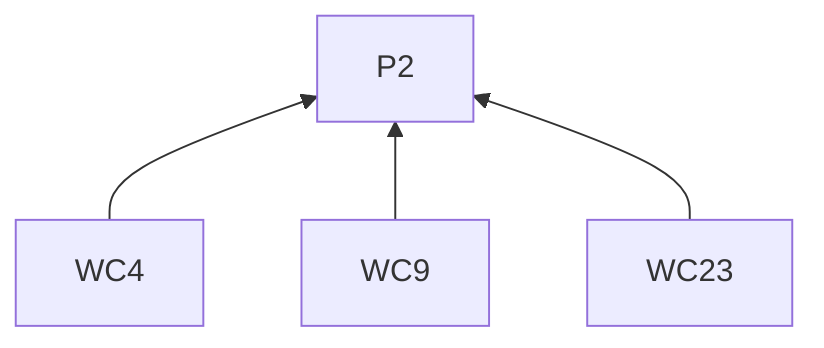
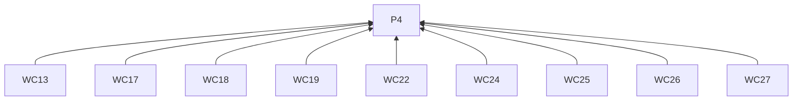
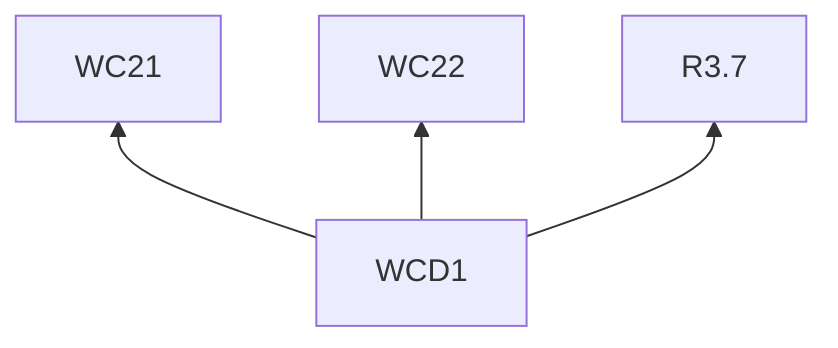

> 中文维护译文，与[英文原文](../../../../../skills/sdlc-build-in-public/references/wechat.md)同步。

# 微信公众号

## 阅读说明

本指南是[技能入口](../SKILL.zh-CN.md)的按需渠道文档。沿用入口的 G0 和 P1–P4；通用要求仅在入口定义。渠道编号标识 L2 规则；示例是 L3 实践。R4.5–R4.12 约束本指南的所有远端交付。

## 规则（L2）

### 写稿

**WC1** 写标题时，须用体现作者观点的词语指出变化、困境或问题。
依据：P3。验收：所承诺认识按 R2.3–R2.5 有材料支持。

**WC2** 写开头时，须从实际行动、观察或困难切入。
依据：P3。验收：开头交代参与者、目标及情境为何重要。

**WC3** 陌生项目背景影响叙述理解时，须补足。
依据：P1。验收：读者能在该处跟上进展。

**WC4** 引用他人原话时，须有材料支持措辞及其公开使用。
依据：P2。验收：引文与有据措辞及 R2.1 的授权一致。

**WC5** 写里程碑叙述时，须串联原有情况、行动、困难、决定和当前结果。
依据：P3。验收：叙述解释到达里程碑的经过。

**WC6** 写决策叙述时，须通过实际工作呈现选项和约束。
依据：P3。验收：叙述将选择与工作相连。

**WC7** 写实验叙述时，须从问题和试验条件讲到观察及剩余不确定性。
依据：P3。验收：叙述按 R2.3 保留结果边界。

**WC8** 解释事件顺序时，须按时间先后叙述。
依据：P3。验收：事件顺序明确。

**WC9** 解释因果时，须有材料支持该关系。
依据：P2。验收：不将先后顺序本身当作因果证据。

**WC10** 使用小标题时，须指出叙述中的进展或问题。
依据：P3。验收：小标题跟随叙述进展。

**WC11** 解释事实时，须将解释放在该事实旁。
依据：P1。验收：事实与解释相邻；可链接延伸背景。

**WC12** 段落关注点变化时，须另起一段。
依据：P3。验收：每段展开一个连贯意思。

**WC13** 审阅排版时，须检查窄屏效果。
依据：P4。验收：已检查窄屏渲染。

**WC14** 选择配图时，须使用能解释行动或影响的视觉材料。
依据：P3。验收：截图、示意图或对比图有明确解释作用。

**WC15** 放置配图时，须置于相关解释附近并用图注指出重点。
依据：P3。验收：图注和位置将视觉与解释相连。

**WC16** 准备文章时，须生成有标题的排版 HTML。
依据：P3。验收：交付物含标题及排版正文。

**WC17** 按 R4.1–R4.2 审阅时，须包含实际封面。
依据：P4。验收：封面与渲染正文及底层内容一同展示。

**WC18** 准备远端草稿正文图片时，须使用微信托管地址。
依据：P4。验收：每张正文图使用微信托管地址。

**WC19** 核对格式硬限制时，须查阅当前官方草稿文档。
依据：P4。验收：检查依据当前草稿格式参考。

**WC20** 结尾时，须交代参与者面临的变化及结果带来的开放问题。
依据：P1。验收：结尾回到参与者及结果。

**WC21** 按 R3.7 邀请试用时，须说明适合谁及怎样取得材料。
依据：P1。验收：读者能确定适用人群及取材方式。

**WC22** 提供参与入口时，须使用该账号实际可用的入口。
依据：P4。验收：账号支持所提参与方式。

**WC23** 引入未来试验时，须注明它是下一项检查。
依据：P2。验收：结果保持待验证；后续文章可在取得证据后接续。

### 交付

**WC24** 使用草稿 API 前，须核实草稿权限、有效令牌及已审封面的永久 `thumb_media_id`。
依据：P4。验收：三项条件齐备；缺少权限时遵循 R4.8。

**WC25** 通过草稿 API 交付时，须仅交付远端草稿 `media_id`，由用户发表。
依据：P4。验收：交付停在远端草稿阶段。

**WC26** 缺少草稿 ID 时，须先检查账号草稿和已发表文章，再考虑重新上传。
依据：P4。验收：按 R4.11 核对两处。

**WC27** 标为已发表前，须取得用户对发表结果的确认。
依据：P4。验收：仅有草稿 ID 不构成已发表。

## 实践（L3）

**WCD1** 依据：WC21, WC22, R3.7.

消除误读：没有可用的取材及反馈入口，邀请仍可发布。

假设材料。读者是有兴趣参加工作坊的人，目的是招募试教参与者。练习要求用两句话概括短文。作者可以通过公众号会话手动发送练习材料，并在会话中收取答案与反馈。试教将观察参与者在哪里找提交说明、什么时候求助。

> **来帮我们试一道两句话的概括练习**
>
> 如果你想练习用简短文字概括一篇短文，可以来试这份工作坊练习。读完短文，写出两句话的摘要，再按练习说明提交。
>
> 我们想观察练习说明在实际使用中的情况。完成后，请告诉我们你在哪里找到了提交步骤，以及哪一处还需要解释。
>
> 想参与，可以给这个公众号发送消息索取练习。我会发给你材料，你也可以在同一会话中交回答案和反馈。

向有兴趣参加的人交代任务、回应理由，以及获取材料和交回反馈的完整入口。

## 条款依赖

## 参考来源

场景开头借鉴 [social 的 Hook Formulas](https://github.com/coreyhaines31/marketingskills/blob/88c79f6528a9347420e57ceb1fff9a60de651768/skills/social/SKILL.md#hook-formulas)，保留作者词汇借鉴 [copywriting 的 Diagnose the Situation First](https://github.com/coreyhaines31/marketingskills/blob/88c79f6528a9347420e57ceb1fff9a60de651768/skills/copywriting/SKILL.md#diagnose-the-situation-first)。

[草稿格式参考](https://developers.weixin.qq.com/doc/subscription/guide/product/draft.html) · [官方文档](https://developers.weixin.qq.com/doc/subscription/guide/product/draft.html)
