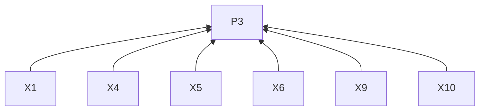
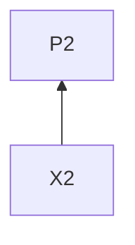
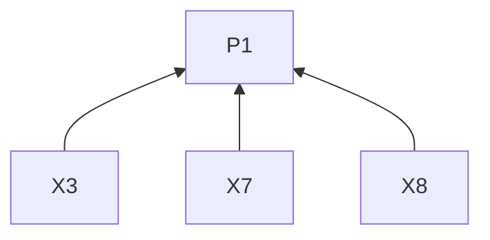
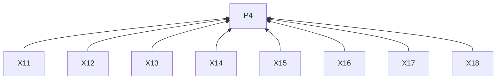
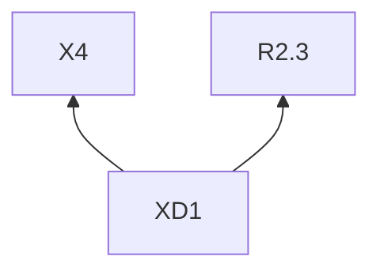

> 中文维护译文，与[英文原文](../../../../../skills/sdlc-build-in-public/references/x.md)同步。

# X

## 阅读说明

本指南是[技能入口](../SKILL.zh-CN.md)的按需渠道文档。沿用入口的 G0 和 P1–P4；通用要求仅在入口定义。渠道编号标识 L2 规则；示例是 L3 实践。R4.5–R4.12 约束本指南的所有远端交付。

## 规则（L2）

### 写稿

**X1** 写帖子开头时，须点明对象，以所选进展的具体事实或判断切入。
依据：P3。验收：单独看到帖子的读者能识别具体变化，而非笼统公告。

**X2** 解释判断时，须在旁边给出支撑观察、影响或限定条件。
依据：P2。验收：重要限定条件紧邻判断；实际数字有材料提供的依据，并按 R2.5 留存。

**X3** 链接细节时，须先在正文说明阅读理由。
依据：P1。验收：正文说明链接补充什么。

**X4** 选择形式时，一项进展可独立讲清则须用单帖；解释需要相连的观察或步骤则须用串帖。
依据：P3。验收：所选形式能承载解释及证据。

**X5** 写串帖时，须在第一条交代主题和继续阅读的理由。
依据：P3。验收：首帖交代两者。

**X6** 写后续串帖时，须以相连的观察或步骤推进。
依据：P3。验收：后续每条均推进解释。

**X7** 串帖可能被单独看到时，须保留理解该帖所需背景。
依据：P1。验收：单独阅读仍能理解对象及关联。

**X8** 串帖已交代结果时，须收束解释。
依据：P1。验收：提问或邀请服务 R3.6，不无故延长已完成的解释。

**X9** 想法转折时，须分段。
依据：P3。验收：段落边界对应想法变化。

**X10** 使用截图或演示时，须说明其重点及媒体内容。
依据：P3。验收：读者知道媒体说明什么。

**X11** 按 R4.1 审阅时，须将帖子附件放入同一预览。
依据：P4。验收：R4.1 的完整文字和 URL 同时附上拟用附件。

**X12** 需要原生媒体时，须核对交付方式是否支持。
依据：P4。验收：所选方法支持所需附件。

**X13** 交付前，须核对账号和内容形式适用的字数限制与计数规则。
依据：P4。验收：最终稿按适用计数规则核对。

**X14** 预览串帖时，须按顺序展示全部帖子。
依据：P4。验收：批准覆盖完整有序的串帖。

### 交付

**X15** 通过 API 发帖时，须使用含 `tweet.write` 及必要用户权限的 OAuth 2 用户令牌。
依据：P4。验收：令牌属于获准用户且含必要权限。

**X16** 批准前，须按实际稿件复查现价并展示预计费用。
依据：P4。验收：R4.1 使用当前估算，而非交付注中的历史费率。

**X17** 按 R4.9 记录交付时，须保留帖子 URL 或 ID。
依据：P4。验收：回执标识已发表帖子。

**X18** 按 R4.11 核对不明交付时，须检查账号发帖记录。
依据：P4。验收：决定重试前已核对目标账号。

## 交付注

历史记录：2026 年 11 月 3 日查到的费率为普通帖每条 0.015 美元、带 URL 的帖子每条 0.200 美元。此处保留原有记录，未重新核验；实际估价遵循 X16。

## 实践（L3）

**XD1** 依据：X4, R2.3.

消除误读：串帖只是加长单帖，或计划中的检查就是已观察到的改善。

假设材料。一份工作坊练习要求用两句话概括短文，任务、答案形式和提交说明写在同一段，改版后每项各有带标题的区块。试教将检查提交步骤是否容易找到。

单帖可以交代变化和准备开展的检查。

> 我把工作坊练习里的一段说明，分成了任务、答案形式和提交三个区块。它们原来混在同一段。试教时，我会观察大家能否在求助前找到提交步骤。

串帖可以展开每个区块的作用。

> 1/ 我把工作坊练习的说明分成三个区块。原来的一段文字混合了要做什么、需要产出什么，以及在哪里提交。
>
> 2/ 任务区说明练习内容，答案形式区要求用两句话概括短文，提交区给出上传步骤。
>
> 3/ 下次试教会检查提交步骤是否容易找到。新版布局的效果还需要实际观察。

根据讲清变化和证据所需的篇幅，选择单帖或串帖。

## 条款依赖

## 参考来源

具体开头和连贯串帖的写法借鉴 [social 在 88c79f6 版本的 X 指南](https://github.com/coreyhaines31/marketingskills/blob/88c79f6528a9347420e57ceb1fff9a60de651768/skills/social/references/platforms.md#twitterx)。

[X 串帖说明](https://help.x.com/en/using-x/create-a-thread) · [官方文档](https://docs.x.com/x-api/getting-started/pricing)
