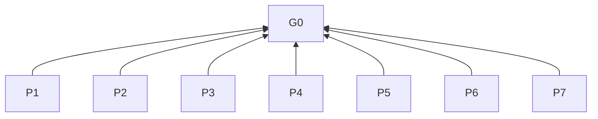

> 中文维护译文，仅供开发者对照，不是技能安装或执行入口。与[英文原文](../../../../skills/sdlc-instruction-optimization/SKILL.md)同步，差异以英文为准。

# 指令优化

## 目的（G0）

使面向 AI 的指令一致、精简、可执行；修改时保留有效含义与必要边界。

## 模式与阅读指南

层级：G0 目的（L0），P 原则（L1），R 规则（L2），D 实践（L3）。依据说明条款理由；判据判断合规性。

范围：R1。准备与模式：R2。参考资料：R2.2。

## 关系概览

## 原则（L1）

**P1 最小充分指令**：优先保留影响执行或结果的指令，避免重复、套话、通识性提醒及无必要的约束。 依据：G0。

**P2 含义可执行**：优先写明主体、对象、条件、动作和结果，避免依赖猜测的表述。 依据：G0。

**P3 边界限定范围**：将领域规则、证据要求、权限及异常处理限定在各自适用范围内。 依据：G0。

**P4 结果导向的上下文**：提供目标、受众、相关上下文、约束原因、取舍依据与验收标准，支持方法选择。 依据：G0。

**P5 Context, not Control**：优先提供决策上下文与结果要求；仅在依赖关系、接口、已识别风险或用户及更高优先级指令的明确要求有依据时，规定步骤、顺序、格式或角色。 依据：G0。

**P6 保留有效内容**：修改时保留事实准确性、完整含义、有效信息及必要行为边界。 依据：G0。

**P7 结论受证据约束**：将结论限定在文本审查、场景推演、文件或加载检查及实际运行结果所提供的证据范围内。 依据：G0。

## 规则（L2）

### R1 范围

| 条款 | 依据 | 判据 |
| --- | --- | --- |
| **R1.1**：当任务设计、撰写、优化或审查面向 AI 的指令、提示词、技能或模型执行规则（含嵌入文档的规则）时，必须应用本技能。 | P3 | 处理对象约束模型行为；仅有祈使句或步骤不构成启用条件。 |
| **R1.2**：当内容供读者理解、操作或排障时，必须交由 `sdlc-document-optimization` 处理。 | P3 | 混合产物对相应内容分别使用两个技能；单一用途任务不默认加载两者。 |
| **R1.3**：当需要其他技能时，必须通过运行环境目录发现，并按实际注册名称和命名空间加载，或从发现的安装位置读取入口及相关资料。 | P3 | 名称或路径来自发现结果，而非猜测的别名。 |
| **R1.4**：当必需技能或资料不可用时，必须报告缺失项，仅暂停依赖它的工作。 | P3 | 继续独立工作；不静默跳过规则，不自动安装依赖。 |
| **R1.5**：当处理产物时，必须遵循其已有领域规则、格式和维护权限。 | P3 | 不将项目或知识库的专属要求推广到其他产物。 |

### R2 准备与模式

| 条款 | 依据 | 判据 |
| --- | --- | --- |
| **R2.1**：当开始范围内的任务时，必须在处理产物前明确范围、用途及适用约定。 | P4 | 可依据已明确的范围、用途和约定评估工作。 |
| **R2.2**：当执行范围内的任务时，必须读取[提示词设计指导原则](references/prompt-design.md)。 | P2 | 新建、仅审查及审查并修改任务均读取该资料。 |
| **R2.3**：当解读请求时，必须对新产物选择新建模式，对仅审查请求选择仅审查模式，对修改已有产物选择审查并修改模式。 | P3 | 仅审查请求不修改目标产物。 |

### 共同表达规则

| 条款 | 依据 | 判据 |
| --- | --- | --- |
| **R3.1**：当选择术语时，必须优先使用项目或文档定义，否则使用业界通用术语。 | P2 | 识别原始表述的实际含义并转换为规范术语，不机械照搬。 |
| **R3.2**：当命名概念时，必须同一概念使用同一规范术语，同一术语只表达一个概念。 | P2 | 不为变化措辞而轮换同义词。 |
| **R3.3**：当概念影响理解，或术语存在多义或定义冲突时，必须解释理解所需的含义、范围及区别。 | P2 | 读者可将目标概念与其他含义及相近概念区分开。 |
| **R3.4**：当表述存在指代歧义或否定范围不清时，必须明确指代对象和否定范围。 | P2 | 不存在会改变所需行为的另一种指代或否定范围解读。 |
| **R3.5**：当描述原因时，必须区分可能原因与确定原因。 | P7 | 不将可能原因表述为确定原因。 |
| **R3.6**：当组织或压缩内容时，必须保留逻辑关系、事实准确性及完整含义。 | P6 | 修改后仍保留必要条件、否定、解释及因果关系。 |

### R4 指令设计

| 条款 | 依据 | 判据 |
| --- | --- | --- |
| **R4.1**：当检查提示词时，必须使用参考资料的通用设计维度。 | P1, P2, P4 | 不要求每个维度各写一条指令；不重复任务或上下文已明确的要求。 |
| **R4.2**：当考虑增加场景指令时，必须仅在启用场景成立且现有提示词缺少相应要求时添加。 | P1, P3 | 每项新增场景要求同时具有成立的场景和已识别的指导缺口。 |
| **R4.3**：当指令与数据共存时，必须区分二者。 | P3 | 仅按任务需要规定证据要求、权限及不确定性处理；参见参考资料 D1–D2。 |
| **R4.4**：当评估既有或拟新增的步骤、顺序、格式或角色时，必须识别每项要求服务的具体任务需要。 | P5 | 保留的控制具有依赖关系、接口要求、已识别风险或用户及更高优先级指令的明确依据；不为保留控制而编造理由。 |
| **R4.5**：当决策上下文与验收标准可替代不必要的过程控制时，必须改用该上下文与结果要求。 | P5 | 修改同时处理不必要的过程控制与措辞问题，不无故扩大范围。 |
| **R4.6**：当用户或更高优先级指令明确要求约束当前任务的流程时，必须保留该流程。 | P3, P5 | 待修改文本中的流程仍按 R4.4–R4.5 审查；仅因原文存在不构成保留依据。 |

### R5 新建、审查与维护

| 条款 | 依据 | 判据 |
| --- | --- | --- |
| **R5.1**：当新建产物时，必须面向其目标、受众和约定编写，并使用参考资料检查内容与表达。 | P2, P4 | 交付前内容齐全、条件与约束明确、相关文档一致，已发现问题得到修正。 |
| **R5.2**：当报告审查结果时，必须给出具体位置、问题、影响和修订建议。 | P7 | 区分已确认问题、待确认事项及未验证范围。 |
| **R5.3**：当修改指令（包括本技能及其参考资料）时，必须依据已识别的问题和修改目标。 | P1, P6 | 无需修改的有效内容保持原样。 |
| **R5.4**：当选择修改单元与顺序时，必须依据范围、依赖关系和风险。 | P5 | 可为一致性同时修改相关文档；不强制固定修改阶段顺序。 |
| **R5.5**：当新增要求时，必须具有明确任务需要、可识别风险或实际问题。 | P1, P3 | 优先补充缺失条件与边界，不为形式完整而添加。 |
| **R5.6**：当删除内容时，必须确定其错误、失效、无关、重复或不影响执行和结果。 | P1, P6 | 不因模型已掌握相关知识而删除必要约束；有依据的删除不属于信息损失。 |
| **R5.7**：当合并规则时，必须仅合并适用条件和预期行为相同的规则。 | P1, P6 | 条件、对象或作用不同的规则仍可独立识别。 |
| **R5.8**：当判断是否保留内容时，必须保留对正确性、证据边界、权限或必要异常处理有实质作用的内容。 | P3, P6 | 压缩删除重复、套话及通识性提醒，同时保留必要信息。 |

### R6 修改验收与报告

| 条款 | 依据 | 判据 |
| --- | --- | --- |
| **R6.1**：当复核修改时，必须与原文对比改进与退化。 | P6 | 有效信息、必要解释、条件、约束及行为边界得到保留或恢复；差异工具辅助但不替代语义判断。 |
| **R6.2**：当完成每份修改文档的复核时，必须在进度消息中展示其前后对比。 | P6, P7 | 使用 D3 覆盖每份修改文档，包括每份译文。 |
| **R6.3**：当修改产生冲突时，必须依据文档目标、事实及适用约束解决。 | P3, P4, P6 | 检查受影响的跨文档关系。 |
| **R6.4**：当修改无法满足 R6.5 时，必须恢复受影响内容，并报告未解决问题及原因。 | P6 | 不保留已知无法满足完成条件的修改。 |
| **R6.5**：当交付产物时，必须确保新内容满足任务目标和约定，修改解决目标问题并保留原有有效内容。 | P1, P2, P4, P6 | 结果不引入遗漏、歧义、矛盾或冗余。 |
| **R6.6**：当结束任务时，必须简要报告结果、未解决事项及验证范围。 | P7 | 逐文档对比留在进度消息中，不在结束报告重复。 |

### R7 验证边界

| 条款 | 依据 | 判据 |
| --- | --- | --- |
| **R7.1**：当审查指令时，必须使用参考资料的最终检查，评估对目标的支持及必要边界的保留。 | P4, P7 | 缺少运行环境不阻塞文本修改与审查完成。 |
| **R7.2**：当措辞仍有不确定性时，必须通过代表性场景推演。 | P5, P7 | 检查能否去除不必要控制，同时保留必要约束及明确要求的流程。 |
| **R7.3**：当拟开展真实模型执行或模型前后对照评测时，必须仅在用户明确要求时进行。 | P3, P7 | 运行评测不是默认完成条件；R6.1 的文本前后对比仍须执行。 |
| **R7.4**：当报告验证结论时，必须区分文本发现、场景推演判断、文件或加载检查及实际观察到的运行结果。 | P7 | 不将推断效果表述为已验证的运行行为，不作超出证据的推广。 |

## 实践（L3）

设计维度 D1–D2 及检查清单 D4 见[提示词设计指导原则](references/prompt-design.md)。

**D3 对比格式**。依据：R6.1、R6.2。

每项重要改动注明：文档与章节；原表述与新表述的并列摘录；理解或执行上的实际影响；明确的新增与删除；重要条件的保留位置或删除理由；退化及修正结果或当前状态。
