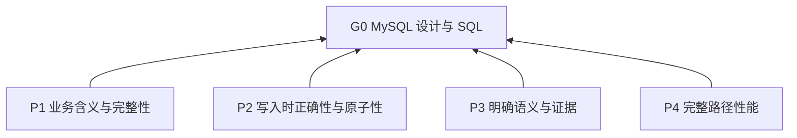

> 中文维护译文，仅供开发者对照，不是技能安装或执行入口。与[英文原文](../../../../skills/sdlc-mysql-design/SKILL.md)同步，差异以英文为准。

# MySQL 数据表与 SQL 设计

## 目标（G0）

帮助助手设计、编写、修改、审查和优化 MySQL 模型与 SQL，保持业务完整性、写入正确性和整体性能。

## 阅读说明

`G0` 为目标（L0），`P1`–`P4` 为原则（L1），`R00a` 及 `R01a`–`R81c` 为规则（L2）。每条规则包含触发条件、动作、依据和合规判据。下方主题标题仅组织规则，不构成额外要求。字母后缀区分主题条目内的原子条款。

领域规则见 [MySQL 设计规则](references/mysql-design-rules.md)。示例为实践（L3），在[参考文档](references/mysql-design-examples.md)中从 `D01` 起编号。其假设与 SQL 解释所引用规则，不另行定义全局政策。R07b 控制加载时机。

## 概览

## 原则（L1）

**P1 业务含义与完整性**：优先采用保持已声明业务含义与完整性的设计。 依据：G0。

**P2 写入时正确性与原子性**：优先采用在并发下落实写入条件、保持必要事务边界的写入方式。 依据：G0。

**P3 明确语义与证据**：优先明确类型、SQL、安全及版本语义，使结论受证据边界约束。 依据：G0。

**P4 完整路径性能**：在保持正确性与负载要求的前提下，优先减少请求和完整路径成本。 依据：G0。

## 规则（L2）

## 适用范围

- **R01a** 任务或项目明确以 MySQL 为目标数据库，且涉及数据建模、表结构、SQL、索引、事务或并发控制时，应用本技能，无须显式调用。 依据：P3。判据：数据库和任务主题均符合适用范围。

- **R02a** 使用本技能时，不以 SDLC 主流程为前提。 依据：P3。判据：独立 MySQL 任务仍可应用。

- **R02b** 数据库任务未指定数据库或仅涉及其他数据库时，不得自行选定 MySQL 或应用本技能。 依据：P3。判据：未自行推定 MySQL 为目标。

## 使用方式

- **R03a** 校验 MySQL 行为时，以 MySQL 8.4 官方语义为基准，不限定部署版本。 依据：P3。判据：未将校验基准变成部署要求。

- **R03b** 涉及版本差异时，核验实际目标版本的功能支持、约束执行和弃用状态。 依据：P3。判据：涉及版本的结论有目标版本支持依据。

- **R04a** 开始任务时，明确与任务相关的业务含义、完整性要求、主要读写方式、数据规模与增长、并发和一致性要求。 依据：P1, P3。判据：已明确任务相关设计输入。

- **R04b** 已有设计或负载证据可用时，使用这些依据。 依据：P1, P3。判据：决策考虑了已有依据。

- **R04c** 关键信息缺失时，说明假设及其影响。 依据：P1, P3。判据：未将缺失输入表述为已知事实。

- **R05a** 应用事务与并发规则时，以 InnoDB 本地事务为范围。 依据：P3。判据：原子性结论未超出该范围。

- **R05b** 解释事务内查询、`CHECK`、外键约束或存储过程禁令时，明确它们是项目约定，而非 MySQL 功能限制。 依据：P3。判据：各项禁令均归因于项目约定。

- **R06a** 按本技能推理时，假定同一记录在同一毫秒内至多修改一次。该前提不保证 `updated_at` 是不复用的版本；基于时间戳的并发校验仍须满足 R53a–R53c。 参见[更新时间校验](references/mysql-design-examples.md#更新时间校验)。依据：P3, R53a, R53b, R53c。判据：未用毫秒假设证明版本安全。

- **R07a** 执行任务时，仅应用相关规则。 依据：P3。判据：无关主题未增加任务要求。

- **R07b** 规则需要解释时，按主题读取 [MySQL 数据表与 SQL 设计示例](references/mysql-design-examples.md)，不默认加载全部示例。 依据：P3。判据：引用内容按具体规则或主题加载。

## 主题路由

- **R00a** 任务涉及下方主题时，先读取 [MySQL 设计规则](references/mysql-design-rules.md) 中的对应章节，再应用这些规则。依据：P3。判据：相关主题均已查阅，无须加载无关章节。

## 数据建模

[读取规则](references/mysql-design-rules.md#数据建模)。

### 实体、关系与字段归属

[读取规则](references/mysql-design-rules.md#实体关系与字段归属)。

## 表结构设计

[读取规则](references/mysql-design-rules.md#表结构设计)。

### 命名与注释

[读取规则](references/mysql-design-rules.md#命名与注释)。

### 数据类型

[读取规则](references/mysql-design-rules.md#数据类型)。

### 键与约束

[读取规则](references/mysql-design-rules.md#键与约束)。

### 字符集与排序规则

[读取规则](references/mysql-design-rules.md#字符集与排序规则)。

## SQL 编程

[读取规则](references/mysql-design-rules.md#sql-编程)。

### 查询

[读取规则](references/mysql-design-rules.md#查询)。

### 数据修改

[读取规则](references/mysql-design-rules.md#数据修改)。

### 表达式与函数

[读取规则](references/mysql-design-rules.md#表达式与函数)。

## 事务与一致性

[读取规则](references/mysql-design-rules.md#事务与一致性)。

### 事务管理

[读取规则](references/mysql-design-rules.md#事务管理)。

### 并发控制

[读取规则](references/mysql-design-rules.md#并发控制)。

## 数据库安全

[读取规则](references/mysql-design-rules.md#数据库安全)。

## 性能优化

[读取规则](references/mysql-design-rules.md#性能优化)。

### 索引优化

[读取规则](references/mysql-design-rules.md#索引优化)。

### 查询优化

[读取规则](references/mysql-design-rules.md#查询优化)。

### 写入优化

[读取规则](references/mysql-design-rules.md#写入优化)。

### 执行计划与性能验证

[读取规则](references/mysql-design-rules.md#执行计划与性能验证)。

#### 适用范围与判定

[读取规则](references/mysql-design-rules.md#适用范围与判定)。

#### 验证方法

[读取规则](references/mysql-design-rules.md#验证方法)。

## 交付内容

- **R81a** 交付所需设计、SQL、修改或审查发现时，提供业务假设及重要选择的理由。 依据：P3。判据：交付回应任务并解释决策。

- **R81b** 正确性或性能问题尚未解决时，指出这些问题。依据：P3。判据：未决问题可见。

- **R81c** 报告检查时，区分静态分析与已执行检查。依据：P3。判据：证据明确哪些检查实际执行。
