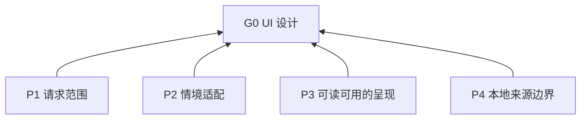

> 中文维护译文，仅供开发者对照，不是技能安装或执行入口。与[英文原文](../../../../skills/sdlc-ui-design/SKILL.md)同步，差异以英文为准。

# UI 设计

## 目的（G0）

为桌面、移动和网页视觉界面工作及 UI 原则指导提供情境适配、可读可用的结果。本技能独立于 SDLC 工作流，可单独安装。

## 模式

按请求选择原则指导（R1.3）、审查（R1.4）、设计（R1.5、R3）、实现（R1.8–R1.13）或混合任务（R1.6–R1.7）。设计交付规则仅约束混合任务的设计部分；实现交付与验收遵循任务及项目现有要求。

## 阅读与维护

L0 为目的；L1 为原则（P）；L2 为规则（R）；L3 为操作指引（D）。`Basis` 标记依赖；规则表每行包含触发条件及作为检查标准的要求结果：触发后结果满足为合规，否则为违反。`可以`表示许可，不表示义务。平台参考依赖本文件的原则；来源说明保留改编上下文。

## 概览

## 原则（L1）

**P1 请求范围**: 优先遵循请求的任务模式及其授权交付范围，避免未请求的扩展。 Basis: G0.

**P2 情境适配**: 优先选择符合产品、平台、内容和明确视觉偏好的方案，避免通用风格处方。 Basis: G0.

**P3 可读可用的呈现**: 视觉变更中保留内容可读性、控件可识别性及主要内容和操作的可达性。 Basis: G0.

**P4 本地来源边界**: 本技能的英文指令是维护中的本地改编；仅查阅来源不采纳上游流程、命令、工具链、审批步骤、风格禁令或数值默认值。 Basis: G0.

## 规则（L2）

### 适用范围

| ID | 触发条件 | 要求结果（检查标准） | Basis |
| --- | --- | --- | --- |
| R1.1 | 选择本技能时 | 必须将其应用限定于请求的桌面、移动或网页视觉界面工作及 UI 原则指导。 排除纯后端、纯数据库及其他非视觉任务。 | P1 |
| R1.2 | 任务同时涉及信息组织、交互行为或恢复时 | 必须对这些决策使用可用的 UX 指导，例如 `sdlc-ux-design`。 | P1 |
| R1.3 | 仅请求原则指导时 | 必须在该层级简短答复。 不扩展为未请求的具体产品设计、实现或验收测试。 | P1 |
| R1.4 | 仅请求审查时 | 必须报告问题和建议，不另行创建设计或修改实现。 | P1 |
| R1.5 | 请求为设计探索、方案设计、方案比选或原型验证时 | 必须将修改限定于独立设计产物。 生产代码变更要求请求包含实现工作。 | P1 |
| R1.6 | 请求混合设计与实现时 | 必须先交付设计，再继续已授权的实现。 | P1 |
| R1.7 | 评估混合任务时 | 必须分别交付和评估设计与实现。 原型验证不代表实现通过验收。 | P1 |
| R1.8 | 执行实现工作时 | 必须遵循项目现有检查要求。 | P1 |
| R1.9 | 实现任务中，当前环境支持复现缺陷时 | 必须围绕该缺陷做针对性复验。 | P1 |
| R1.10 | 为其他行为改动选择检查时 | 必须依据风险和范围选择。 | P1 |
| R1.11 | 规划实现验证时 | 不得仅为满足本技能而额外搭建验证环境、生成正式验证报告或重复检查。 | P1 |
| R1.12 | 报告实现结果时 | 必须说明已执行检查、观察结果和未验证范围。 | P1 |
| R1.13 | 报告实现证据或评估时 | 必须区分运行证据、基于代码的推断和主观判断。 不将模型自评表述为用户验收。 | P1 |

### 按需读取规则

| ID | 触发条件 | 要求结果（检查标准） | Basis |
| --- | --- | --- | --- |
| R2.1 | 具体任务的目标平台已知时 | 必须按 D1 读取其平台参考，并按该文档的使用条件补充读取。 | P2 |
| R2.2 | 平台未明确时 | 必须先依据任务及项目上下文推断。 仅当具体任务仍缺少必要的平台决定时才澄清。 | P2 |
| R2.3 | 提供通用建议时 | 必须仅使用公共原则。 | P2 |
| R2.4 | 改编的上下文或边界影响决策时 | 必须查阅其链接到的[来源上下文](references/sources.md)条目；假设、例外、数值或改编细节需要原文时，再查阅原文。原文不可用时，标明未验证结论，不编造缺失细节。 | P4 |

### 设计交付

| ID | 触发条件 | 要求结果（检查标准） | Basis |
| --- | --- | --- | --- |
| R3.1 | 交付请求的视觉探索、方案设计、方案比选或原型验证时，无论改动大小 | 必须优先使用生图呈现 UI 方案；生图不可用或失败时使用单页 HTML 产物。可用已有界面截图作参考。 [来源上下文](references/sources.md#ui-方案形式)。 | P1 |
| R3.2 | 交付 UI/UX 混合设计时 | 必须提供 UI 设计图和可交互的 UX HTML 原型。 R3.1 使用 HTML 后备形式时，两者共用一份 HTML。 | P1 |
| R3.3 | 创建 HTML 设计产物时 | 必须默认内联 CSS 和 JavaScript，使文件可直接打开。 | P1 |
| R3.4 | 在 HTML 产物中演示交互时 | 必须使用本地状态和明确标识的示意数据，限于已确定的交互范围。 | P1 |
| R3.5 | 制作设计产物时 | 必须在目标视口下检查渲染结果；有实际内容时使用实际内容，否则使用明确标识的代表性内容。 [来源上下文](references/sources.md#渲染后的设计)。 | P3 |
| R3.6 | 交付设计产物时 | 必须以图像、预览和可打开的文件为主体。 配套文字简短，仅包含打开方式、模拟范围和必要限制。 | P1 |

### 原则的应用

| ID | 触发条件 | 要求结果（检查标准） | Basis |
| --- | --- | --- | --- |
| R4.1 | 应用公共或平台规则时 | 必须选择与请求工作、目标平台和场景相关的规则。 | P2 |
| R4.2 | 提出建议时 | 必须说明影响建议的条件和权衡。 不将特定视觉风格规定为通用要求。 | P2 |
| R4.3 | 引用数值要求或建议时 | 必须先核验来源、计量单位和目标平台适用性。 | P4 |

### 公共原则

#### 设计原则

##### [入口与操作可识别性](references/sources.md#入口与操作可识别性)

| ID | 触发条件 | 要求结果（检查标准） | Basis |
| --- | --- | --- | --- |
| R5.1 | 设计主要入口时 | 必须使其在视觉上易于识别。 | P3 |
| R5.2 | 设计控件时 | 必须通过外观、标签和位置传达操作方式及动作含义。 | P3 |

##### [一致性与风格](references/sources.md#一致性与风格)

| ID | 触发条件 | 要求结果（检查标准） | Basis |
| --- | --- | --- | --- |
| R5.3 | 选择图标、组件和装饰时 | 必须符合产品目的及既有设计约定。 | P2 |
| R5.4 | 添加装饰时 | 必须保持内容可读、操作可用。 | P2 |
| R5.5 | 选择视觉风格时 | 必须适合产品类型、目标受众、使用环境和已说明的视觉偏好。 | P2 |

##### [视觉设计系统](references/sources.md#视觉设计系统)

| ID | 触发条件 | 要求结果（检查标准） | Basis |
| --- | --- | --- | --- |
| R5.6 | 向页面应用视觉规则时 | 必须默认沿用产品统一规则，明确的页面例外在相应页面优先。 覆盖仅限该页面的视觉规则，不涉及无关的产品、无障碍或授权约束。 | P2 |
| R5.7 | 组织可复用设计值和模式时 | 必须按语义角色组织。 | P2 |
| R5.8 | 提取共享定义时 | 必须以已经存在的重复需求为依据。 | P2 |
| R5.9 | 决定复用范围时 | 必须保留用途上的差异。 | P2 |

##### [审美方向](references/sources.md#审美方向)

| ID | 触发条件 | 要求结果（检查标准） | Basis |
| --- | --- | --- | --- |
| R5.10 | 用户明确的审美选择与技能的风格偏好冲突时 | 必须遵循用户的选择。 | P2 |

##### [展示页的视觉概念](references/sources.md#展示页的视觉概念)

| ID | 触发条件 | 要求结果（检查标准） | Basis |
| --- | --- | --- | --- |
| R5.11 | 设计展示页时 | 必须从所展示对象自身的特征建立视觉概念。 | P2 |

##### [内容适配](references/sources.md#内容适配)

| ID | 触发条件 | 要求结果（检查标准） | Basis |
| --- | --- | --- | --- |
| R5.12 | 选择布局时 | 必须容纳实际内容的形态、长度和数量。 | P3 |
| R5.13 | 结构无法承载所需内容时 | 必须调整结构并保留事实和必要信息。 | P3 |

##### [可用素材](references/sources.md#可用素材)

| ID | 触发条件 | 要求结果（检查标准） | Basis |
| --- | --- | --- | --- |
| R5.14 | 视觉方案依赖素材时 | 必须以已经存在或确实能够取得的素材为依据。 所需素材不可用时，构图仍可用可获取素材实现。 | P2 |

##### 排版

| ID | 触发条件 | 要求结果（检查标准） | Basis |
| --- | --- | --- | --- |
| R5.15 | 设置文字样式时 | 必须按阅读条件选择字体、字号和行距。 | P3 |
| R5.16 | 建立文字层级时 | 必须使用大小和字重。 | P3 |
| R5.17 | 显示正文和辅助文字（含放大文字）时 | 必须保持可读，不截断或隐藏必要内容或控件。 | P3 |

##### [目标语言](references/sources.md#目标语言)

| ID | 触发条件 | 要求结果（检查标准） | Basis |
| --- | --- | --- | --- |
| R5.18 | 为支持的语言和书写系统布局时 | 必须适配文本扩展、阅读方向及相应文字的字形特性。 | P3 |

##### [布局与间距](references/sources.md#布局与间距)

| ID | 触发条件 | 要求结果（检查标准） | Basis |
| --- | --- | --- | --- |
| R5.19 | 定位和分组元素时 | 必须表达重要性及关系。 | P3 |
| R5.20 | 应用对齐和间距时 | 必须保持一致。 | P3 |
| R5.21 | 选择密度时 | 必须适合阅读、比较和操作需要。 | P3 |
| R5.22 | 分配视觉重点时 | 必须避免重点相互争夺注意力。 | P3 |
| R5.23 | 选择布局结构时 | 必须依据界面或容器的可用空间。 | P3 |
| R5.24 | 可用空间变化时 | 必须按保持主要内容和操作可达的需要重组内容。 | P3 |

##### [色彩、状态与焦点](references/sources.md#色彩状态与焦点)

| ID | 触发条件 | 要求结果（检查标准） | Basis |
| --- | --- | --- | --- |
| R5.25 | 定义界面颜色时 | 必须定义并一致使用主要、辅助及状态色。 | P3 |
| R5.26 | 呈现文字、控件和状态时 | 必须确保文字、控件和状态具有足够对比度，使其在阅读和使用条件下可辨识。 | P3 |
| R5.27 | 颜色传达信息时 | 必须用文字或形状补充。 | P3 |
| R5.28 | 呈现控件状态和焦点时 | 必须使其在视觉上可辨识。 | P3 |
| R5.29 | 产品支持某种外观模式时 | 必须检查该模式下文字和控件的可读性及状态区分。 | P3 |
| R5.30 | 目标平台提供高对比偏好时 | 必须在界面呈现中响应。 | P3 |

##### 操作目标

| ID | 触发条件 | 要求结果（检查标准） | Basis |
| --- | --- | --- | --- |
| R5.31 | 确定操作目标尺寸和间距时 | 必须考虑鼠标、触控或其他目标输入方式。 目标易于选中且不误激活相邻目标。 | P3 |

##### [数据编码](references/sources.md#数据编码)

| ID | 触发条件 | 要求结果（检查标准） | Basis |
| --- | --- | --- | --- |
| R5.32 | 用图形呈现数据时 | 必须按用户需要理解的数据关系选择视觉编码。 | P3 |
| R5.33 | 图形数据具有适用的单位和尺度时 | 必须明确呈现。 | P3 |

##### [动效用途](references/sources.md#动效用途)

| ID | 触发条件 | 要求结果（检查标准） | Basis |
| --- | --- | --- | --- |
| R5.34 | 向操作或阅读界面添加动效时 | 必须用于反馈、状态变化或连续性。 | P3 |
| R5.35 | 用动效解释变化时 | 必须使因果可理解。 | P3 |
| R5.36 | 为说服型或体验型界面选择动效时 | 可以让动效独立承担明确的表达目的。 | P3 |
| R5.37 | 用户启用目标环境支持的减少动态效果偏好时 | 必须遵循。 | P3 |
| R5.38 | 减少或替换动效时 | 必须保持内容可读、必要状态变化可理解。 | P3 |
| R5.39 | 运行非必要动效时 | 不得阻塞输入。 | P3 |
| R5.40 | 交互支持切换或取消时 | 必须使动画可中断并过渡到最新交互状态。中断动画本身不代表取消后台操作。 | P3 |

## 操作指引（L3）

**D1 平台读取**。Basis: R2.1, P2.

| 目标 | 读取参考 |
| --- | --- |
| 桌面 | [桌面端原则](references/desktop.md) |
| 移动 | [移动端原则](references/mobile.md) |
| 网页 | [网页原则](references/web.md) |
| 移动网页 | 移动端与网页参考 |
