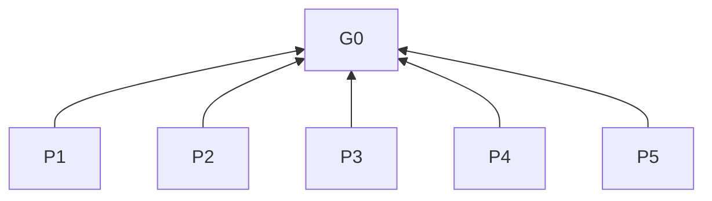

> 中文维护译文，仅供开发者对照，不是技能安装或执行入口。与[英文原文](../../../../skills/sdlc-ux-design/SKILL.md)同步，差异以英文为准。

# UX 设计

## 目的（G0）

在请求范围内支持桌面、移动和网页的产品内任务体验，使用户能够理解、完成并在失败后恢复任务。

本技能独立于 SDLC 工作流，可单独安装。

## 结构与阅读方式

层级：G0 目的（L0）→ P 原则（L1）→ R 规则（L2）。表格每行表示“当条件成立时，必须遵循要求”；判定列检验是否遵守。依据指向更高层条款；图中箭头仅表示依赖。先选范围，再按需读取；实现交付与验收遵循任务及项目现有要求。

## 原则（L1）

**P1** 优先请求范围，避免扩展工作流。 依据：G0。

**P2** 优先任务成果，再考虑界面简化。 依据：G0。

**P3** 让操作可理解，任务进程可恢复。 依据：G0。

**P4** 依据实际输入能力支持无障碍操作。 依据：G0。

**P5** 以事实证据为先，避免无依据的主张。 依据：G0。

## 适用范围

| 条款 | 当 | 必须遵循的要求 | 判定标准 | 依据 |
| --- | --- | --- | --- | --- |
| **R1.1** | 选择范围时 | 应用于请求的桌面、移动、网页产品内任务体验设计、实现、修改、审查、优化或原则指导。 | 排除纯后端、纯数据库及其他不涉及面向用户交互的工作。 | P1 |
| **R1.2** | 也请求视觉工作时 | 对视觉层级、排版、颜色、布局、控件几何布局和动效使用可用 UI 指导，如 `sdlc-ui-design`。 | 覆盖所列视觉决策。 | P1 |
| **R1.3** | 仅咨询原则时 | 在原则层级简短答复。 | 不扩展为具体产品设计、实现或验收。 | P1 |
| **R1.4** | 仅审查时 | 报告问题和建议。 | 不创建设计或修改实现。 | P1 |
| **R1.5** | 请求设计探索、方案设计、方案比选或原型验证时 | 只创建或修改独立设计产物。 | 改动限于设计产物。 | P1 |
| **R1.6** | 设计与实现混合请求时 | 先交付设计，再继续已授权的实现。 | 设计先交付。 | P1 |
| **R1.7** | 设计与实现混合请求时 | 分别交付和评估两者。 | 原型验证不代表实现通过验收。 | P1 |
| **R1.8** | 实现时 | 遵循项目现有检查。 | 已遵循项目检查。 | P1 |
| **R1.9** | 当前环境支持缺陷复现时 | 进行针对性缺陷复验。 | 已复验所复现的缺陷。 | P1 |
| **R1.10** | 检查其他行为改动时 | 按风险和范围选择检查。 | 覆盖受影响行为及风险。 | P1 |
| **R1.11** | 实现时 | 不为本技能额外搭建验证环境、生成正式验证报告或重复检查。 | 无仅为本技能增加的验证工作。 | P1 |
| **R1.12** | 报告实现结果时 | 报告实际检查、观察及未验证范围。 | 三项均报告。 | P5 |
| **R1.13** | 报告实现结果时 | 区分运行证据、代码推断和主观评价。 | 证据类型可区分。 | P5 |
| **R1.14** | 报告实现结果时 | 不将模型自评等同用户验收。 | 不根据自评宣称验收。 | P5 |
| **R1.15** | 修改生产代码时 | 请求须包含实现工作。 | 实现已获授权。 | P1 |

## 按需读取规则

| 条款 | 当 | 必须遵循的要求 | 判定标准 | 依据 |
| --- | --- | --- | --- | --- |
| **R2.1** | 应用本技能时 | 按工作、平台和场景读取并应用[公共规则](references/shared.md)相关部分。 | 不强加无关要求。 | P1 |
| **R2.2** | 面向桌面端时 | 读取[桌面端原则](references/desktop.md)。 | 按系统、输入、窗口场景选取。 | P1 |
| **R2.3** | 面向移动端时 | 读取[移动端原则](references/mobile.md)。 | 按设备、系统、握持方式选取。 | P1 |
| **R2.4** | 面向网页时 | 读取[网页原则](references/web.md)。 | 按浏览器场景选取。 | P1 |
| **R2.5** | 平台上下文组合时 | 移动网页读取移动端和网页参考；其他组合遵循已选参考的补充读取条件。 | 已读取所有条件触发的参考。 | P1 |
| **R2.6** | 平台未明确时 | 先依据任务及项目上下文判断。 | 先查阅上下文。 | P1 |
| **R2.7** | 平台未明确的通用咨询时 | 仅使用公共原则。 | 不要求平台决定。 | P1 |
| **R2.8** | 平台未明确时 | 仅在具体任务仍缺少必要平台决定时澄清。 | 缺少该决定影响具体任务。 | P1 |
| **R2.9** | 改编上下文或边界影响决策时 | 查阅链接的[来源上下文](references/sources.md)；假设、例外、数值或改编细节未解决时查原文。 | 核验未解决细节或标为未验证。 | P5 |
| **R2.10** | 查阅来源时 | 本技能英文指令定义本地改编规则。 | 不引入上游流程、工具链、命令、审批、风格禁令或默认数值。 | P5 |
| **R2.11** | 提出建议时 | 说明影响建议的条件和权衡。 | 已说明条件和权衡。 | P1 |
| **R2.12** | 引用数值建议或要求前 | 核验来源、单位及目标平台适用性。 | 引用前三项均核验。 | P5 |

## 设计交付

本节仅适用于请求的交互探索、方案设计、方案比选或原型验证，不论改动大小；下表“设计任务”指此范围。混合任务仅对设计部分应用本节。

| 条款 | 当 | 必须遵循的要求 | 判定标准 | 依据 |
| --- | --- | --- | --- | --- |
| **R3.1** | 设计任务中 | 呈现可交互单页 HTML。[来源上下文](references/sources.md#交互原型) | 已交付可交互 HTML。 | P1 |
| **R3.2** | 设计任务中 | 使原型主要操作可执行。 | 主要控件执行预期动作。 | P1 |
| **R3.3** | 设计任务中 | 演示相关状态变化。 | 控件和反馈区分状态。 | P1 |
| **R3.4** | 设计任务中 | 使必要返回或恢复路径可操作。 | 路径到达预期状态。 | P1 |
| **R3.5** | 制作 HTML 时 | 默认内联 CSS/JavaScript 以便直接打开。 | 默认产物可直接打开。 | P1 |
| **R3.6** | 制作 HTML 时 | 用本地状态演示已确定的交互范围。 | 本地演示已确定范围。 | P1 |
| **R3.7** | UI/UX 混合设计时 | 优先生图呈现 UI 方案。[来源上下文](references/sources.md#混合设计形式) | 除不可用或失败外优先生图。 | P1 |
| **R3.8** | UI/UX 混合设计时 | 提供可交互 UX HTML。 | 已提供可交互原型。 | P1 |
| **R3.9** | 检查原型时 | 在目标视口检查渲染结果。[来源上下文](references/sources.md#渲染后的原型) | 已检查目标渲染结果。 | P1 |
| **R3.10** | 检查原型时 | 使用实际内容；不可用时使用明确标识的代表性内容。 | 内容实际或标为代表性。 | P1 |
| **R3.11** | 交付设计时 | 以交互预览和可打开 HTML 文件为主体。 | 以预览和文件交付。 | P1 |
| **R3.12** | 交付设计时 | 文字简短，仅说明打开方式、模拟范围、必要限制。 | 仅有所列说明类型。 | P1 |
| **R3.13** | 检查原型时 | 核对控件及反馈演示预期操作并区分相关状态。 | 已检查操作及状态反馈。 | P1 |
| **R3.14** | UI 生图不可用或失败时 | UI 和 UX 共用一份 HTML。 | 同一 HTML 覆盖两者。 | P1 |

## 公共原则

按 R2.1 读取[公共规则](references/shared.md)中与请求、平台和场景相关的部分；其中 R4–R8 为本节的执行条款。
