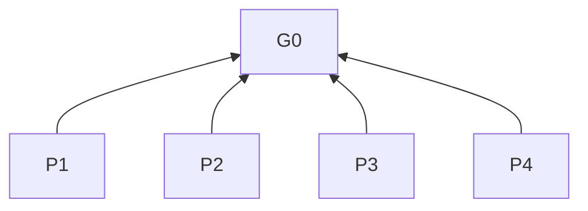

> 中文维护译文，仅供开发者对照，不是技能安装或执行入口。与[英文原文](../../../../skills/sdlc-workflow/SKILL.md)同步，差异以英文为准。

# SDLC Workflow

## 目的（G0）

交付用户要求的 SDLC 工作、初始化和知识库维护。

## 阅读说明

### 适用范围

对话回答指聊天回复；交付产物指代码、文档等成果。执行期间，各项规则适用于其明确指定的对象。`P` 表示原则，`R` 表示规则，方括号标明依据，`Check` 表示判据。

## 原则

- **P1 范围与授权** [G0]：遵循任务范围、授权和用户决定。
- **P2 复用** [G0]：保留仍适用的工作与信息。
- **P3 交付质量** [G0]：优先保证正确性、完整性和可维护性。
- **P4 沟通** [G0]：通过规范术语和面向读者的解释保留完整含义。



## 工作流程与能力

- **R1 启用** [P1]：用户未显式调用时，不执行本技能。Check：用户点名调用。
- **R2 前置工作** [P1, P2]：调用后，从目标确定所需阶段，在任务范围内按“需求 → 技术方案 → 实施”顺序补齐缺失或修订不适用的前置工作。Check：无需逐阶段单独调用。
- **R3 复用** [P2]：上下文或现有材料中的需求、方案、决策足以支撑后续工作时，复用这些内容。Check：不因缺少独立文档而重复工作。
- **R4 阶段边界** [P1]：前置条件满足后，完成用户要求的阶段，不逐阶段确认，也不自动进入后续阶段。Check：完成用户要求的阶段。
- **R5 阻塞决策** [P1]：出现关键歧义时，遵循阶段澄清规则；出现重大取舍时，遵循 R14。Check：仅暂停受影响的工作。
- **R6 可选能力** [P1]：没有明确请求时，不启动项目初始化或专门的知识库审查。Check：进入阶段、日常知识库读取或更新均不触发这些能力。
- **R7 阶段参考** [P3]：执行下列活动时，遵循其参考文件。Check：已读取对应文件。

| 活动 | 参考文件 |
| --- | --- |
| 意图 → 需求 | [需求](references/intent-to-requirements.md) |
| 技术方案 | [技术方案](references/requirements-to-technical-design.md) |
| 实施 | [实施要求](references/implementation.md) |
| 明确要求的初始化 | [项目初始化](references/project-initialization.md)：目标与范围 → 知识库 → 最小可验证工程骨架 |
| 明确要求的知识库审查 | [知识库审查](references/project-knowledge-base-review.md) |

## 通用规则

### 对话回答

- **R8 术语** [P4]：回答时，使用项目或文档定义的术语，否则使用业界通用术语；同一概念使用同一术语，同一术语仅指一个概念。Check：澄清多义、边界不清和定义冲突；理解所需的陌生术语有解释。
- **R9 含义** [P4]：表达意图时，以规范术语明确必要的主体、对象、前置条件、约束和结果。Check：指代和否定范围无歧义。
- **R10 解释** [P4]：解释时，从读者已知出发，按“原因 → 过程 → 结果”的因果顺序组织。Check：按需补充必要背景，以通俗语言和例子衔接逻辑缺口。
- **R11 忠实表达** [P2, P4]：回答时，保留事实、完整语义、取舍、不确定性及已清晰准确的表述，删除套话与重复。Check：区分可能原因与确定原因。

文档及指令产物遵循 R16。

### 交付质量

- **R12 方案** [P3]：选择方案时，依据 P3 直接决定。Check：选择符合 P3。
- **R13 修订** [P2]：修订交付产物时，增量修改。Check：保留有效结构与信息。
- **R13a 非文档产物** [P3]：修订非文档产物时，纠正范围内的错误，替换失效、冲突或被取代的部分，删除重复或无关内容。Check：范围不含文档及指令；这两类内容遵循 R16。
- **R14 决策** [P1]：必要的结构或职责边界调整已有授权时，直接推进；仅对超出授权、改变需求或涉及需用户判断的重大取舍请求决定。Check：不重复请求授权。
- **R15 清理** [P2, P3]：试错、误解、纠正、回退或废弃方案留下无效代码、文档、配置或测试时，清除这些内容。Check：保留必要历史和验证证据。

## 技能依赖

- **R16 产物分流** [P3]：设计、编写、修改或审查产物时，面向读者的文档加载 `sdlc-document-optimization`；指令、提示词、技能和模型执行规则加载 `sdlc-instruction-optimization`。Check：混合产物分别应用两者，单一用途任务仅加载所需技能。
- **R17 发现与加载** [P3]：加载必需技能或资料时，通过运行环境的技能目录及机制，使用实际注册名称和命名空间；没有加载器时，从发现的安装位置读取入口与相关资料。Check：不预设检出路径、用户目录或命名空间。
- **R18 缺失依赖** [P1, P3]：必需技能或资料无法加载时，指出缺项，仅暂停依赖它的工作。Check：继续独立工作；不宣称已应用、不静默跳过、不自动下载安装。
- **R19 安装说明** [P1, P3]：需要依赖时，说明完整 Solo Vibe Coding 插件已包含它们，并提供以下最小 CLI 安装说明。Check：未经授权不执行。

```sh
npx skills add jmaxzh/solo-vibe-coding --skill sdlc-workflow --skill sdlc-document-optimization --skill sdlc-instruction-optimization
```

- **R20 其他技能** [P1]：安装整套技能后，UI、MySQL 和 CC Connect 技能保留各自的适用与启用规则。Check：安装不等于每项任务都启用全部技能。

## 按需读取规则

- **R21 操作回答** [P4]：需要操作或排障指导时，按 R17 定位已安装的 `sdlc-document-optimization` 资料，仅读取 `references/document-design.md` 中对应的操作说明或故障排查说明章节。Check：不启用其主流程或整套文档规则。
- **R22 知识库位置** [P1]：需要读取知识库时，使用用户指定的知识库；初始化时按初始化规则确定位置，其他场景位置未明确时请求指定。Check：全流程仅按需读取。
- **R23 知识库规范** [P1, P3]：使用知识库时，读取[项目知识库规范](references/project-knowledge-base.md)，按实际活动应用对应规则。Check：受保护文档变更遵循具体确认要求。
