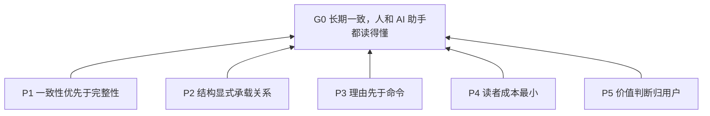
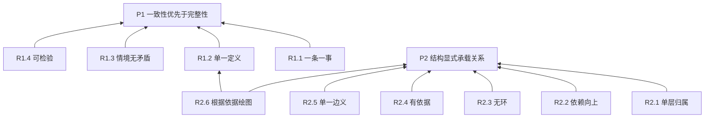
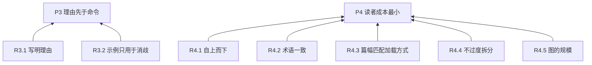
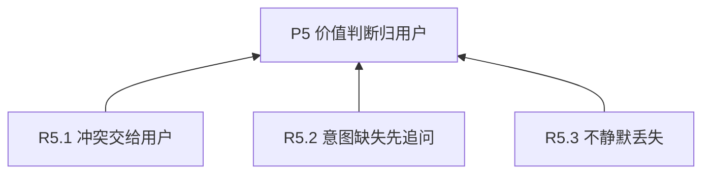
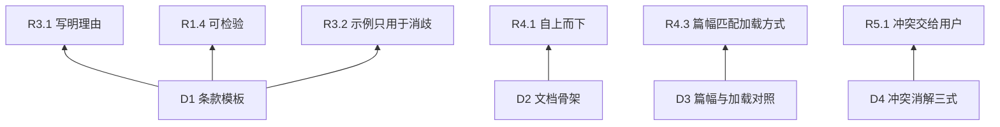
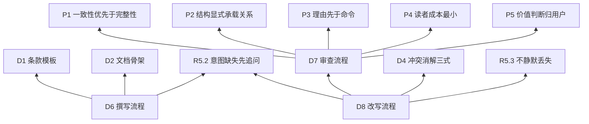

# 指令文档结构化

> 开发者维护译文；[英文源文档](../../../../skills/structuring-instruction-docs/SKILL.md)是唯一可安装的规范性版本。

## 调用策略

所有智能体仅可在用户显式调用 structuring-instruction-docs 时加载和执行本技能。任务匹配、其他技能推荐或引用、智能体自主判断均不构成启用授权。将该技能作为审查或修改对象提及，不属于调用。

## 目的（G0）

让指令文档在长期修改中保持一致，并且人和 AI 助手都读得懂。

## 如何阅读和修改

条款是可独立引用的要求或做法。P1、R1.1 等编号用于引用条款，避免重复陈述。以下四层将目的与逐渐具体的指导区分开：

| 层 | 名称 | 回答的问题 | 典型形态 |
| --- | --- | --- | --- |
| L0 | 目标 | 为谁、为了什么？ | 1–3 句 |
| L1 | 原则 | 取舍时偏向什么？ | “宁可 X，不要 Y” |
| L2 | 规则 | 什么情境下必须或禁止做什么？ | 可检验的祈使句 |
| L3 | 做法 | 具体怎么做？ | 步骤、模板、示例 |

依赖关系说明一条条款为什么需要另一条：被支撑的条款指向它的依据。目标以下的每条编号条款都有“依据”行，列出依据并解释它如何服务于这些依据。图中每个箭头由条款指向它的一项依据；Mermaid 是绘制这些图所用的文本格式。

- 自上而下读。读完原则，即可理解目的和主要取舍。
- 图根据“依据”行绘制；两者不一致时，以条款为准。
- 修改条款后，检查它的依据和依赖它的条款。

## 总览

五条原则直接服务于目的：



## 原则（L1）

**P1 一致性优先于完整性**: 优先消除重复和解决冲突，不为追求完整保留问题条款。涉及意图取舍时，按 R5.1、R5.3 处理。 依据: G0. 未解决的重复和冲突会在后续修改中破坏一致性。

**P2 结构显式承载关系**: 条款之间的关系用结构表达，不靠读者揣摩。 依据: G0. 明确关系有助于人和助手理解并维护文档。

**P3 理由先于命令**: 每条要求都应能回答“为什么”，让 AI 助手在没写到的情况下也能顺着理由判断。 依据: G0. 理由帮助读者在应用或修改指令时保持原有意图。

**P4 读者成本最小**: 人的阅读成本和 AI 助手的上下文成本都要尽量低。 依据: G0. 降低阅读和上下文成本，让指令更容易长期使用。

**P5 价值判断归用户**: 取舍和意图由用户决定，AI 助手不替用户拍板。 依据: G0. 由用户掌握意图，避免修改偏离文档目的。

## 规则（L2）

### 服务于 P1、P2



**R1.1 一条一事**: 一条条款只表达一个要求。
依据: P1. 拆开独立要求，更容易定位重复和冲突。
判据: 如果两项要求可以被独立遵守或违反，就将它们拆成不同条款。

**R1.2 单一定义**: 同一个要求只在一处定义，其他位置只引用它的编号。
依据: P1. 只定义一次，避免重复要求在修改中逐渐分歧。
判据: 任意两条条款不会在同一情境下要求同一行为。发现重复时，保留抽象层更合适的一条。

**R1.3 情境无矛盾**: 任何情境下，不同时存在相反的要求。
依据: P1. 结论相容，读者才不会收到互相冲突的指令。
判据: 对每对相关条款枚举触发情境，情境无交集，或结论一致。

**R1.4 可检验**: 每条规则（L2）带判据，让他人能独立判断遵守与否。
依据: P1. 共同判据让不同审查者能够识别同样的一致性问题。
判据: 判据读完后，不需要追问作者就能给出“遵守/违反”。

**R2.1 单层归属**: 每条条款属于且仅属于“如何阅读和修改”中定义的四层之一。
依据: P2. 区分层级，让目的与具体指导的关系可见。
判据: L2 不含价值取舍，L1 不含具体命令。

**R2.2 依赖向上**: 条款只能依赖同层或更抽象的条款。
依据: P2. 依据保持在同层或更抽象层，避免用实现细节论证原则。
判据: 每条“依据”都指向同层或更高层；没有 L1 依赖 L2、L2 依赖 L3 的情况。

**R2.3 无环**: 依赖关系不能成环：沿依据追溯，不能回到起点。
依据: P2. 回到自身的依据链无法解释其中条款为何必要。
判据: 沿“依据”行追溯，永不回到自身。出现环说明条款在互为理由，应上提共同原因，或合并。

**R2.4 有依据**: 每条非 L0 条款至少有一个上位依据。
依据: P2. 上位依据将每条条款连接到它所服务的目的。
判据: 每条非 L0 条款都有“依据”行，且至少引用一条更抽象的条款；也可以同时引用同层条款。

**R2.5 单一边义**: 关系用 Mermaid 表达，所有箭头只表示“依赖于”，由条款指向同层或更抽象层的依据；不自创记法。
依据: P2. 箭头含义统一，读者才能直接理解关系。
判据: 全图箭头语义一致；冲突等其他关系不画成边。

**R2.6 根据依据绘图**: 根据各条款“依据”行列出的依赖绘图；图与条款不一致时，以条款为准。
依据: P2、R1.2. 根据唯一权威来源绘图，避免图和条款定义不同的关系。
判据: 在整组图中，每条边都对应“依据”行列出的一项依赖，每项依赖也都在图中出现；单张图只覆盖对应部分。

### 服务于 P3、P4



**R3.1 写明理由**: “依据”行除编号外，用一句话说明为什么该条款能从上位条款推出。
依据: P3. 只有编号，无法解释要求为什么服务于它的依据。
判据: 能回答“删去此条，会损害上位条款的什么”。

**R3.2 示例只用于消歧**: 只为容易误读的条款写示例，必要时加反例。
依据: P3. 有针对性的示例能澄清推理，而不引入无关内容。
判据: 每个示例都对应一个确实可能被误读的条款。

**R4.1 自上而下**: 文档按抽象层由高到低排布，让读者在主要章节边界停止阅读时，仍能理解目的和已介绍的层级。
依据: P4. 先介绍全貌再展开细节，减少为理解前文而反复查阅。
判据: 理解目的和每个已介绍的层级不依赖后续章节；必要概念在使用前已解释。

**R4.2 术语一致**: 同一概念全文只用一个词，首次出现时给一句解释。
依据: P4. 术语稳定且有解释，能降低理解条款的成本。
判据: 不存在两个词指同一件事，也不存在一个词指两件事；每个必要术语在首次使用时已解释。

**R4.3 篇幅匹配加载方式**: 文档越是常驻加载，篇幅越短，内容越要对每个任务都成立。
依据: P4. 反复读取的内容会在多个任务中持续消耗上下文和注意力。
判据: 每份文档只含与其加载时机相符的内容。具体做法见 D3。

**R4.4 不过度拆分**: 同一父条款下的子条款过多时，重新检查层级。
依据: P4. 检查过密的分组，让层级容易理解，避免不必要的嵌套。
判据: 约 7 个子条款是检查提示：是否缺一个中间层，或其中有些只是同一规则的示例。仅在有助于阅读时拆分，不为凑数拆分。

**R4.5 图的规模**: 以约 15 个节点作为检查图是否易读的提示；有助于阅读时，按 L1 原则分图。
依据: P4. 易读的图能降低追踪关系的成本。
判据: 在正常阅读大小下，标签和关系容易辨认；不能只用节点数量判断可读性。

### 服务于 P5



**R5.1 冲突交给用户**: 发现冲突时，向用户列出消解方案，不自行选边。
依据: P5. 决定哪项意图优先，属于用户的取舍。
判据: 文档里没有未经用户确认的取舍。

**R5.2 意图缺失先追问**: 找不到条款的上位依据时，向用户追问其意图，不替用户臆造原则。
依据: P5. 臆造缺失的目的，等于替用户指定意图。
判据: 每条新增的 L1 原则都能追溯到用户说过的话。

**R5.3 不静默丢失**: 改写时，旧文档中的每条意图要么在新文档里有去处，要么在变更摘要里说明删除原因。
依据: P5. 交代旧意图的去处，让用户要求的变化可见。
判据: 存在“旧位置 → 新条款”的完整对照。

## 做法（L3）

### 模板与对照



**D1 条款模板**. 依据: R3.1、R1.4、R3.2. 模板为理由、判据和可选的消歧示例提供固定位置。

普通 Markdown，编号只是标题里的名字：

```markdown
**R2.1 简短标题**：一句祈使句。
依据：上位条款编号＋一句理由。
判据：怎样算遵守，怎样算违反。
示例：（可选，仅用于消歧）
```

**D2 文档骨架**. 依据: R4.1. 这份骨架先介绍目的和阅读概念，再展开详细指导。

按此顺序：目的（L0）→ 阅读说明及层级定义 → 总览图 → 原则（L1）→ 规则（L2）→ 做法（L3）。

**D3 篇幅与加载对照**. 依据: R4.3. 按读取频率选择内容，使反复使用的上下文保持聚焦。

根据助手何时读取内容、内容被重复使用的频率来组织文档。Frontmatter 是文件开头的 YAML 元数据。`references/` 目录用于存放按需读取的补充文档。决定内容放在哪里之前，先检查目标助手实际如何读取文档。

| 文档 | 助手何时读取 | 建议 |
| --- | --- | --- |
| CLAUDE.md / AGENTS.md | 作为项目指令应用时，内容可能随多个任务一起提供给助手 | 保持简短、普遍适用；项目事实与行为规则分开 |
| SKILL.md | 技能被调用时 | 在 frontmatter 的 description 中写明做什么、何时使用。仅在用户允许自动调用时，才建议略为主动选择；仅限显式调用的限制优先。正文约 500 行时，检查详细做法是否应移到 references/ |
| references/*.md | 助手需要链接所指向的细节时 | 在 SKILL.md 中写明何时读哪份文件。约 300 行时，考虑增加目录。每份聚焦一个主题 |

行数是检查可读性和查找效率的提示，不是限制或质量保证。仅在有助于查找和使用时拆分内容。

**D4 冲突消解三式**. 依据: R5.1. 具体选项帮助用户决定如何协调冲突要求。

由轻到重，请用户选：

1. 情境其实不同：把触发条件写进两条条款，冲突自然消失。
2. 存在优先级：在更高层加一条原则说明取舍，两条下层条款都依赖它。
3. 真正矛盾：由用户决定保留哪一条，另一条删除。

### 工作流程



**D6 撰写流程**. 依据: D1、D2、R5.2. 流程结合条款模板和文档骨架，并向用户确认缺失的意图。

从零开始：

1. 问清 L0：读者是谁？成功时 AI 助手的行为有什么不同？
2. 让用户倒出所有想法，不限格式。
3. 按 R2.1 归层，按 R1.1 拆分，按 R1.2 合并。
4. 为每条找依据；找不到的按 R5.2 追问。
5. 按 D1、D2 输出，并按 R2.5 画图。
6. 用 D7 自审一遍。

**D7 审查流程**. 依据: P1、P2、P3、P4、P5. 检查全部规则，暴露不一致、不清楚或缺乏依据的要求，同时不替用户决定取舍。

只出报告，不改文档。

对被审文档逐条核对本文档的全部 L2 规则，输出下表，依赖图只画文档中可以确认的依赖。依据缺失时列为问题，不将猜测画成现状依赖。严重度分三档：

- 阻断：违反 R1.3 或 R2.3。
- 重要：违反 R1.1、R1.2、R2.1、R2.2、R2.4。
- 建议：其余规则。

| 编号 | 位置 | 违反的规则 | 严重度 | 说明 | 建议 |
| --- | --- | --- | --- | --- | --- |

**D8 改写流程**. 依据: D7、D4、R5.3、R5.2. 用审查和用户决定指导重构，保留旧意图并确认缺失的意图。

保持意图，重构结构：

1. 对旧文档做一次 D7，作为内部底稿。
2. 抽取所有条款，建立“旧位置 → 新条款”对照。
3. 拆分、合并、重新分层。补全缺失的上位条款前，检查 R5.2；意图缺失时先向用户追问。
4. 遇到冲突，按 D4 请用户选。
5. 输出新文档，并附变更摘要：拆了哪些、合了哪些、删了哪些、新增了哪些上位条款。
