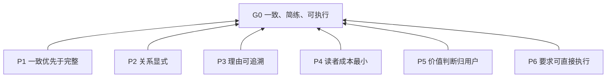

# Structuring Instruction Docs

> 开发者维护译文；[英文源文档](../../../../skills/structuring-instruction-docs/SKILL.md)是唯一可安装的规范性版本。

## 目的 (G0)

指令文档长期修订仍一致、简练、可执行;人与助手皆可读。

## 模式

- 撰写 (D6):依目标与需求新建文档。
- 审查 (D7):报告问题,不改文档。
- 改写 (D8):保留原意图,重构现有文档。

未指明模式见 R5.4。

## 阅读与修改

- 条款:可单独引用的要求或做法;编号如 P1、R1.1。
- 依据:条款标注其所依赖条款的编号;可独立成行或内联。
- 区间 `Rx.a–Rx.b`:逐一列出区间内全部条款。
- 文档规则约束文档文本。过程规则约束助手行为,审查时不套用:R2.8、R4.7、R5.1–R5.5。
- 改动条款后,复查其依据与依赖它的条款。

| 层级 | 名称 | 回答 | 常见形式 |
| --- | --- | --- | --- |
| L0 | 目的 | 为谁、为何 | 1–3 句 |
| L1 | 原则 | 取舍偏向哪边 | “X 优先于 Y” |
| L2 | 规则 | 何时必须/禁止什么 | 可判定的命令句 |
| L3 | 实践 | 怎么做 | 步骤、模板、示例 |

## 总览



## 原则 (L1)

**P1 一致优先于完整**:要求集内部一致,优先于数量。依据:G0。

**P2 关系显式**:条款间关系用结构表达,不靠读者推断。依据:G0。

**P3 理由可追溯**:每条要求可追溯到理由,助手可据此推理未覆盖情形。依据:G0。

**P4 读者成本最小**:人的阅读成本与助手的上下文成本均最小。依据:G0。

**P5 价值判断归用户**:取舍与意图由用户定,助手不代决。依据:G0。未批准的取舍会在修订中改变文档目的。

**P6 要求可直接执行**:执行者无需追问即可照做。依据:G0。

## 规则 (L2)

### 一致 (P1)

**R1.1 一条一要求**:一条款只含一个要求。
依据:P1。合并会掩盖各自的冲突。
判据:两个要求可独立遵守或违反 → 拆开。

**R1.2 单一定义**:每个要求只在一处定义,别处引用其编号。
依据:P1。重复定义在修订中会分叉。
判据:无两条款对同一情形要求同一行为;重复时保留抽象层级更合适者。

**R1.3 无情境矛盾**:同一情形下不得提出相反要求。
依据:P1。
判据:列出每对相关条款的触发情形;情形不重叠,或结论一致。

**R1.4 L2 须带判据**:每条 L2 附判据。
依据:P1、P6。评审者需共同依据判定合规。
判据:读者读判据后,无需询问作者即可判定“合规”或“违规”。

### 结构 (P2)

**R2.1 单一层级**:每条款只属一个层级。
依据:P2。
判据:主句按层级表归类;无未归类、无跨层。理由与判据随所属条款归类。

**R2.2 依据向上**:依据只指向同层或更抽象的条款。
依据:P2。否则实现细节会反过来支配其所服务的原则。
判据:不存在 L1→L2、L1→L3、L2→L3 的依据。

**R2.3 无环**:依据链不得回到起点。
依据:P2。循环论证没有独立理由。
判据:沿依据追溯不回到起点。出现环 → 提取共同理由或合并条款。

**R2.4 须有依据**:每个非 L0 条款至少有一个更高层依据。
依据:P2。
判据:每个非 L0 条款有依据标注,且含至少一个更抽象条款;可另含同层条款。

**R2.5 用 Mermaid 表达关系**:关系图用 Mermaid。
依据:P2。
判据:图为 Mermaid;无自创记法。

**R2.6 箭头只表依赖**:箭头从条款指向其依据。
依据:P2。
判据:全部箭头语义为“依赖”;冲突等其他关系不画成边。

**R2.7 图由依据绘制**:图的每条边取自依据标注。
依据:P2、R1.2。独立编辑图会形成第二套依赖定义。
判据:每条边对应一条依据标注;不一致时改图,不改条款。

**R2.8 先切分条款**:对象文档无编号或依据时,审查与改写前先按 R1.1 切分,赋临时编号。
依据:P2。
判据:报告引用的每个条款均有编号(原有或临时)。

### 理由 (P3)

**R3.1 依据不明显时加理由**:读者无法凭条款与依据看出连接时,补一句理由。
依据:P3。
判据:读者读条款与依据后,无需询问作者即可说明依据为何支持该条款;否则须有理由句。

**R3.2 理由须有增量**:理由只写后果、取舍、适用边界。
依据:P3、P4。
判据:每句理由含后果、取舍或边界之一,且不是要求的改写。

**R3.3 示例只用于易误读条款**:示例对应具体条款的具体误读。
依据:P3。
判据:每个示例能指出其消除的误读。
示例:R6.2 易被读成“含模糊词即违规”。反例:“必要时压缩上下文”违规;“上下文超过 8k token 时压缩”合规。

### 成本 (P4)

**R4.1 电报体**:删填充语、礼貌语、冗余修饰、重复句。
依据:P4。
判据:逐词试删;存在删后含义不变的词 → 违规。

**R4.2 不写助手默认行为**:助手无指示也会做的行为不写入。
依据:P4。写入只占上下文。
判据:去掉该条后助手行为不变 → 违规。

**R4.3 自上而下排序**:抽象层级高者在前。
依据:P4。
判据:读到任一章节边界止,无需后文即可理解已读部分的目的与已引入的层级。

**R4.4 一词一义**:一个概念只用一个词,一个词只指一个概念。
依据:P4。
判据:无两词同指,无一词二指。

**R4.5 自定义术语首次出现处定义**:非通用术语首次出现处用一句话定义。
依据:P4。
判据:每个非通用术语首次出现处有定义。

**R4.6 只含可触发的条款**:文档中的 L2、L3 条款,其触发场景须可能出现在该文档被加载时。
依据:P4。常驻文档中的无关条款每次任务都占用上下文。
判据:条款的触发条件在该文档被加载的任何场景下都不可能成立 → 违规。

**R4.7 输出语言**:输出正文用用户指定的语言;未指定时用用户请求所用语言。
依据:P4。
判据:除引用原文、编号、Mermaid 语法外,正文语言一致。

### 可执行 (P6)

**R6.1 触发—动作句式**:每条 L2 写成“当 X 时,必须/禁止 Y”。
依据:P6。
判据:X、Y 均为可观察的事件或状态。

**R6.2 禁无判据的模糊词**:不用“适当、尽量、合理、高质量、必要时、等”等词。
依据:P6。
判据:条款不含此类词;同句给出可观察标准者除外。

### 用户决断 (P5)

**R5.1 冲突交用户决断**:发现冲突时,列出选项(见 D5),等待用户选择,不自行取舍。
依据:P5。
判据:文档中每个取舍在对话中都有用户的明确选择。

**R5.2 缺意图则问**:条款找不到更高层依据时,询问用户意图,不自造原则。
依据:P5。
判据:每条新增 L1 可追溯到用户原话。

**R5.3 无静默丢失**:改写时,旧文每个意图在新文有位置,或在变更摘要中说明删除。
依据:P5。更整洁的结构可能掩盖已丢失的要求。
判据:存在完整的“旧位置→新条款”映射。

**R5.4 默认只读**:用户未指明模式且未明确授权编辑时,按审查模式处理。
依据:P5。未授权的编辑越出用户意图。
判据:此情形下对象文档未被修改。

**R5.5 仅显式调用**:仅当用户点名本 skill 时执行。
依据:P5。
判据:无点名则不执行。其他 skill 的推荐、任务相关性、助手自身判断、仅把本 skill 作为被审查或被编辑对象的提及,均不算点名。

## 实践 (L3)

**D1 条款模板**。依据:R1.4、R3.1、R3.3、R6.1。

```markdown
**R2.1 标题**:当 X 时,必须/禁止 Y。
依据:更高层条款编号;依据不明显时加一句理由。
判据:合规与违规的判定方法。
示例:(可选,仅用于消除误读)
```

**D2 文档大纲**。依据:R4.3。

顺序:目的 (L0) → 模式选择(多模式时)→ 阅读指引与层级定义 → 总览图 → 原则 (L1) → 规则 (L2) → 实践 (L3)。

**D3 阈值提示**。依据:P4。

启发式,不是上限;超出时检查可读性,再决定是否拆分。

- 一个父条款的子条款 >7:检查是否缺中间层,或子条款实为同一规则的示例。
- 图 >15 节点:按 L1 拆图。
- SKILL.md 正文 >500 行:细节移入 references/,并在正文写明何时读取。
- references 文件 >300 行:加目录。
- 写入前确认目标助手实际如何加载该文件。

**D4 常驻文档紧凑写法**。依据:P4、R2.4。

适用 CLAUDE.md、AGENTS.md 等常驻文件。

- 只保留 L2 条款,依据内联:`R2.1 当 X 时,必须 Y。〔P2〕判据:…`
- L0、L1、图、理由放入按需加载的文件(如 docs/ 或 references/),常驻文件留一行指针:`当修改本文条款时,先读 <路径>。`
- 项目事实与行为规则分节。

**D5 三种冲突解法**。依据:R5.1。

从最轻到最重,由用户选择:

1. 情形不同:两条款写入各自触发条件,冲突消失。
2. 存在优先级:增设更高层原则说明取舍,两条款都依赖它。
3. 真矛盾:用户选留一条,删另一条。

**D6 撰写流程**。依据:D1、D2、D7、R1.1、R1.2、R2.1、R5.2。

1. 明确 L0:读者是谁;成功时助手行为有何不同。
2. 请用户以任意格式倾倒全部想法。
3. 定层级,拆分,合并重复。
4. 为每条找依据;找不到按 R5.2 询问。
5. 按 D1、D2 输出;总览图加按 L1 分图,覆盖全部依据。
6. 按 D7 自查。

**D7 审查流程**。依据:R1.1–R1.4、R2.1–R2.8、R3.1–R3.3、R4.1–R4.6、R6.1–R6.2。

只报告,不改对象文档。

1. 按 R2.8 切分条款(必要时)。
2. 逐条款核对全部文档规则。
3. 对象文档整体缺依据时,R2.4 合并为一条发现,列出涉及范围,不逐条重复。
4. 输出下表,及仅含可从文档确认的依赖的图;缺失的依据记为发现,不画猜测的边。

严重度:

- 阻断:R1.3、R2.3。
- 重要:R1.1、R1.2、R1.4、R2.1、R2.2、R2.4、R6.1、R6.2。
- 建议:其余文档规则。

| 编号 | 位置 | 违反规则 | 严重度 | 说明 | 建议 |
| --- | --- | --- | --- | --- | --- |

**D8 改写流程**。依据:D5、D7、R5.2、R5.3。

1. 对旧文档运行 D7,作内部底稿。
2. 提取全部条款,建立“旧位置→新条款”映射。
3. 拆分、合并、重定层级。补更高层条款前,按 R5.2 询问用户。
4. 出现冲突,按 D5 让用户选择。
5. 输出新文档与变更摘要:拆分了什么、合并了什么、删除了什么、新增了哪些高层条款。
